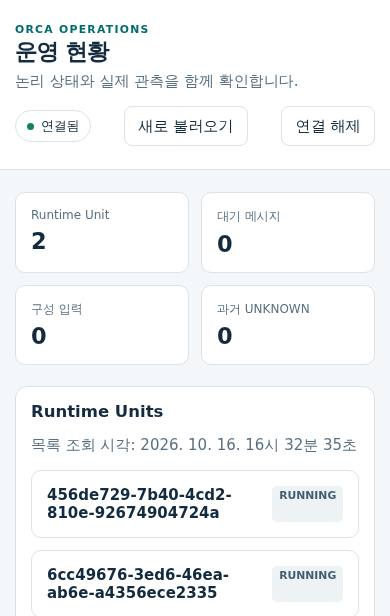
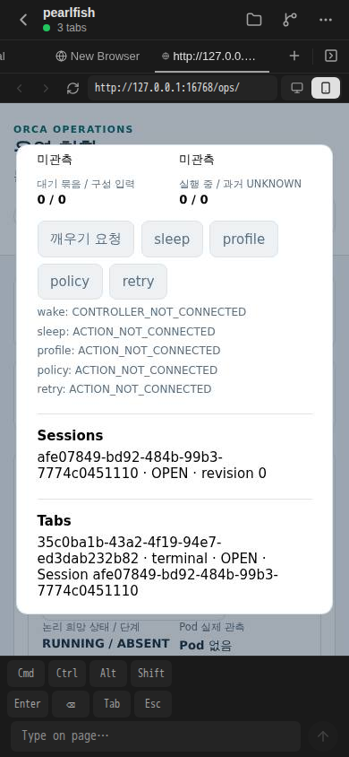

# 최초 managed binding의 등록·읽기 전용 후처리·owner 검증

2026-10-16 15:53 UTC에 서버 운영자 경로로 새 profile·repository·worktree를 한 번씩 등록했고 각 transaction의 COMMIT ACK를 확인했다. 원 caller는 `CREATION_RECEIPT_MISMATCH`로 exit 1을 반환했으며 이 결과와 원 run을 보존했다. 16:07 UTC의 별도 읽기 전용 후처리는 exit 0으로 끝났고 receipt JSON·membership·미사용 binding과 기존 UI/legacy 보존을 확인했다.

등록 후처리 관측 cutoff는 `2026-10-16T16:07:49.216Z`이고 고정 source pin은 `86223828a1517d5457005cd31aa2f40ca177691b`다. 실제 입력 259개의 Git blob·SHA·mode가 이 pin과 일치했다. 전체 checkout의 동일성이나 전체 type 통과를 주장하지 않는다.

정제한 실행값은 [JSON 증거](first-managed-binding-target-20261016.json)에 있다. 원 raw UI·full receipt·자격·config·ownerToken과 비공개 운영 경로는 이 공개 자료에 포함하지 않는다. 원 실행 자료는 비공개로 보존했고 Root가 직접 대조했다.

## 확정한 대상

| 항목 | 값 |
| --- | --- |
| Repository | `orca-1012-managed-project` / folder / local |
| Workspace | `d9cbb30f-5f13-44d7-9d43-a5b6b84f3420` |
| Session | `afe07849-bd92-484b-99b3-7774c0451110` |
| Unit | `456de729-7b40-4cd2-810e-92674904724a` |
| Binding | `c9dbe650-4d3f-49d6-8854-d688d8accab1` |
| Session / Unit / Binding revision | `0 / 1 / 0` |
| Binding epoch / access state | `0 / UNVERIFIED` |

위 값은 cutoff 시점의 관측이다. `/agent/checkout`, `/agent/homes`, `/agent/worktrees`는 후속 Agent Pod를 위한 논리 좌표이며 현재 Backend의 실제 mount·디렉터리 생성 증거가 아니다. 기존 UI의 legacy tuple과 config는 보존했다.

## 원 exit 1과 후처리 exit 0

원 `captureCatalogJson`은 응답을 null-prototype 객체로 캡처한다. PG receipt는 JSONB 객체로 반환되므로 caller의 strict 비교가 prototype 차이를 구분했다. 보존한 생성 JSON과 receipt의 canonical response SHA256은 모두 `3b3c395ddd25ff8b90453502867ad00ac05f2198048cf5bc12fcb0824b4d924f`다.

원 profile은 REGISTERED·COMMITTED/ACKNOWLEDGED, repository는 COMMITTED, creation은 receipt INSERT와 COMMIT ACK 및 FOUND로 확정됐다. 같은 mutation을 재호출하거나 새 ID를 만들지 않았다. 별도 후처리는 원 key/payloadHash의 full receipt를 JSON 값으로 대조하고 READ ONLY snapshot에서 membership 1개, ledger 23의 version/checksum/applied_at, raw UI·legacy repository 불변을 확인했다. Binding epoch/revision은 0이고 attempt·execution grant·write grant·seal·mount 이력과 hold는 모두 0이다. 두 실행 모두 pool.end 완료·cleanupFailed=false를 기록했다.

## 최초 owner 검증

후속 owner는 같은 고정 source와 수락된 target을 사용해 `2026-10-16T16:13:52.141Z`부터 `16:13:53.308Z`까지 한 번 실행했다. Caller PID는 9663이고 exit 0이며 hold·audit·binding·release가 각각 COMMITTED/ACKNOWLEDGED다. Binding은 `VERIFIED`, revision 1, epoch 0으로 바뀌었고 hold는 `RELEASED`다. 위 대상 표의 UNVERIFIED/revision 0은 그 전 읽기 전용 관측값으로 보존한다.

Pin ID는 `618ca98a-4338-4c11-92aa-e936ad10ca54`, audit ID는 `824bd957-78ab-437b-8659-a69432e35c29`다. Binding 검증의 `evidenceRef`는 `first-managed-binding:sha256:495fc8738c4c29a96a752b9d5e49327f6fe8b35aaa2e7f4f53bdfc479c2389a0`이다. Collector 자체의 `observationRef`는 별도의 `managed-leaf-observation:sha256:8ca050a7eddc257f48a24932f670bd6b965f04b7bf637071f26c9ab46027da64`이며 원 관측은 감사에 보존됐다. 정확 membership 1개와 ledger 23은 유지됐다. Attempt·execution grant·write grant·seal·mount 이력은 여전히 0이다. Pool 정리 완료·active client 0·cleanupFailed=false이며 16:15:36.439 UTC의 원 PID 관측은 ABSENT다. Root는 인계의 참조 20개에서 오류 0을 확인해 수락했다.

재호출·새 pin·자동 release·Pod/정책 변경·provider/writer 활성화는 수행하지 않았다. 이 한정된 binding 검증은 물리 pin issuer 일반 구현·실제 Agent mount·oldwriter 차단을 대신하지 않는다.

## 기존 개발 서버 scope 반영과 정상 API

Root가 수락한 Infra의 최초 실행은 16:26:20.046–16:26:49.430 UTC에 exit 0으로 끝났다. 기존 watch에 SIGTERM 한 번을 보내고 원 runtime 종료·lock 해제를 확인한 뒤, 새 Workspace의 scope만 원 Catalog config에 원자적으로 게시했다. 소유 watch 한 번과 기존 cache의 개발 bundle 한 번을 사용했으며 source sync·Pod/Expo 변경·설치·새 pairing·직접 PG 호출은 0이다.

16:26:47.588 UTC에 새 runner PID 10089/startTicks 27988707, runtime PID 10133/parent 10089/startTicks 27990500, generation 1을 기록했다. Artifact SHA256은 `99aceb02fd005a6e75b2f67318b8599d17b816d232bdb70b1f7ba91535536eea`, runtime version은 `0.1.0+0b254e661182`다. 16:26:49.359 UTC의 기존 인증 암호화 `status.get` 한 번은 exit 0이며 PID·artifact hash·version이 준비 완료 자료와 일치했다.

이 개발 runtime의 표시 version과 운영자 등록/owner source pin `86223828`은 별도로 기록한다. 최신 main 전체를 runtime에 적용했다고 주장하지 않는다. 원 Ops·인증·키·source는 보존했고 새로운 managed 대상의 부분 화면 결과는 다음 절에 별도로 기록한다.

## 최초 실제 화면과 미확인 범위

Root가 기존 인증 viewer의 첫 실행과 원 summary stream JPG·최종 PNG를 직접 보고 부분 화면 결과를 수락했다. Viewer는 `2026-10-16T16:32:29.298Z`부터 `16:35:49.625Z`까지 한 번 실행해 exit 0으로 끝났다. Summary 요청 시각은 `16:32:38.795Z`이고 최종 PNG 촬영 시각은 `16:35:49.461Z`다. 새 Unit `456de729-7b40-4cd2-810e-92674904724a` 전체를 원 stream frame에서 확인했고, Sessions/Tabs와 최종 PNG에서 Session `afe07849-bd92-484b-99b3-7774c0451110`을 확인했다. 상세 첫 위치에는 `RUNNING / ABSENT`와 `Pod 없음`이 표시됐다.

Summary JPG는 원 stream frame이며 최종 Playwright PNG와 별개다. JPG 파일 SHA256은 `163ebfc90690cc1de9b3d6f2a2f396d67d4d770df2c890eebe2c5ab2b7b4a115`, 원 stream URI SHA256은 `0257e74905cedaccfe580625214b607ea90e220362a442fd2c8e4a46f2016e52`다. 최종 PNG SHA256은 `b20a4fde407f806d28f13733141b802b9b9c456769e67a0b9c67552913259435`다. 두 파일은 기존 원본을 바이트 그대로 복사했다. [Client 정제 provenance](managed-unit-first-viewer-provenance.json)는 전달받은 SHA256 `271756e35c119b4c341461a8276a2ea4e6ca4011f49dbb7b3fb62ab1f903ff9b`의 바이트 동일 사본이다.

Summary 선택 1회·detail 선택 1회·위로 drag 2회 뒤 최종 PNG 1개를 얻었다. Mount 영역에는 도달하지 못했으므로 저장 상태·경로·VERIFIED 값의 화면 확인은 미완료다. DB owner의 VERIFIED 결과와 화면 확인을 합쳐 쓰지 않는다. 실제 Agent 홈 mount·provider 실행·writer 활성화·oldwriter 차단·HA/Spot 장애 인수·native iPhone/Mac 합격도 미완료다. 화면에 보이는 controller/action 미연결 표기를 기능 성공으로 해석하지 않는다.

Viewer child 11531은 원 정리 관측에서 ENOENT이고, supervisor 11524는 parent 1의 종료된 Z 상태였다. Context·browser 정리와 auth state 불변을 기록했다. 추가 촬영·viewer 재실행·직접 RPC·PG·API probe·syntax·재시작은 0이다.

Client provenance는 설치 source `8edb42e16caf0ddaa840dc16e4e886e6acaca328`, frame source `3817fb489ff9539aa1c0187170e842bed539c691`, Ops detail source `ba5b58931fe054e3054ff04481bd41cd5422b4ee`, source delta `80eff45fe6395ed40dc3106e7d874e584969b80c`다. 설치된 전체 checkout의 Git identity는 미증명이다. 이 provenance·개발 runtime artifact와 운영자 등록/owner pin `86223828` 및 PR publication base `06b1b7a1f10f59d91b95894dc95384ec11ea0c6f`를 각각 구분한다.

새 제품 시험·PG 조회·스크린샷·runtime 재시작은 Catalog의 증거 PR 준비에서 수행하지 않았다. 기존 최초 syntax·operator bundle 입력 대조·등록·읽기 후처리·owner·Infra runtime·Client viewer 원 결과를 재사용했다.

## 초기 실패와 한정 교정

원 syntax와 기존 의존성을 재사용했다. Raw UI 전체 보존 비교를 추가하고 Pool checkout 뒤 인계 전 실패에서 원 client를 release(true) 한 번으로 정리하는 최소 교정을 적용했다. 최초 bundle 입력에서 cancel-record.ts 한 파일의 고정 pin 차이를 발견해 원 artifact를 보존한 뒤 승인된 한 파일 overlay와 한 번의 재bundle로 259개 실제 입력을 맞췄다. 제품 함수·SQL·인증·assertion을 대체하거나 성공 suite를 반복하지 않았다. 원 등록의 prototype 비교 실패는 별도 읽기 전용 후처리로 확인했으며 원 exit 1을 성공으로 덮지 않았다.

## 실제 화면

목록의 새 Unit 전체 UUID를 보여주는 원 stream JPG다.

정확 Session과 RUNNING / ABSENT·Pod 없음이 보이는 최종 PNG다. Mount 확인은 포함하지 않는다.

