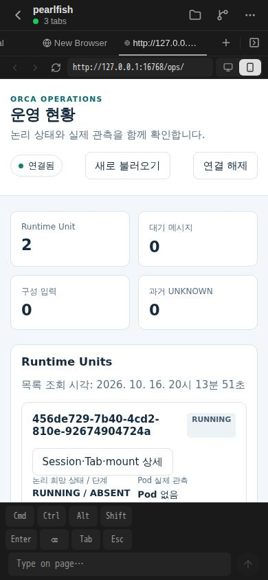

# 최초 managed startup의 runtime·DB·Agent Pod·화면 관측

2026-10-16 UTC의 첫 개발 runtime 반영과 후속 관측을 기록한다. Root가 원 runtime artifact 9개와 게시 매핑, DB snapshot, 정확 Pod GET 및 새 PNG를 검토해 수락한 범위를 사용했다. 새 원격 실행·시험·빌드·촬영 없이 작성한 증거 문서다.

## 선택 source와 실행 artifact

PR150은 2026-10-16 19:46:04 UTC에 병합됐다. 이 문서의 Git base는 `f314abed565af95c4ff5f9eacbb2fd681e35ae5c`이며, 실제 반영한 선택 source pin은 검증된 `90aa7d5f64fa98ea6711b554ae5394a653a16f51`이다. 두 값을 전체 live checkout 일치로 해석하지 않는다.

| 항목 | 수락된 관측 |
|---|---|
| 선택 source manifest SHA-256 | `e46cf01d10312c3ead7ec6d53dc2e139d94dcffcfba89f5c477f42f0077fd537` |
| 선택 파일 | 제품 `src/` 261개다. |
| 실제 게시 | 260개다. 신규 35개, 내용 변경 5개, 내용 동일·mode 변경 220개다. |
| 기존 상태 보존 | hash·mode가 동일한 1개를 재게시하지 않았다. |
| whole checkout Git identity | 증명하지 않았다. |
| 실행 artifact SHA-256 | `bf7943499b1bc70cfab22930954ea93334f867e63ab0d0b018d8eb88e27db70d` |
| runtime 보고 version | `0.1.0+5723ca92e847`이다. 선택 source pin과 별도로 기록한다. |

## Runtime 반영과 기존 인증 API

최초 반영 제어 PID 1596675는 20:01:36.635–20:02:12.648 UTC에 실행돼 exit 0으로 종료·회수됐다. 원 watch에 정상 SIGTERM 1회, source/controller 일괄 게시 1회, 같은 launcher와 cache를 사용한 개발 bundle 1회, 새 watch 시작 1회를 수행했다. Root가 원 artifact 9개와 선정 파일 매핑을 대조한 결과 불일치는 0개였다.

20:02:11.413 UTC readiness에서 watch PID는 13570/startTicks `29280792`, runtime PID는 13614/startTicks `29282910`/parent 13570, generation은 1이었다. Readiness 시점 watch의 helper parent는 후속 현재 부모 guard로 사용하지 않는다.

기존 인증의 encrypted `status.get` 1회는 20:02:11.531–20:02:12.607 UTC에 실행됐다. API helper 13879/child 13886은 exit 0이며 `ok=true`였다. 응답의 runtime PID 13614, artifact hash, version이 위 readiness와 일치했다. Readiness만 회수한 시점의 API 미검증 상태와 그 뒤 정상 API 결과를 구분한다. 새 pairing·설치·이미지 build·Expo 재시작·Pod 교체는 없었다.

## 별도의 DB snapshot과 Agent Pod GET

정확 target의 REPEATABLE READ READ ONLY snapshot 1회는 PID 14090으로 20:09:33.728–20:09:34.224 UTC에 실행돼 exit 0으로 끝났다. 승인된 live DB identity guard를 통과했으며 쓰기는 0회였다. 아래 개수는 해당 target 범위의 관측이다.

| 대상 | Snapshot에서 확인한 상태 |
|---|---|
| Unit `456de729-7b40-4cd2-810e-92674904724a` | desired `RUNNING`, phase `ABSENT`, revision 1, execution epoch 0, intent revision 0, active attempt 없음이다. |
| Session·binding | Session `OPEN`/revision 0, binding `VERIFIED`/revision 1이다. |
| 원 operation | `WAKE`/`INTENT_QUEUED`, controller term 7, revision 1, step revision 0이며 미완료다. |
| 새 audit | `RECONCILE_OPERATION_ADOPTED`의 occurredAt은 20:02:10.596 UTC다. 기존 이력은 보존됐다. |
| 후속 객체 | recorded Agent Pod plan·declared profile·command·지정 새 attempt·지정 새 pin hold가 없다. |
| target 권한·mount | execution grant·write grant·mount 개수가 각각 0이다. |

정확 Agent Pod 이름의 첫 GET은 제어 PID 1597759로 20:08:19.149–20:08:19.489 UTC에 실행됐으며 원 결과는 `NotFound`/exit 1이다. 제어 프로세스는 회수됐다. 실제 Pod UID·admission은 관측되지 않았다. LIST·exec·events·다른 이름 조회·추가 GET·Pod 생성으로 이 결과를 대체하지 않았다.

정상 개발 runtime/API와 Agent 미생성 관측은 별개다. 이 snapshot과 NotFound만으로 실패 원인을 확정하지 않는다.

## 새 Expo Web viewer의 실패 화면

Root는 이 원 PNG와 확대 화면을 직접 보고 **실패 증거 범위**로 수락했다. 화면에는 연결됨, 전체 Unit UUID `456de729-7b40-4cd2-810e-92674904724a`, `RUNNING`·`ABSENT`, Pod 없음이 보인다. 역사 PNG를 새 실행 화면으로 대체하지 않았다.

| 항목 | 원 결과 |
|---|---|
| 촬영 UTC | `2026-10-16T20:15:12.202Z`다. |
| PNG SHA-256 | `73c291165dbaec20ce623f6e2e98f5aaa2d70873a7275445983009efb23b0bb6` |
| 크기 | 390 × 844 px, 136,294 bytes, DPR 1이다. |
| Viewer | PID 11807, 20:13:44.846–20:15:12.355 UTC이며 exit 1로 끝났다. |
| 실패 경계 | detail review 단계의 `REVIEW_FILE_METADATA`가 20:15:12.149 UTC에 기록됐다. |
| 실제 조작 | Summary tap 1회, detail tap 0회다. |
| 캡처 분류 | review metadata 실패 뒤 자동 촬영한 실제 개발 UI의 실패 PNG다. 합성 화면이나 native iPhone 결과가 아니다. |
| 후속 상태 | 원 result에서 browser/context 종료와 기존 private state 불변이 기록됐다. |

Provenance의 내부 `state=detail`은 detail tap 성공의 증명이 아니다. 실제 detail tap은 0회이고 detail UUID 관측·review 수락은 false였다. 후속 파일 metadata가 정상이라는 사실로 실패 순간의 원인을 확정하거나 원 실패를 지우지 않는다.

Client의 설치 source는 `8edb42e16caf0ddaa840dc16e4e886e6acaca328`, 관측 frame source는 `3817fb489ff9539aa1c0187170e842bed539c691`, Ops mobile detail source는 `ba5b58931fe054e3054ff04481bd41cd5422b4ee`다. 이들은 backend의 선택 source pin이나 whole checkout identity를 대신하지 않는다.

## 남은 완료 경계

이 증거는 한 번의 개발 runtime 반영·기존 encrypted API와 별도의 DB·Pod·실패 화면 관측에 한정된다. 실제 Agent 생성·admission·mount, physical pin issuer, provider/writer, oldwriter 차단, Active/Standby HA, native iPhone 및 detail 직접 조작 성공은 완료되지 않았다. Source/value 검증 통과와 이 실제 가동 결과를 구분한다.

원 source·인증·원자료는 보존했으며 이 문서 준비에서 제품·배포 설정 변경, 원격 실행, 시험·빌드·재촬영은 0회다. 공개 문서에는 private 경로·endpoint·token·환경·CA·전체 로그를 포함하지 않았다.
