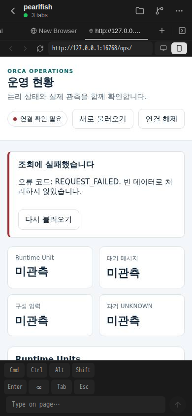
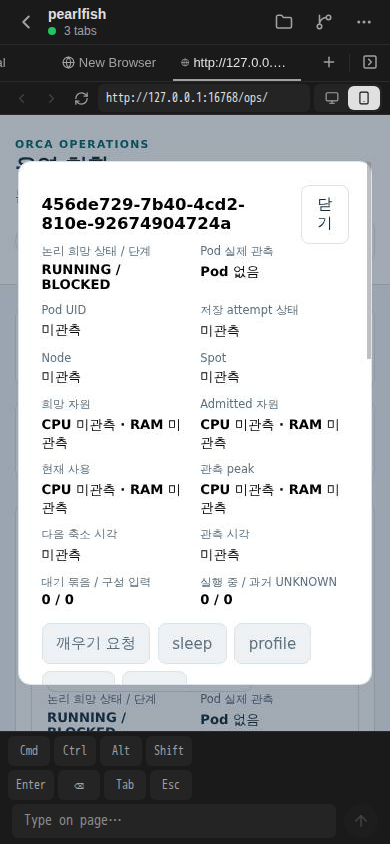

# 최초 WAKE 만료 확정의 실제 개발환경 관측

증거 cutoff는 **2026-10-16 21:39:45.367 UTC**의 최종 PNG입니다. 이후 새 WAKE·Agent 실행의 결과를 포함하지 않습니다. 이 PR은 [PR152](https://github.com/hongseok-lee/orca-1012-runtime/pull/152)의 구현 뒤 Root가 수락한 원자료만 공개 정제했습니다. 제품 코드·fixture·설정 변경이나 시험·촬영 재실행은 없습니다.

## 구현 검증과 실제 반영

PR152의 tested pin은 `ba40f8272ab5ebdc1d48fee01c9008d5c2e919fb`이며 병합 main은 `491c855484abbf03f98219e29cf568485d030558`입니다. 소유 3개 lint/strict type와 격리 PG source parent 1개 + child 10개(TAP pass 11/fail 0)가 통과했습니다. 원 35개 표의 행과 ledger 23개를 보존했고 정상 lease acquire/release 1회·renew 0회였습니다. 이 합성 검증과 아래 실제 개발환경 관측을 구분합니다.

병합 뒤 `lifecycle/controller.ts`, `lifecycle/intent.ts` 두 제품 파일만 게시했습니다. 21:13:04.059 UTC에 watch PID 14734/runtime PID 14778/generation 1이 Ready였고 artifact SHA-256은 `c7c97adedfb0e6a548a3e89e8ca5260fbfb9d128f469de9d0ed17fc9b6f3364f`입니다. 지정 두 파일의 반영은 검증됐지만 **checkout 전체 Git SHA는 증명되지 않았습니다**. 기존 controller 구성·Catalog/Ops와 인증을 보존했습니다. 21:18:07.346–21:18:08.637 UTC의 기존 인증 암호화 `status.get` 1회가 exit 0이며 readiness가 새 runtime과 일치했습니다.

21:21:13 UTC의 READ ONLY/REPEATABLE READ snapshot 1회에서 원 operation FAILED/`DEADLINE_EXPIRED_BEFORE_ACCEPTANCE`, Unit BLOCKED/revision 2를 확인했습니다. 원 deadline/retry/resource name/intent/epoch·Session/binding이 보존됐고 terminal audit/outbox/receipt는 각각 1개이며 revision 연결이 일치했습니다. 정확 대상의 plan/command/attempt·mount·execution/write grant는 0개였습니다. 기존 비종료 deadline receipt 692개는 보존 이력입니다. 최초 전송의 `-i` 누락은 PG 미진입 준비 실패였고 교정 전송 1회 뒤 snapshot을 처음 실행했습니다. PG 재시도는 없습니다.

## 첫 UI 실패와 명시적 reload 뒤 실제 화면

첫 viewer는 21:24:06.942–21:25:57.750 UTC에 `REQUEST_FAILED`·`EXACT_TARGET_UNIT_UUID_NOT_VISUALLY_CONFIRMED`/exit 1이었습니다. 정확 UUID·BLOCKED를 화면에서 확인하지 못했습니다. 원 실패를 runtime/API/terminal DB 결과와 구분하며 원인 해결을 단정하지 않습니다. Browser/context 종료와 인증 보존을 수락했습니다.

명시적 Ops reload 1회 뒤 summary tap 1회/detail tap 1회/scroll 0회로 정확 Unit `456de729-7b40-4cd2-810e-92674904724a`의 **RUNNING/BLOCKED·Pod 없음**을 Root가 직접 확인했습니다. 두 번째 viewer는 exit 0이며 원 인증은 유지됐습니다. 아래 원 PNG는 **21:39:45.367 UTC**, 390 × 844 px입니다.

두 PNG는 편집하지 않았습니다. 정확 SHA-256/bytes와 정제 결과는 [근거 JSON](operation-deadline-terminal-20261016.json)에 있습니다. [PR151의 이전 PNG](https://github.com/hongseok-lee/orca-1012-runtime/blob/0e1922ace8f989973d44bbea78fd41e0a2516cd6/deploy/dev/backend/evidence/first-managed-startup-observation-20261016.png?raw=true) SHA `73c291165dbaec20ce623f6e2e98f5aaa2d70873a7275445983009efb23b0bb6`는 수정 전 RUNNING/ABSENT 재현으로 유지합니다.

## 남은 범위

아래쪽 Session/mount와 공개 failure reason은 화면에서 확인하지 않았습니다. DB의 무효과 행 관측과 UI의 Pod 없음은 물리 종료·writer fencing 증거가 아닙니다. 새 인증 WAKE 접수, 실제 Agent/Pod/mount/provider writer·physical pin·Active/Standby HA·native iPhone의 합격을 주장하지 않습니다. P1-09/P1-14 전체 완료와 구분합니다. 이번 증거 준비 중 usage/credits/stream 중단은 미관측입니다.
