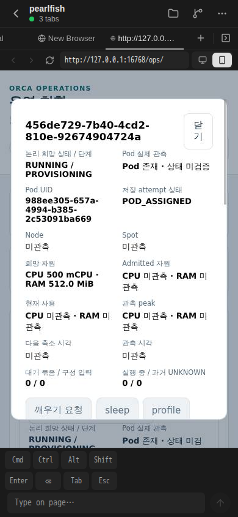
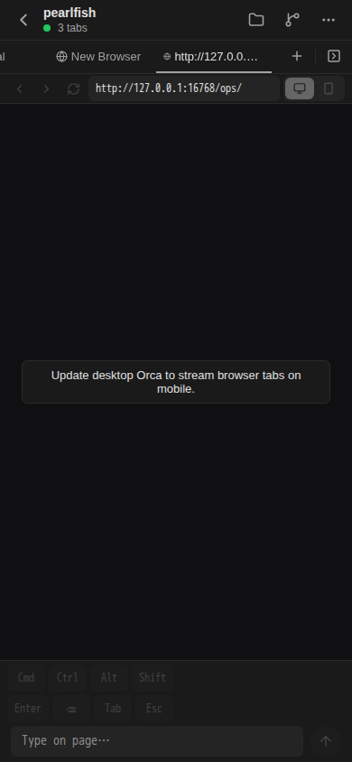
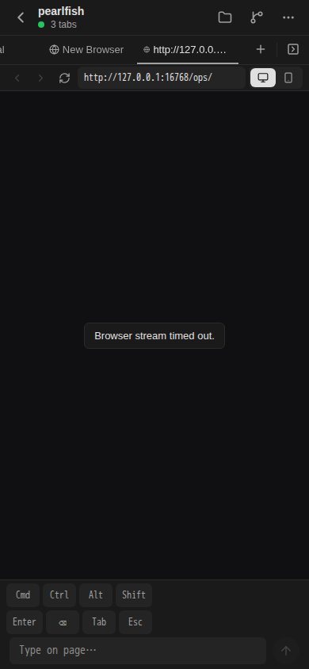

# 저장된 희망 자원의 Ops 조회·실제 화면

기존 Ops 목록/상세의 동일 read-only snapshot에서 정확한 저장 profile revision을 `resources.desired`로 연결했습니다. 검증 제품 source는 `39b21e8823d3b161accfcdbd7885aa5fa661e07a`, 고정 base는 `874f07cdf14c7ea998b3d77b0d826989ff8b9636`입니다. 최종 기능 diff는 조회 제품 2개 파일과 집중 fixture뿐이며 Browser 진단 코드는 포함하지 않습니다.

Resource head가 있으면 명시 desired revision 또는 approved fallback을 사용합니다. Head가 없으면 원 initial Agent plan/operation/audit/profile identity와 digest를 확인합니다. 최대 revision 선택·정책 계산·권한/schema 변경은 없으며 admitted/usage/peak/Node/Spot을 선언 requests로 채우지 않습니다.

## 집중 검증과 원 실패

소유 lint 3개는 통과했습니다. 첫 격리 PG는 초기 선언/list-detail/접근 범위/관측 null과 잘못된 plan 거절을 통과했으나 head fixture의 policy JSON revision 누락으로 `23514 resource_policy_versions_check`·exit 1이었습니다. 원 실패를 보존하고 fixture만 교정한 뒤 미완료 head 케이스만 실행했습니다. 변경 fixture lint와 head-only PG는 exit 0이며 desired revision/approved fallback을 확인했습니다. 원행 손실 0·ledger 23개 불변·pool 종료입니다. 성공한 케이스/schema는 재실행하지 않았습니다.

전체 타입 검증은 실행하지 않았습니다. 기존 type 후보의 4,704개 파일 확대를 중단하고 runtime 값 closure 43개만 사용했습니다. Stub이나 type alias 사본으로 성공을 만들지 않았습니다. 원 TAP 해시·PID/UTC와 정제 결과는 [JSON](ops-desired-resources-20261017.json)에 있습니다.

## 실제 개발 API

조회 제품 2개 파일만 기존 개발 watch에 반영했습니다. 2026-10-17 02:37:27.685–02:37:27.974 UTC의 기존 인증 GET 목록/상세 각 1회는 모두 HTTP 200입니다. 같은 정확 Unit의 desired는 `cpuMilli: "500"`, `memoryBytes: "536870912"`로 일치하며 admitted/usage/peak/Node/Spot은 null입니다. POST·새 pairing·인증 원본 변경은 없습니다. 전체 checkout Git SHA는 증명되지 않았습니다.

## 실제 Expo 화면

아래 원 PNG는 **2026-10-17 03:36:33 UTC**, 실제 Expo Web 390 × 844 px입니다. 정확 Unit의 전체 UUID와 **희망 CPU 500 mCPU / RAM 512.0 MiB**, admitted·현재 사용·peak·Node·Spot의 **미관측**을 직접 확인했습니다. 기존 새로 불러오기/카드/상세 각 1회, scroll 0회, PNG 1장으로 끝냈습니다.

Generation 4/runtime PID 21338의 artifact SHA는 `095f7e4c7b61e0abf04ebeb46e832a03df6ae71d1b79449667b31d3335a17c0c`입니다. Ops 제품 2개 파일 bytes는 그대로입니다. Browser/context 종료·child 부재·원 인증 상태 불변을 확인했습니다. 화면의 Pod 존재/저장 attempt는 별도 관측 시점의 projection이며 실제 Node/Spot/liveness/권한 부여 성공으로 확대하지 않습니다.

## Browser 원 실패와 회복 경계

첫 generation 2 viewer는 capability 부재로 `OPS_BROWSER_DECODED_FRAME_WAIT_FAILED`·exit 1/클릭 0이었습니다. 아래 실제 원 PNG를 보존합니다.

Backend는 CDP FD 3이 Node execve에서 닫히고 shell-parent exec에서는 보존됨을 관측했습니다. 기존 scope/argv guard를 유지한 wrapper 교정 뒤 generation 3은 실제 인증 status에서 screencast/headless capability와 빈 degradation을 확인했습니다. 이 운영 wrapper 교정은 본 PR의 제품 source 변경이 아닙니다.

교정된 조건의 별도 viewer는 `Browser stream timed out.`·exit 1/클릭 0이었습니다. 다음 실제 원 PNG를 처음 실패와 구분해 보존합니다.

기존 모바일 인증을 재사용한 selector 진단 1회는 `browser_ops_auth_unavailable`을 반환했습니다. 실제 bundle에는 기존 same-page stream recovery가 있었고 중립 marker의 native CDP 명령도 통과했습니다. 임시 private callsite 진단 뒤 generation 4의 다음 요청은 같은 page의 ready 응답을 받았으나 거절 callsite는 발생하지 않았습니다. 이 관측만으로 **이전 auth 거절의 원인을 확정하거나 로깅을 기능 수정으로 주장하지 않습니다**. 확인된 same-page materialize 뒤 위 실제 Expo 화면을 확인했습니다. 원인 변경 없는 viewer 반복·성공 API/PG 반복은 하지 않았습니다.

임시 진단은 최종 PR의 제품 diff에서 원 bytes로 제거했습니다. runtime의 제거 packet은 Backend의 다음 필요한 Terminal/cold 게시에 합류하도록 인계했으며 제거만 위한 독립 재시작/API 재검증은 만들지 않습니다.

## 남은 범위

이번 성과는 저장 선언의 정확한 조회·실제 Expo 표시입니다. 실제 admission/telemetry 수집·자동 정책 실행·provider·writer fencing·HA·native iPhone/Mac 및 P1-26/27 전체 수용과 구분합니다. 이전 Browser auth 거절의 원인 미확정도 유지합니다. usage limit/credits/모델 stream 중단은 이번 작업에서 미관측입니다.
