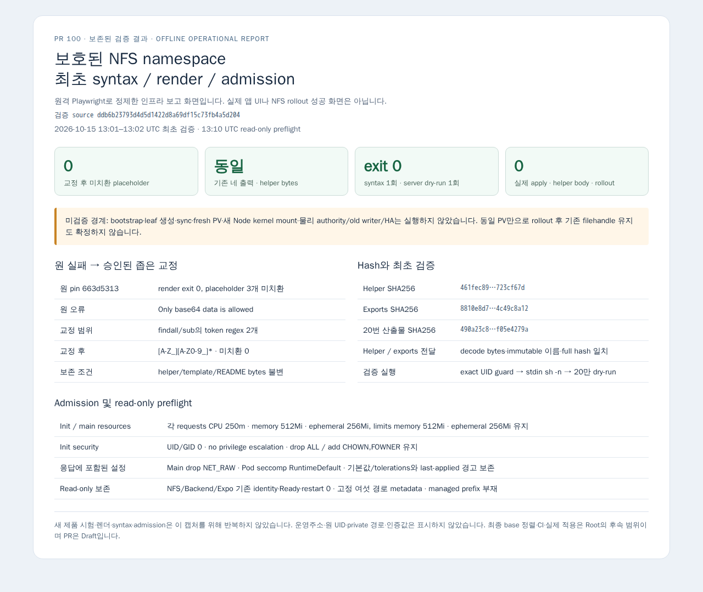

# 보호된 NFS namespace 최초 검증 결과

검증 source는 `ddb6b23793d4d5d1422d8a69df15c73fb4a5d204`입니다. 원 실패의 두 token regex만 Root 승인으로 교정했으며 helper/template/README bytes는 보존했습니다. 교정 render·exact NFS guard·stdin `sh -n`·20번 단독 server dry-run은 각각 1회, exit 0입니다. 미치환은 0이며 helper bytes/full hash·immutable 이름·exports hash와 기존 네 출력의 동일성을 확인했습니다.

[결과 JSON](managed-nfs-namespace-first-validation.json)과 [capture provenance](managed-nfs-namespace-first-validation-provenance.json)에 원 실패→교정, 실제 검증 범위와 미완료 조건을 기록했습니다. 원 stdout/stderr·운영 identity·mountinfo·사전 복원 자료는 비공개 원자료로 보존했습니다. 공개 자료에는 운영주소·원 UID·private 경로·인증값을 넣지 않았습니다.

이 PNG는 보존된 검증 결과를 표시하는 offline 보고이며 실제 앱 UI나 rollout 성공 화면이 아닙니다. Capturing 중 제품/인프라 시험은 반복하지 않았고 application request는 0입니다. 새 context만 사용하고 소유 browser를 종료했습니다.

Read-only preflight 1 batch에서 기존 세 Pod의 identity/Ready/restart 0, 고정 여섯 경로 metadata, managed prefix 부재 및 현재 exports를 보존했습니다. 실제 apply/helper body/bootstrap/leaf/sync/rollout/PG/build/install은 0입니다. Fresh PV·새 Node mount·물리 authority/old writer/HA와 rollout 후 filehandle 연속성은 미검증입니다. 동일 PV만으로 기존 handle 유지를 보장하지 않습니다. 실제 rollout과 최종 수락/merge는 Root의 후속 판단입니다.
