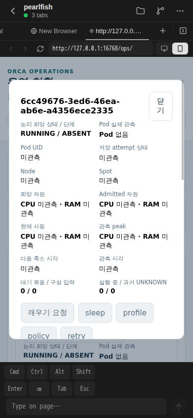

# 공용 NFS 실제 서버 적용과 지연 완료 — 부분 결과

기준 source main은 `99623a5977f1bd43c9895a5317bc8566162df1e9`입니다. Root가 서버 namespace·0770 관측과 현재 Client 새 화면을 수락했으며, G03 두 consumer의 최종 결과는 별도 수락을 기다립니다. 이 문서 PR은 제품 코드나 환경을 변경하지 않고 원 자료의 정제본만 작성합니다.

## 서버 적용과 보호 자료 보존

2026-10-15 19:45:54–19:46:27 UTC의 최초 실행에서 helper ConfigMap create·exports CAS·template CAS를 각 1회 수행했습니다. 새 소유 NFS Pod는 19:46:10에 Ready, restart 0, init exit 0입니다. Init은 `/exports/shared`와 정확한 dataset 두 경로를 생성했고 main은 created=false로 확인했습니다. Shared 부모 0:0/0755와 dataset 0:1000/0770, 기존 legacy/보호 경로 metadata 및 보호 block PV가 보존됐습니다. Helper/export hash는 정제 JSON과 private 원자료에 연결했습니다.

## 최초 실패와 같은 job의 지연 완료

Marker-before는 완료됐지만 marker-after는 **15초 감독 timeout**으로 supervisor exit 124, 최초 executor exit 1이었습니다. 원 실패 `COMMAND_FAILED_OR_UNCERTAIN:kernel-marker-after`와 원 출력은 보존합니다. 이를 전체 즉시 연속성 PASS로 바꾸지 않습니다.

후속 읽기 전용 회수에서 **같은 원 child**가 19:46:12.450Z 시작→19:48:15.558Z 완료, 123.108초 지연 뒤 같은 inode/hash/18 B/fsync/readback을 반환했음을 확인했습니다. PID/startticks의 같은 identity는 private 원자료에서 대조했고 후속 상태는 Zombie(Z)였습니다. 재실행·rollback·신호는 0입니다. 어느 syscall이 기다렸는지는 측정하지 않았습니다. 이 늦은 완료는 첫 15초 timeout을 지우거나 무중단·모든 client handle·HA 합격으로 확대하지 않습니다.

## 아직 합류하지 않은 결과

G03 두 consumer의 공용 RW/상호 읽기·보호 범위 우회 관측은 진행 중이며 현재 완료를 가정하지 않습니다. 빈 qualification 파일은 만들지 않았습니다. Root가 원자료를 수락하면 같은 PR에 합류합니다. 현재 Client 새 캡처는 별도로 수락돼 아래에 기록했습니다.

현재 수락 범위는 서버 shared namespace/0770, 같은 원 marker job의 지연 완료, 현재 Client 화면 관측입니다. Production Agent mount generator/controller 연결·native provider·old writer 차단·physical authority·HA는 미완료입니다. Credentials·운영주소·원 Pod/Node/Session UID·private 절대경로·full preimage·env/log 원문은 공개하지 않습니다. [정제 JSON](shared-nfs-rollout.json)은 private 원본 hash와 public projection hash를 별도 provenance로 인계합니다.

## 현재 Client 화면 관측

Root가 2026-10-15 19:53:29.593 UTC에 새로 캡처한 원본 PNG를 직접 보고 같은 Unit 상세, RUNNING / ABSENT, Pod 없음, 한글, 가시 로딩/오류 없음을 수락했습니다. Backend/Expo 각각 GET 1회와 metadata batch 1회에서 기존 identity, PID/startticks, source/raw manifest가 유지됐습니다.

원본 PNG는 146837 B이며 SHA-256은 `764c87f0d34f0145aa699fa11f14bdf48457e1ac035f2298ded27bc44de8e9d0`입니다. 과거 캡처와 pixels/hash가 같지만 이번 새 viewer/job의 capture UTC와 frame/provenance를 분리 보존했습니다. 관측 harness의 새 browser/context/page와 제품 Browser/Tab 추가 0을 구별합니다. Phone 클릭 1회, 상세 재클릭/drag/reload/명령/direct RPC 0회이며 소유 context/browser는 정상 종료됐습니다.

이 PNG는 below-fold Session/Tab/mount, 공용 RW 자체, native iPhone, 모든 filehandle, old writer fencing 또는 HA 합격을 증명하지 않습니다. 최초 marker-after timeout과 같은 child의 지연 완료는 위 원 실패 이력으로 유지합니다.
