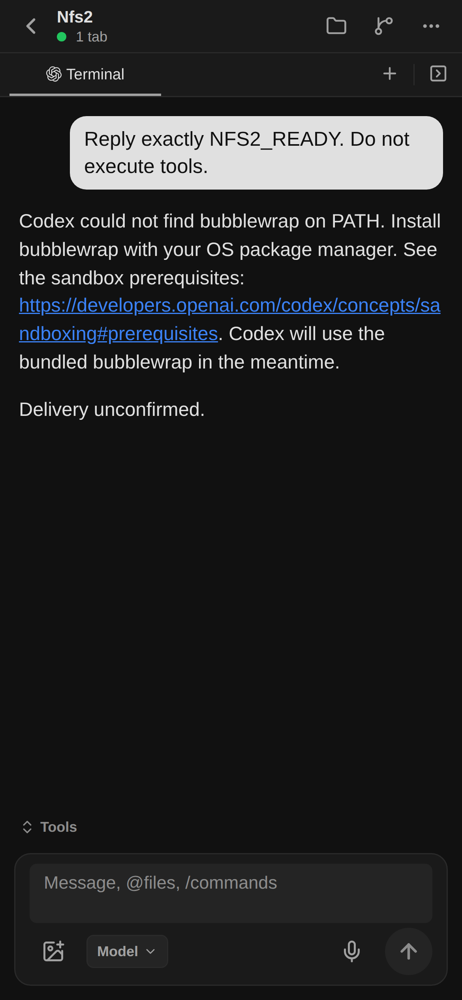

# Durable Chat and authentication refusal

Root deployed product revision `3d72af60` to the existing backend development watcher and Expo source on 2026-10-20 at 01:24 UTC. No image or dependency build was performed. Authenticated `session.tabs.list` returned both the durable Catalog Session address and the separate certified native provider address. The actual Expo browser was reloaded and visually inspected; its errors list was empty.

This is failure-state evidence, not successful inference or physical iPhone validation. The independent NFS-backed Agent reached READY, but its account/read failed with `refresh_token_reused` (401) in the native SQLite log. The backend exposed MANAGED_AUTH_REQUIRED. After normal backend takeover the original delivery became UNKNOWN; no input was resent. The bubblewrap fallback notice shown here is not the authentication failure cause.

The new input readiness guard retains future accepted messages before staging when the original runtime owner already knows authentication failed. One focused queue boundary test passed: no DB connection while refused; the same retained receipt proceeds to the first transaction when readiness returns. It does not rewrite the historical UNKNOWN delivery. The preceding durable Chat identity change passed five focused checks. Changed-source lint passed.

Remaining: one owner for each account's rotating refresh credential, protected access-token distribution and renewal, actual assistant response, earlier UNKNOWN resolution, raw Terminal and the remaining task05 scope. The current native-only refresh duplicates a source credential across Agent homes and does not return rotated credentials to that source.

Official app-server external token contract: https://learn.chatgpt.com/docs/app-server (authentication). Installed 0.160.1 LoginAccountParams includes chatgptAuthTokens but marks it unstable/internal; validate the exact installed protocol before enabling that path. This evidence does not claim the replacement authentication design is implemented.
