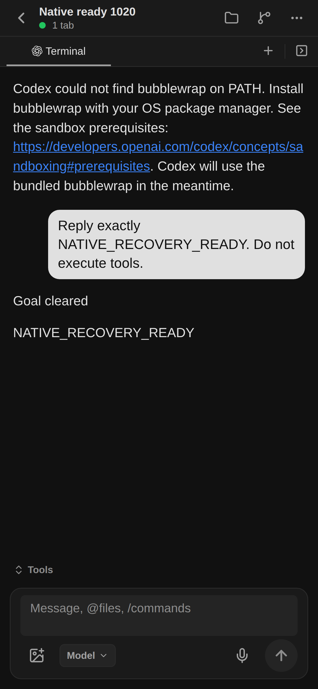

# Actual empty-session recovery and first input

Runtime source: `1de4c628`, schema034. Executed by Root on 2026-10-20 in the existing development environment; no image build.

1. Authenticated account listing and selection succeeded after headless runtime wiring. A new Expo workspace captured the authorized managed account.
2. Initial Agent READY at 03:31:22.956Z. Authenticated HOME observation was `PROVISIONAL / NOT_STARTED`, generation `base`.
3. Exact owned Pod UID was gracefully retired; authenticated sandbox termination was observed at 03:32:33Z and controller active attempt cleared.
4. Same Orca session recovered to READY at 03:33:27.926Z, generation `191b2379-4153-4677-8532-f019499d662a`. The old empty generation was retained; the new provider initialization was allowed only through the no-input recovery contract.
5. The first actual message was sent once through Expo Chat. Response `NATIVE_RECOVERY_READY` appeared, delivery reached `SETTLED`, and authenticated HOME observation became `FOUND / EFFECT_POSSIBLE`.

This proves the tested empty initialization recovery and first-input path. Persisted-history resume, raw PTY/Stop parity, installed iPhone/Mac, and full HA remain unverified here. The original Nfs2 UNKNOWN input was not replayed. The screenshot retains the native bubblewrap PATH fallback warning; it was not hidden.
