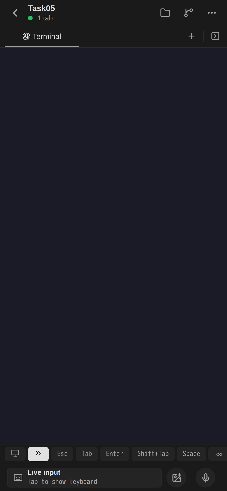

# Expo Web terminal integration — 2026-10-20

Root exercised the existing Expo development server in Chromium with an iPhone-sized 390×844 viewport (DPR 3). This is browser evidence, not an installed iPhone application test.

The native react-native-webview implementation previously rendered “React Native WebView does not support this platform.” The platform-specific surface now mounts the same bundled xterm document in an opaque-origin iframe and forwards the existing command/notification protocol. Incoming notifications are accepted only from that frame; the frame accepts commands only from its parent. Native keeps the original WebView implementation. No extra package or image build was used.

Actual Task05 workspace: opened through the normal UI and switched from Chat to Terminal using its tab menu. The iframe bridge was present and its document reported no engine errors. The unsupported-platform and initialization-error overlays disappeared. Three changed TypeScript/TSX files passed focused lint (0 errors, 0 warnings).

Limit: the current Pod0 stream announces its logical subscription but sends no initial snapshot. No xterm screen cells were initialized in this observation; the screenshot is a blank retained surface, NOT proof of provider input/output. Initial Pod0 snapshot, Chat/server mode synchronization, and actual provider execution remain unfinished. No new prompt was sent during this surface check. Full typecheck/native device validation was not run.

During implementation Metro selected the generic .ts surface before the .web.tsx variant. Matching both extensions to .tsx corrected selection. Expo CI mode disables automatic watching, so the owned Metro was normally restarted after source publication; no watcher limit or cluster permissions were changed. Final running Metro PID was 502. A type-only native handle alias correction after publication does not affect emitted code.
