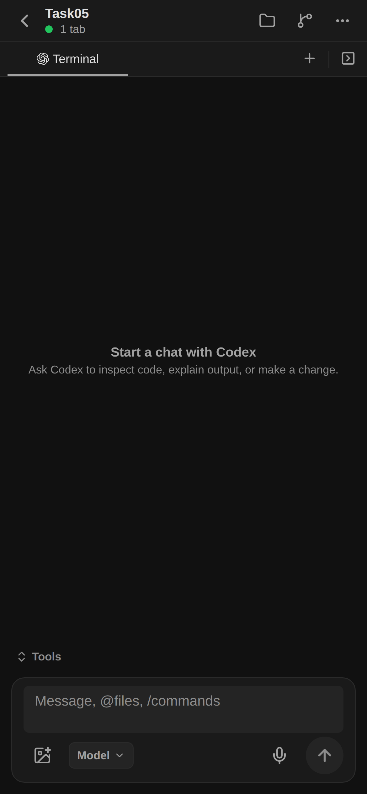

# Server-authoritative view mode and actual intake

Root changed Catalog Terminal projection to always advertise its effective `viewMode` (missing stored value means `terminal`). Mobile uses this value instead of device preferences for server-backed tabs. Existing `session.tabs.setTabProps` now admits paired mobile callers while preserving Catalog workspace/tab authorization. The UI waits for the normal committed tabs snapshot before switching its composer, reports failure, and does not queue mode writes across disconnect. Tab reconciliation now includes mode changes. Legacy tabs without server-advertised mode retain their device preferences.

Focused validation: two React hook cases PASS (server authority, no optimistic composer, duplicate in-flight toggle, committed snapshots and failure); four Catalog/mobile value cases PASS. Lint10 had zero errors and five pre-existing hook warnings in unchanged dictation logic. The initial standalone value test lacked its existing dependency link; linking the already-installed modules corrected that setup failure. No packages were installed. Full native/typecheck suite was not run.

Actual Expo Web tab menu switched Task05 to Chat. Authenticated `session.tabs.list` at 2026-10-20T00:30:04.326Z returned `viewMode: chat` and the UI showed Chat. Terminal mounting exposed native-only `setNativeProps` calls; both now retain controlled React state updates and use the synchronous native shortcut only when available. This removed the Web crash; old page errors remain historical in the browser log.

One UI Send action then committed message `f5eb5dbe-4ae6-4226-824e-950b64128550`, seq1, at 00:30:22.718Z. PG observation at 00:31:31.405Z found DURABLE with Unit ABSENT. This proves intake, NOT provider completion. No prompt was resent after this committed message.

The follow-up PG observation at 00:32:25.921Z identified the start blocker: new Task05 Unit points to the same protected storage binding currently ACTIVE under the existing Task04 attempt. Its WAKE remains INTENT_QUEUED. Independent Agents require correctly separated protected homes/checkouts; stopping the existing Agent would mask the allocation defect. General initial startup (TODO-04) is therefore reopened for multiple concurrently existing Agents. The earlier single-target PR179 evidence remains valid but does not establish this wider requirement.

Remaining task05: independent storage/startup correction, actual reply/PTY/Stop, initial Pod0 binary snapshot, ANSI fidelity, ACK/multiplex/viewport/raw idle and prior-turn cancellation limits. PR182 remains draft.
