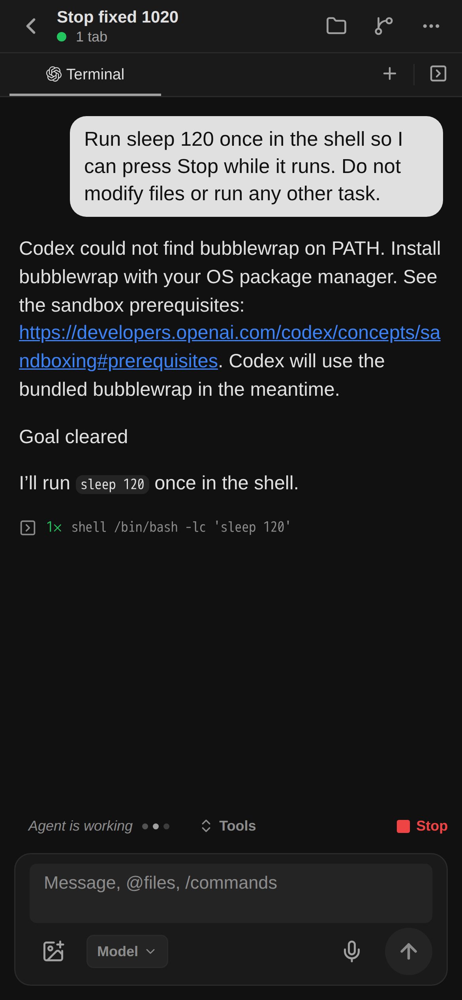
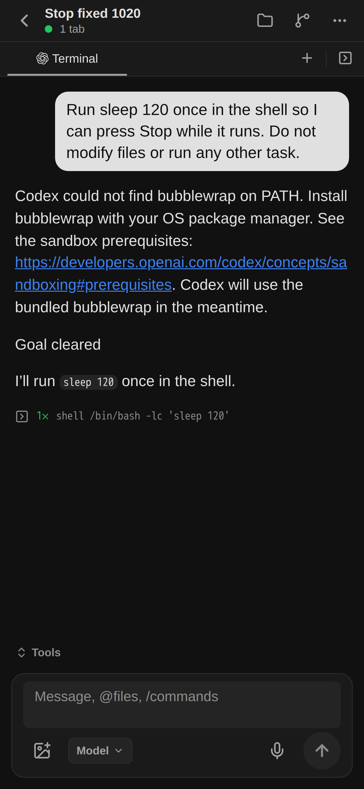

# Stop delivery and activity repair

Product revision: `920419f5` (2026-10-20). Root executed directly under the user's updated workflow.

The previous real Stop request was accepted into PostgreSQL, but the original turn completed normally. The initial provider effect permission query only admitted COLD/DISPATCH and omitted CANCEL. The cancellation runtime swallowed the refusal. Native logs contain no `turn/interrupt` request for that attempt. The cancel intent ultimately became ALREADY_SETTLED; this is not successful Stop evidence.

The repair admits CANCEL through the existing exact owner/attempt/Pod/turn checks and reports bounded refusal codes. It also connects previously missing Pod-local descendant capture/termination to the real Codex driver. Process snapshots remain inside the Agent; the backend uses a private opaque reference and never signals a remote PID locally. Stop waits for the original native terminal notification after ACK. Chat receives activity derived from durable delivery observations, with catalog revision notifications, so the actual running state exposes the existing Stop button.

No general permission framework, namespace permission change, dependency install, or container image build was introduced.

Validation:

- A real child `sleep` process was terminated while its owner stayed alive; an incorrect scope was rejected and a consumed scope was not reused.
- A terminal notification arriving after the interrupt ACK was awaited, with exactly one interrupt request.
- Existing isolated PostgreSQL cancellation integration passed.
- The actual production grant query accepted the current target for CANCEL and rejected a different Pod (read-only verification).
- Changed-source lint: 16 files, zero warnings/errors. Control bundle prepared successfully.

Published through the backend development watcher at 11:48:22 UTC. New private control artifact applies to newly created Agents. Existing live control processes are preserved.

Actual Expo UI acceptance passed on fresh `Stop fixed 1020` using the current VM account:

- One input committed before READY; automatic startup reached READY and admitted that original input. No input replay or manual WAKE.
- Native shell `sleep 120` was visibly running, with the Stop button shown.
- UI Stop was clicked once at 11:55:06.738 UTC; the same input/delivery became INTERRUPTED and the fixed cancel intent CONFIRMED at 11:55:07.261 UTC (523 ms).
- The production cancellation command resolved with `{requested:true,stopped:"OBSERVED"}`. This consumes the exact interrupted native turn plus Pod-local descendant termination evidence, not ACK alone.
- After Stop, the working indicator and Stop button disappeared. Screenshots below were captured from the real Expo Web UI and visually reviewed.

Installed iPhone/Mac validation, cancellation of a pre-existing turn adopted across backend restart, and wider terminal parity remain separate acceptance gaps. The previously failed input was not replayed or relabeled successful.
