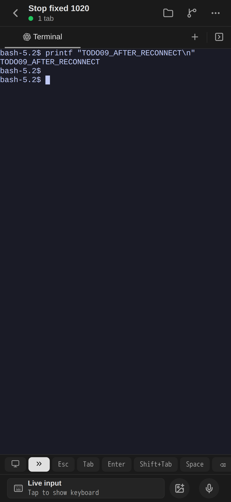
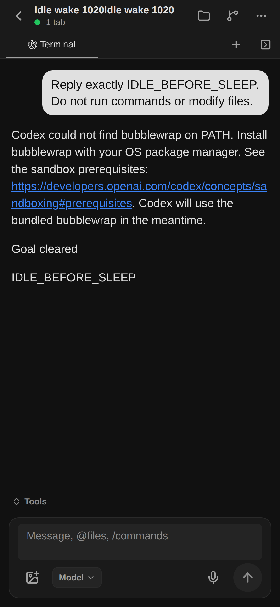
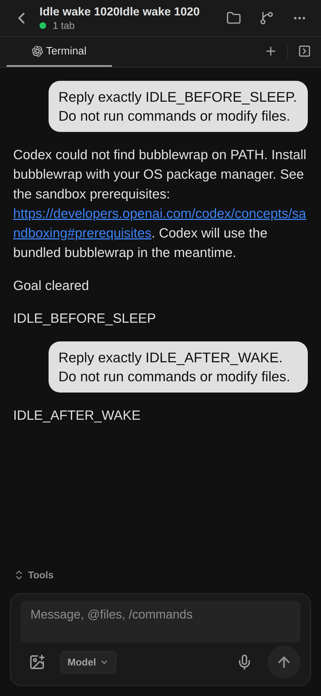
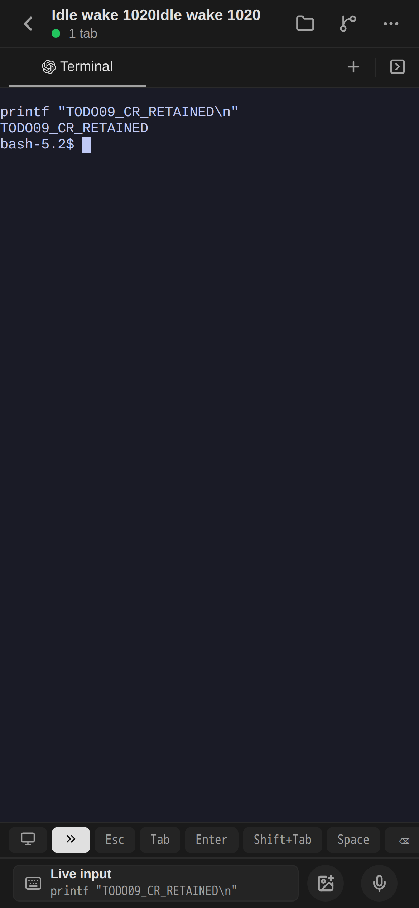
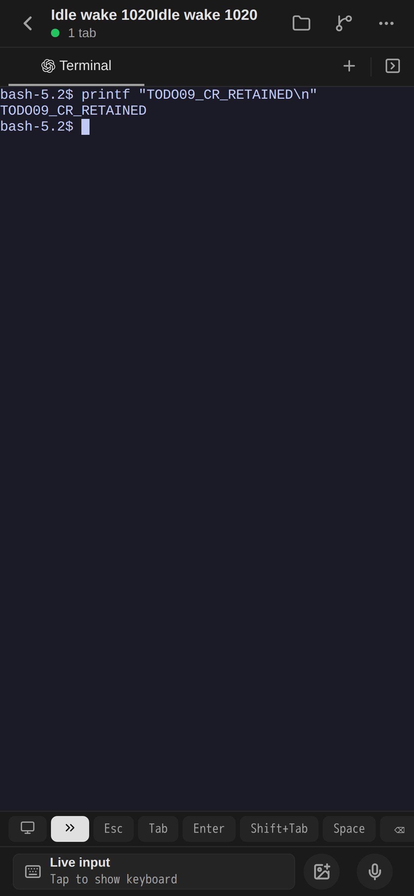
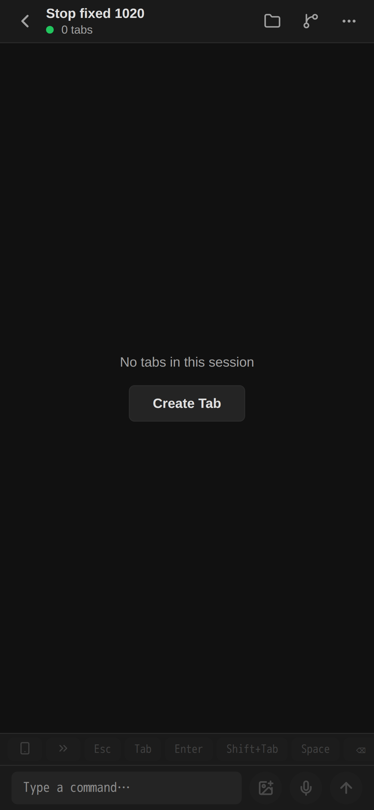

# TODO-09 / TODO-11 — Terminal and idle lifecycle

Status: TODO09/11 implementation and scoped acceptance complete; final PR review.

## Terminal diagnosis

Chromium launched at native scale 1 with Playwright `deviceScaleFactor: 3`
reports `devicePixelRatio=3` but ResizeObserver `devicePixelContentBoxSize`
300×200 for a CSS 300×200 canvas. This occurs both in the main document and
an opaque `sandbox="allow-scripts"` iframe. With Chromium
`--force-device-scale-factor=3` **and** matching context scale 3, the same box
reports 900×600. The xterm addon observes that device box and updates canvas
backing dimensions; its WebGL viewport still follows DPR. The mismatch is in
the browser test configuration. No forced canvas resize/product workaround
has been added. This does not yet establish installed iPhone rendering parity.

## Idle implementation

- Resident Agent activity records input, native turn/tool notifications and
  workload processes, including descendants reparented to Pod PID 1. PID/start
  identity distinguishes reuse. Queries, subscriptions and resize do not count
  as work. Old control bundles without the capability cannot assert idle.
- The existing controller observes every member, then reserves SLEEP under
  existing Session/Unit locks and rechecks the PG idle deadline. Historical
  UNKNOWN input does not itself block an otherwise observed idle runtime.
- Existing FENCE_ATTEMPT command records the stop. The resident control closes
  input admission, checks activity again, closes native/PTY and flushes the
  protected filesystem. UID-preconditioned Pod retirement is only a request.
- Existing sandbox stop evidence and writer revocation settle the original
  stop command/operation. A RUNNING intent/new pending input accepted during
  shutdown survives cleanup. Original UNKNOWN input is not replayed.
- A single closing member does not delete an open sibling's unit. Actual
  whole-unit stop completes CLOSING members. Closing members with active work
  remain busy; merely closing a tab does not prove its writer stopped.

## Verification and outstanding acceptance

Local resident activity test passed. Isolated PostgreSQL tests cover physical
stop/new-input ordering, PG idle deadline, and close/open sibling behavior.
Changed-source lint passed. No container image build was performed.

The pre-existing development controller was found STOPPED/PASS/DB_FAILURE on
2026-10-20; its lease expired at 22:51:52 UTC. Existing logging lost the original
error cause, so neither a precise root cause nor automatic controller recovery
is claimed here. This is separate from the browser pixel discrepancy.

UNKNOWN cancel is retained as uncertain history, but no longer excludes new
lifecycle commands through the unresolved-command index or pending-pass map.
Migration 035 and isolated PG coverage verify that no historical result is
invented or replayed. Running DELETE subsequently passed; see final acceptance below.

## Live Terminal, 23:07 UTC

After development source publication, the controller was ACTIVE under a new
lease and reattached the existing Agent (same Pod, no input replay). In the Expo
iPhone-sized browser, a new `printf "TODO09_AFTER_RECONNECT\\n"` command was entered
once using live input and the Enter accessory. The PTY echo, resulting output
and prompt are visible below. Native browser scale and emulated DPR are both 3.

This is browser visual evidence, not installed iPhone or Desktop parity.

## Actual idle → stop → same native session, 23:17–23:22 UTC

A new Agent received one request for `IDLE_BEFORE_SLEEP`, then remained idle
with its Expo screen open. With the one-minute acceptance policy, the original
attempt stopped at 23:17:13.486Z. Actual sandbox-stop evidence and both execution
and write grant revocations completed SLEEP. A **new** input requested
`IDLE_AFTER_WAKE`; no manual WAKE was used for this sequence. The restored Agent
responded in the same native session `01a15b99-4ed0-7f80-89ce-d7eeb00d2674`.
It then slept again. Reloading the asleep Terminal left the unit ABSENT/SUSPENDED,
with no active attempt and unchanged work activity. Original UNKNOWN inputs were
not resent.

## Durable CR/LF projection correction

The asleep Terminal initially appeared empty even though its PTY frames were
journaled. The reused compact status-preview reducer intentionally discarded
text preceding CR, which is wrong for a durable Terminal display. The display
now uses the existing cursor-aware row reducer: CR moves the cursor and LF
completes the row. The real PG test includes CR/LF split across frames and
UTF-8 split across frames. No forced canvas refresh was added.

Previously discarded projection text is not automatically reconstructed across
possible user clear-buffer boundaries. The source journal is unchanged; newly
projected output uses the corrected semantics. Installed iPhone/Desktop parity
and full two-Serve HA remain separate tasks.

## Controller budget blocker during DELETE preparation

The dedicated manual WAKE was accepted once at 23:26:20Z. Its Pod became Ready,
but the controller had already stopped with `CONTROLLER_EXTERNAL_TIMEOUT`;
the cold executor was cancelled in `HELD_PROTECTION`. The code shared one
wall-clock budget across the entire pass and every admitted external call,
so work scheduled late inherited only earlier work's leftover time.

The pass now stops admitting new items at its scheduling budget, while each
admitted external call gets its own bounded I/O budget. PG operation deadlines,
lease guards and true call timeout remain unchanged. A focused scheduling test
proves two individually bounded calls can cross the pass scheduling deadline
without killing the controller, while a genuinely timed-out call still stops.
This is not a full two-Serve recovery claim or a diagnosis of the earlier DB_FAILURE.
Product139d2fcb, including CR handling, was published at23:33:19Z without image
or Agent control rebuild. Original unready attempt recovery remains in progress.

## Accepted manual demand after a failed stop, 23:38 UTC

The interrupted WAKE was physically stopped and recorded FAILED/REWAKE_OWNER_LOST.
A later authenticated manual request joined that root, but its updated intent
was excluded by the old root-intent-only demand selector. The selector now
recognizes the actual receipt for the current intent. It also lets the claim
path account an expired root rather than hiding demand before exhaustion can
be recorded. Retry count/deadline and old receipts remain unchanged.

The isolated PG manual-wake test verifies current-intent demand, expired-budget
accounting, authenticated HTTP idempotence, linked explicit resumption, and
preservation of UNKNOWN/pending inputs. Product107bc330 was published23:37:35Z.
The old root exhausted normally; an explicit resume at23:38:40Z was QUEUED with
a new linked operation. Running DELETE acceptance continues on that same run.

## Live CR output, reconnect and Pod0, 23:43–23:45 UTC

The linked resume reached READY at23:42:46.750Z. One new raw PTY command,
`printf "TODO09_CR_RETAINED\\n"`, produced visible output. `terminal.read` also
returned its command/output/prompt correctly after CR/LF projection. Browser
reload cleared the draft and restored the recorded output; no raw command was
resent. With the screen open, the unit slept again: at23:45:17 it was
ABSENT/SUSPENDED with active attempt null and last work still23:43:28.433Z.
The Terminal retained the output. No further WAKE is needed for this unit.

For running DELETE, the already READY `Stop fixed 1020` verification Agent is
reused. Its Terminal was closed through the Expo tab menu once; the UI showed
0 tabs and PG showed Session CLOSING/Tab CLOSED at23:46:01. Physical stop and writer revocation completed as recorded below.

## Final acceptance, 23:47 UTC

Running DELETE operation `22d7651a-dd16-45cf-a98b-b4055d936171` reached SUCCEEDED.
The attempt stopped at23:46:38.031Z, both execution and write grants were REVOKED,
Session/Tab CLOSED, Unit DELETED/ABSENT and active attempt null. Exact sandbox
proof: `kubernetes-sandbox-stop:sha256:7c581b053ddf5ec5c1570c0f7f8f2897dfc41fd10dc88cab6a8f570c3de90d07`.

The development environment retains its explicitly configured one-minute idle
policy for new capability-aware Agents. Older control bundles are not assumed
idle. This is a development setting, not a new hard-coded product default.

Scoped TODO09/11 acceptance is complete: visible Terminal output/reconnect,
read-only retained Pod0 display, actual idle/stop/grant revocation/same-native
wake, and running close/DELETE. Existing PR182 binary/generation/raw no-replay
fixtures are reused. Actual multi-member race coverage is isolated PG, not a
claimed multi-Pod end-to-end run. Installed iPhone/Desktop parity remains TODO15;
full HA and unexplained earlier DB_FAILURE remain TODO14. No image build.
