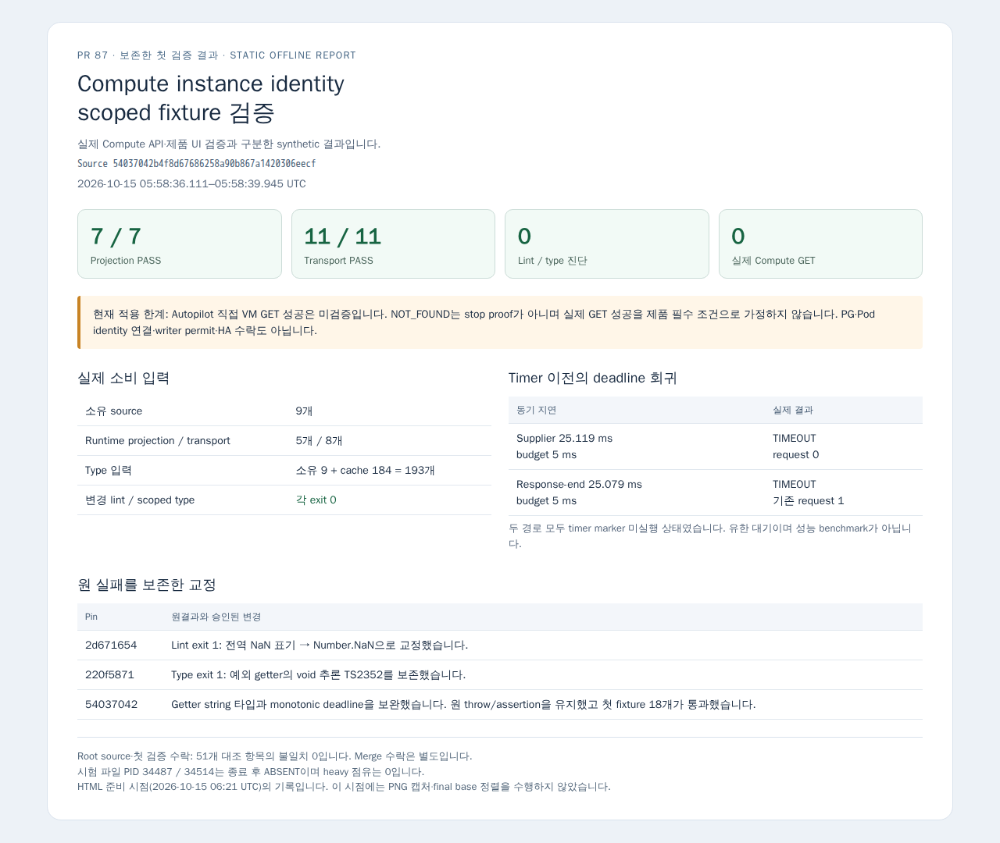

# Compute instance identity의 첫 scoped fixture 검증

검증 source는 `54037042b4f8d67686258a90b867a1420306eecf`이고 base는 `e3ceda2d258153271b526ebda0db74bf51886ffd`입니다. Root는 원 source/fixture diff·TAP·readset의 51개 대조 항목을 읽고 불일치 0을 확인했습니다. [수락 댓글](https://github.com/hongseok-lee/orca-1012-runtime/pull/87#issuecomment-6185834988)은 source 교정과 첫 검증의 수락이며 merge 수락은 아닙니다.

2026-10-15 05:58:36.111–05:58:39.945 UTC에 기존 원격 Node 24와 TS 7.0.2/esbuild 0.25.12/oxlint 1.80.0 cache로 변경 파일 2개 lint, scoped type, 첫 projection 7개·transport 11개를 실행했고 모두 exit 0이었습니다. Type의 실제 소비 입력은 소유 source 9개와 외부 cached type 184개이며 전체 제품 graph 검증이 아닙니다. Runtime 변환 입력은 projection 5개·transport 8개이고 두 변환 모두 소유 source 범위 안입니다.

[정제 결과](result.json)에는 PID·UTC·exit·원 실패와 새 회귀의 실제 값을, [provenance](provenance.json)에는 Git blob/SHA256·runtime/type 소비 입력·tool entry·원 로그 hash를 기록했습니다. Operator 절대경로와 private 근거 위치는 공개하지 않았으며 private 원 manifest와 공개 JSON의 hash를 구분합니다. Git mode `100644`와 private remote 검증 사본의 UID 1000/mode `0600`도 구분했습니다.

## 원 실패와 교정

최초 source `2d6716542ae5f135d8472e95e454efef23112c37`의 lint는 fixture의 전역 `NaN` 1곳에 `unicorn(prefer-number-properties)` 진단과 exit 1을 반환했습니다. `220f5871c03ccfcedd45eafd738984169841478e`에서 `Number.NaN` 표기만 교정한 뒤 변경 파일 lint는 통과했습니다. 같은 pin의 첫 type은 fixture 233행의 예외 getter가 `void`로 추론돼 configuration cast에서 `TS2352` 1건과 exit 1을 반환했습니다. 원 로그와 두 실패 hash는 보존했습니다.

Root 후속 계약에 따라 getter 반환형에 `string`을 명시하고 원 throw/assertion을 유지했습니다. Root가 채택한 독립 source 리뷰는 실행 재현 없이 timer callback 전에 실행되는 continuation의 deadline 공백을 지적했습니다. 현재 source는 `performance.now()`로 호출별 monotonic absolute deadline을 capture하고 credential continuation의 request 진입 직전 및 response 수락/완료 경계에서도 경과를 검사합니다. Date.now 기반 deadline이나 외부 요청자가 고르는 clock은 없습니다.

새 회귀 callback 하나에서 bounded 동기 대기 두 경로를 실제 실행했습니다. Supplier는 25.119 ms 동안 5 ms budget을 넘겼고 timer marker가 실행되지 않은 상태에서 TIMEOUT/request 0을 반환했습니다. Response-end 경로는 25.079 ms 대기 뒤 같은 조건에서 TIMEOUT이었으며 request 1은 deadline 전에 시작됐습니다. 기존 비동기 timeout/abort와 의미 assertion을 유지했고, 이 유한 대기는 성능 benchmark가 아닙니다.

## 실행 종료와 적용 한계

Projection runner PID 34481과 실제 시험 파일 자식 34487, transport runner 34508과 시험 파일 자식 34514는 모두 종료 후 ABSENT였습니다. Controller 34408과 esbuild service 자식 34475/34502는 Z 상태이며 `/proc` raw wait status 0을 관측했습니다. 종료된 zombie를 실행 중으로 표시하지 않았고 heavy 점유는 0입니다.

이 결과는 synthetic stream fixture입니다. 실제 Google Compute API 호출·TLS handshake·권한 관측은 0이며 Autopilot 직접 VM GET 성공을 검증하지 않았습니다. Root가 재대조한 기존 G04 NOT_FOUND와 Autopilot node visibility 제한은 삭제 증명이 아니며, 실제 GET 성공을 현재 제품의 필수 선행 조건으로 가정하지 않습니다. 별도 creation Audit 사실에 따른 identity 연결은 Root의 후속 검토 대상입니다.

PG·Pod original-target·startup/RPC 연결, stop proof·writer permit·HA 수락, Cloud/Kubernetes 자원 변경, live source/config/watch 변경은 없습니다. 검증을 위한 Pod UID 읽기와 소유 stage 전송·exec·근거 읽기만 수행했습니다. 설치·전체 build/suite·성공 검증 반복은 하지 않았습니다.

[정적 오프라인 보고 HTML](verification-report.html)을 기존 Browser cache의 `/usr/bin/node`와 새로운 ephemeral context에서 한 번 렌더링했습니다. [PNG 보고서](verification-report.png)는 보존한 synthetic fixture 결과의 요약이며 제품 UI/native/실제 Compute API 화면이 아닙니다.

Capture Node PID 6383과 Chrome 자식 6395는 2026-10-15 06:28:23.185–06:28:24.160 UTC의 PNG 1회 뒤 종료됐고 launcher exit는 0이었습니다. Context는 offline이며 관측한 context 요청은 0입니다. Auth storageState·기존 paired profile·제품 페이지를 읽지 않았고 context/browser를 닫았습니다. PNG는 1280×1080, 156,913 B이며 SHA256은 `320b87dacdbc281bb87a269636499029f3173fc47c6e52411082a63ae3b7a350`입니다. HTML은 06:21 준비 시점의 snapshot이며 그 화면의 당시 미실행 표기와 실제 후속 capture provenance를 구분합니다.

첫 launcher는 과거 보고 log 경로가 남아 중복 방지 guard에서 exit 1로 종료됐습니다. 원 source/stderr와 exact diff를 보존하고 신규 root/log 부재를 확인한 뒤 log 경로만 교정했습니다. Guard는 파일 생성·자식 기동보다 앞에 있어 첫 실패의 browser/page/screenshot은 0이며, 실제 capture는 위 1회뿐입니다. Namespace·Chrome 설치·프로필 정리·인증 변경으로 우회하지 않았습니다.

Root가 지정한 `74e80cb529f8604e4dfb6fd8912fa4d51ac1de21` 위로 rebase를 한 번 수행했습니다. 원 검증 source `54037042`와 최종 공개 head를 구분했습니다. Source 9개·runtime 입력 5/8개·소유 type 입력 9개의 byte/Git mode와 기존 lint config/plugin 6개는 불변이며 외부 cached type 184개의 원 readset을 보존했습니다. 이 정렬을 이유로 시험·설치·API를 반복하지 않았습니다. Final head는 PR과 private 최종 인계에 기록하며 전체 live checkout SHA를 증명한 것으로 표시하지 않습니다. Source와 첫 검증 수락을 실환경 identity·merge 수락으로 확대하지 않습니다. 이번 후속의 usage limit·credits 오류·stream 중단은 미관측입니다.
