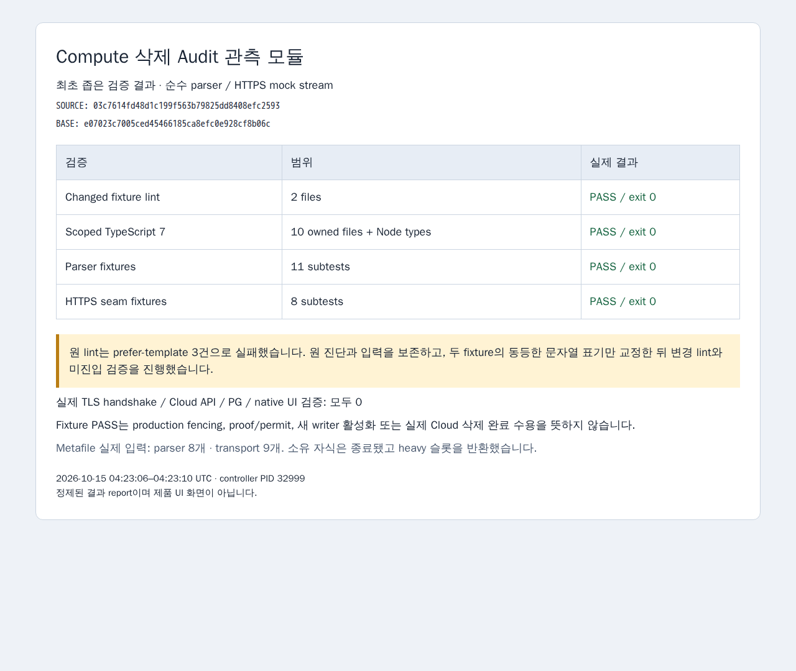

# Compute 삭제 Audit 관측 모듈의 최초 좁은 검증

검증 source는 `03c7614fd48d1c199f563b79825dd8408efc2593`이고 고정 base는 `e07023c7005ced45466185ca8efc0e928cf8b06c`입니다. Source 작성과 실제 fencing 통합 수용은 구분합니다.

원 `6a0b5485`의 소유 10개 lint는 fixture 두 파일의 `prefer-template` 3건으로 exit 1이었습니다. 원 진단과 입력을 보존하고 문자열 표기 3곳만 같은 값으로 교정했습니다. 제품 6개 파일, assertion, callback 내용·순서·소속은 바꾸지 않았습니다.

변경 두 파일 lint와 소유 10개/Node 타입의 좁은 type 검증이 exit 0이었습니다. Parser 11개와 transport 8개 TAP subtest는 각각 최초 1회 모두 통과했습니다. Parser/transport의 실제 metafile 입력은 각각 8개/9개이며 정확한 digest와 TAP SHA는 [정제 결과](first-scoped-verification.json)에 있습니다. 원 --listFiles 전체 로그와 원 실패·runner·입력 hash·프로세스 종료는 비공개 증거에 보존했습니다.

Transport fixture는 실제 event stream을 내는 주입 HTTPS seam으로 auth/redirect/abort/token timeout/stream 정리와 certificate 오류 분류를 검사합니다. 실제 TLS handshake나 인증된 Cloud Logging 호출 성공을 뜻하지 않습니다. 실제 Cloud/PG/native UI 검증, 삭제/drain/G04 반복, storage proof/provider permit 발급 및 새 writer/startup 활성화는 모두 0입니다.

PNG는 기존 Expo Playwright 1.59.1/cache에서 새 ephemeral browser와 offline context로 정제 HTML을 한 번 렌더링한 결과 보고서입니다. 기존 paired/auth profile을 재사용하지 않았고 application request는 0이며 소유 browser를 정상 종료했습니다. 제품 UI 화면이나 실제 Cloud 결과 화면으로 표시하지 않습니다. 성공한 검증과 screenshot은 반복하지 않았습니다.
