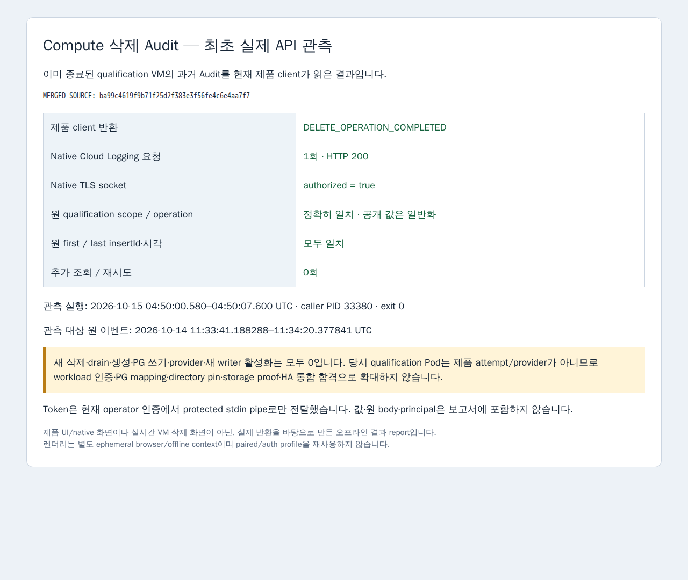

# 병합된 Compute 삭제 Audit client의 최초 실제 API 관측

병합 source `ba99c4619f9b71f25d2f383e3f56fe4c6e4aa7f7`의 제품 6개 파일과 기존 Backend cache의 bytes가 같음을 확인한 뒤, 독립 caller에서 `createComputeDeletionAuditClient(...).observe(input)`를 한 번 호출했습니다. 기존 dev server/watch/Expo와 제품 source/config는 변경하지 않았습니다.

2026-10-15 04:50:00.580–04:50:07.600 UTC에 caller PID 33380이 exit 0으로 종료했습니다. Native Cloud Logging 요청 시작 event는 정확히 1개이고 HTTP 200, native TLS socket의 `authorized=true`를 관측했습니다. Fixture HTTPS seam을 주입하지 않았습니다. GCP scope/시간 구간과 endpoint/filter/pageSize 100은 Root 고정값이며 추가 조회·retry·pagination은 0입니다.

실제 제품 반환은 `DELETE_OPERATION_COMPLETED`입니다. 보존한 원 projection과 exact identity·operation·producer·first/last insertId·시각·numeric target이 모두 일치합니다. 실제 반환을 예상 결과로 대체하지 않았습니다. 관측 대상은 2026-10-14에 이미 종료된 qualification VM의 과거 Audit이며 이번에 삭제를 다시 수행한 것이 아닙니다.

현재 operator의 기존 gcloud 인증에서 token을 한 번 얻어 protected stdin pipe로만 전달했습니다. Worker의 argv/env/일반 파일/로그에 token을 넣지 않았고 원 API body·principal·authenticationInfo를 수집하지 않았습니다. Caller 로그는 allowlist metadata만 담고, caller/launcher와 별도 report browser는 정상 종료했습니다. Request 수는 [Node native HTTP diagnostics channel](https://nodejs.org/docs/latest-v24.x/api/diagnostics_channel.html#event-httpclientrequeststart)에서 비밀 아닌 metadata만 관측했습니다.

[정제 결과 JSON](result.json)은 환경 고유 project/instance/operation/insert ID와 private 경로를 일반화한 공개 사본입니다. Private 원 계약 SHA256은 `42d08bbe3c8ec8004b95a383364be3bbeb16c8559a53283a3f83e0fec51cf67d`이고, 원 product result·metafile·helper·source hash와 구분해 기록했습니다. PNG는 기존 Expo Playwright/cache의 새 ephemeral browser/offline context에서 실제 정제 결과를 한 번 렌더링한 report이며 제품 UI/native/실시간 VM 삭제 화면은 아닙니다.

당시 qualification Pod는 제품 attempt/provider가 아니었습니다. 이 결과를 PG 원 mapping·authenticated workload·directory lifetime pin·ComputeStoppedProof·새 writer·HA 통합 합격으로 확대하지 않습니다. Compute/Pod/Node 생성·삭제·drain, PG 쓰기, source/live restart 및 provider 활성화는 모두 0입니다. 기존 fixture/type/build/성공 화면과 실제 API 호출을 반복하지 않았습니다.
