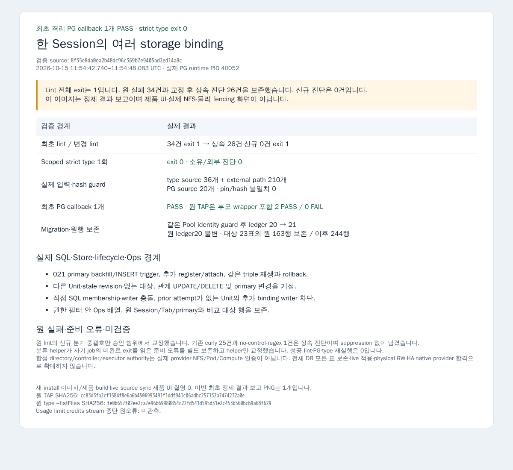

# 한 Session의 여러 storage binding — 최초 격리 검증 결과

기존 Session→Unit 유일성과 primary checkout binding을 보존하고 추가 binding을 append-only 관계로 표현합니다. 이 연결의 존재는 directory 인증이나 RO/RW 허가가 아닙니다.

최초 검토 source pin은 `b6c7a3ca10c3616e9178421ea04fc1a0b70dbe0a`, base는 `a8874fd1952f010f2da1ed4a43352510394cfbed`입니다. 제품 4파일과 focused PG fixture 1파일을 작성했습니다. [Source diff](source.diff), [정확한 file/hash 기록](source-provenance.json), [Root 계약 전문](contract.md)을 함께 제공합니다.

- Migration 021은 primary를 backfill하고 이후 기존 runtime_members INSERT의 primary도 같은 transaction에 연결합니다. 새 관계의 UPDATE/DELETE와 primary binding의 실제 변경을 거절합니다. 동일 primary 값 UPDATE는 허용합니다. 기존 migration 001–020과 primary 컬럼/Session UNIQUE/FK는 유지합니다.
- `attachBinding`은 Session→Unit→storage domain 순서로 잠근 뒤 기존 membership·binding·expectedUnitRevision을 확인합니다. 새 연결만 같은 transaction에서 journal/audit/outbox에 남기고, 같은 triple 재호출은 추가 사건 없이 같은 binding을 반환합니다. proof/epoch/revision/access/writer와 primary는 바꾸지 않습니다.
- `registerBinding`은 기존 primary 등록을 유지하고 같은 Session/Unit의 새 binding은 추가 관계에 연결합니다. 다른 Unit의 Session은 거절합니다. 기존 canonical binding 재사용·UNVERIFIED→VERIFIED·receipt 재생을 새로 구현하지 않았습니다.
- Store/grant의 exact Unit membership, lifecycle의 모든 연결 binding에 대한 과거 writer 확인, Ops의 기존 dataset/workspace 접근 필터 안 중복 없는 mounts 배열을 새 관계에 맞췄습니다. Catalog/RPC의 primary checkout 조회 3곳은 바꾸지 않았습니다.

Root의 early source 리뷰에서 primary 컬럼을 직접 UPDATE하면 기존 primary 소비자와 추가 관계가 갈라질 수 있다는 공백이 지적됐습니다. [수락한 보완 diff](primary-guard-supplement.diff)는 같은 021의 primary 변경 거절과 fixture assertion입니다. 현재 제품 경로에서 그 UPDATE가 발생한 회귀라고 표시하지 않습니다.

## 최초 검증 결과와 한계

2026-10-15 11:54 UTC에 기존 격리 PostgreSQL의 focused callback 1개를 처음 실행했습니다. 부모 wrapper는 제품 callback에 합산하지 않으며 원 TAP은 2 PASS / 0 FAIL, 실제 제품 callback은 1개입니다. 같은 Pool에서 첫 seed/DDL 전에 실제 database/system/OID/dataset을 확인했고, 기존 ledger001–020을 보존하며 새 021만 적용했습니다. 비교 대상 23표의 원행 163개가 보존됐고 fixture 이후 같은 비교 범위는 244개입니다. 원 ledger20의 checksum/applied_at도 동일합니다. Live DB 적용은 0입니다.

Fixture는 실제 Store·PG·lifecycle·Ops 함수를 통해 021 backfill/primary trigger, 추가 register/attach·무사건 재생·rollback, 잘못된 소속/revision/대상 거절, 관계 UPDATE/DELETE·primary 변경 거절, 직접 SQL membership·writer 충돌, 자신의 prior attempt가 없는 Unit의 추가 binding writer 때문에 차단되는 lifecycle, 접근 필터 안 Ops 배열과 원 ID/primary/행 보존을 확인했습니다. Directory/controller/executor authority는 명시적인 합성이며 실제 NFS/Pod/Compute 인증·물리 old-writer 종료 proof가 아닙니다.

최초 소유 4파일 lint는 exit 1 / 34건이었습니다. Root가 승인한 신규 6개 if의 중괄호와 동일 SQL/params 분기의 삼항식 교정 후 변경 store 1파일 lint도 exit 1입니다. 기존 base 행과 정적으로 대조한 상속 진단 26건(curly 25·no-control-regex 1)이 남았으며 신규 진단은 0건입니다. 기존 진단을 0 또는 lint 전체 PASS로 표시하지 않았고 suppression·기존 코드 전면 정리는 하지 않았습니다.

진단 분류 helper가 실행 중인 자기 job의 exit를 읽은 준비 오류는 별도 보존했습니다. 완료된 lint job 이름으로 exit를 읽도록 교정한 뒤 성공 lint를 반복하지 않고 미진입 type/PG를 진행했습니다. 좁은 type은 exit 0 / 소유 0·외부 0 진단입니다. 실제 source 입력 36개·외부 타입 경로 210개, PG bundle source 입력 20개와 wrapper provenance를 기록했으며 pin/hash 불일치는 0개입니다. 원 metafile은 guard 전에 보존했습니다.

기존 성공 suite·install·이미지/릴리스 build·live source sync·기존 PNG는 반복하지 않았습니다. 최초 offline 결과 보고 PNG 1개를 추가했으며 실제 UI·physical RW·HA·native provider 합격을 주장하지 않습니다. Heavy는 반환했습니다. 사용량 제한·credits·stream 중단 원오류는 이번 turn에서 미관측입니다. Root의 최종 source 리뷰·수락·merge 전 Draft를 유지합니다.

최종 공개 정렬 base는 `9339d7457ff3fc7aa0dd12dd3decef862b57bcbe`입니다. 제품 4파일·fixture 1파일의 blob/mode는 실제 검증 pin과 동일하고 base 변경 6파일과 실제 입력의 교집합은 없습니다. 전체 DB의 모든 표 보존으로 확대하지 않습니다.

[검증 요약](verification.json) · [실제 입력](actual-inputs.json) · [정제 TAP](pg.sanitized.tap) · [원 lint](first-lint.log) · [교정 후 lint](changed-lint.log) · [lint 교정](lint-correction.diff) · [helper 교정](helper-correction.diff) · [PNG provenance](session-storage-bindings-result-report-provenance.json)

Root가 원 검증을 직접 대조해 수락했습니다. Source/검증 수락과 최종 PR merge는 구분하며 Draft를 유지합니다.
