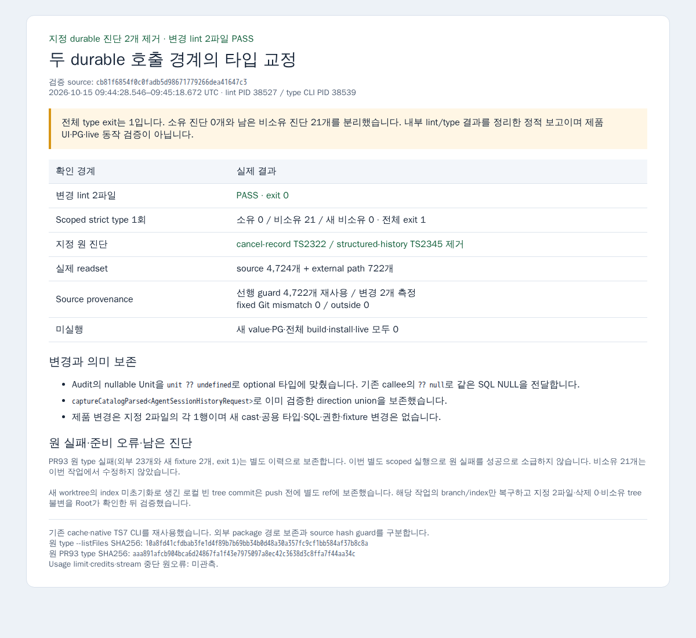

# Durable 호출 경계의 타입 교정

Root가 지정한 두 호출 경계만 교정했습니다. `cancel-record.ts`의 Audit Unit은 `unit ?? undefined`로 optional 계약에 맞췄습니다. 기존 callee `appendAudit`가 `input.runtimeUnitId ?? null`로 SQL 인수를 만들므로 null 의미를 유지합니다. `structured-history.ts`는 `captureCatalogParsed<AgentSessionHistoryRequest>`로 이미 검증한 direction union을 보존합니다. 새 assertion/cast·공용 타입·schema·SQL·인증·기존 fixture 변경은 없습니다.

Source pin은 `cb81f6854f0c0fadb5d98671779266dea41647c3`, base는 `110d091538dedea4bfcd2b959e8dbc91c99b51e0`입니다. [Exact diff](product.diff)는 각 파일 1행입니다.

| 경계 | 실제 결과 |
|---|---|
| 변경 lint | 소유 2파일 PASS · exit 0 |
| Scoped strict type 1회 | 소유 진단 0 · 비소유 진단 21 · 전체 exit 1 |
| 지정 원 진단 | cancel TS2322 / history TS2345 제거 |
| 실제 readset | source 4,724개 + external path 722개 |
| Source guard | 선행 4,722개 재사용 · 변경 2개 측정 · Git mismatch/outside 0 |
| 신규 value / PG / build / install / live | 모두 0 |

전체 type PASS가 아닙니다. 남은 비소유 21개는 PR93 최초 원 진단 목록에도 있던 항목이며 이번 작업에서 수정하지 않았습니다. 원 PR93 source `cf475953`의 제품 소유 0·fixture 2·외부 23·전체 exit 1 결과는 그대로 보존했습니다. 별도 scoped entry 실행으로 그 원 실패를 성공으로 소급하지 않습니다. [원 durable 진단](original-durable-diagnostics.txt), [이번 원 진단](type-diagnostics.txt), [분류](type-classification.json), [입력](type-inputs.json), [검증](verification.json)을 구분합니다. 전체 `--listFiles` 원 로그·실행 config·원 manifest는 비공개 원자료에 hash와 함께 보존했습니다. 공개 config는 typeRoots 경로만 일반화한 설명용 사본입니다.

새 worktree의 index 준비 실패와 잘못된 로컬 빈 tree commit도 보존했습니다. 오류 commit을 push하지 않았으며 이 작업 전용 branch/index만 복구하고 fixed base 대비 지정 2파일·삭제 0·비소유 tree 불변을 Root가 확인한 뒤 검증했습니다. 다른 worktree reset과 원 PR93 증거 변경은 0입니다.

이 PNG는 내부 lint/type 결과의 offline 보고이며 제품 UI·live·PG 동작 검증 화면이 아닙니다. 기존 원격 Browser 도구로 HTML을 한 번 열어 캡처합니다. 외부 요청·auth state 없이 진행하며 provenance에 원 결과 hash·PID·UTC·cleanup을 기록합니다. 성공 검증을 반복하지 않고 type 종료 후 같은 heavy 슬롯에서 순차 실행합니다.

[Root 계약 전문](contract.md)과 승인 public COMMON을 적용합니다. Root 리뷰·수락·merge 전 Draft를 유지합니다. Usage limit·credits·stream 중단 원오류는 이번 turn에서 미관측입니다.
