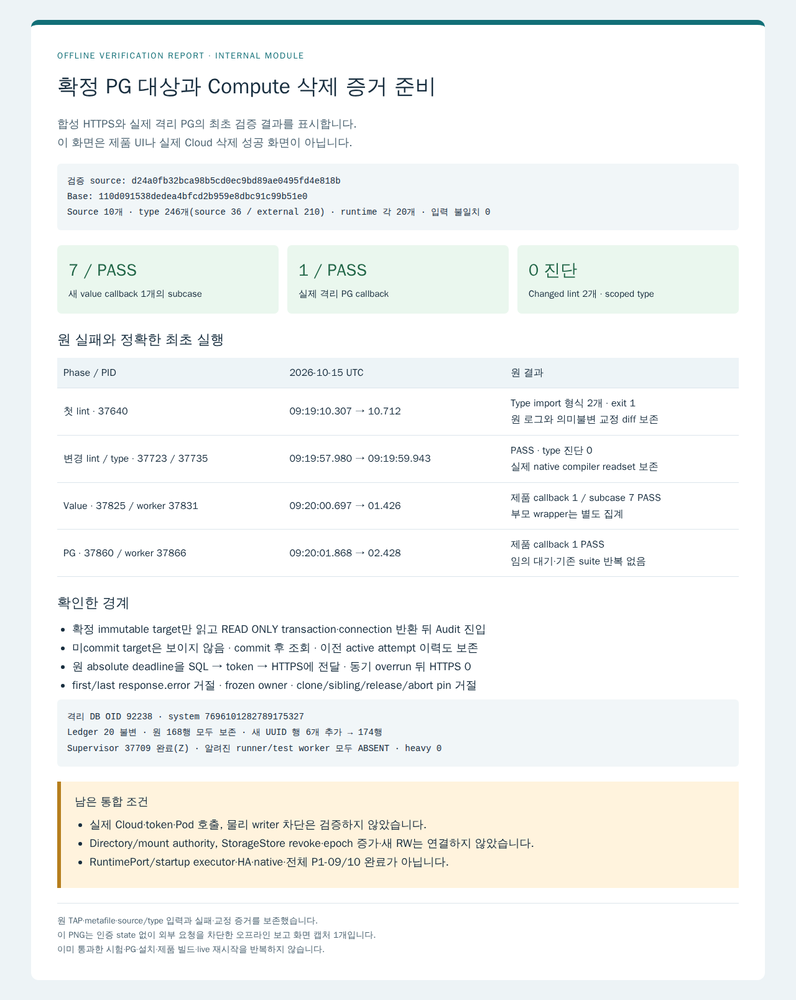

# Compute stop evidence 준비 모듈의 최초 검증

확정 PG execution target과 완결된 삭제 Audit를 private compute lifetime owner로 연결합니다. Read-only transaction과 connection 반환 뒤에만 Audit를 호출하고, abort·단일 monotonic deadline·객체 identity pin을 지킵니다. Startup/Port/StorageStore는 활성화하지 않습니다.

검증 source는 `d24a0fb32bca98b5cd0ec9bd89ae0495fd4e818b`, base는 `110d091538dedea4bfcd2b959e8dbc91c99b51e0`입니다. 공개 head에는 이 제품·fixture 10개를 보존하고 결과 문서만 추가합니다. [정제 결과](verification.json), [정확한 입력 manifest](input-manifest.json), 원 [value TAP](value.tap)·[PG TAP](pg.tap)를 제공합니다.

| 단계 | 실제 결과 |
| --- | --- |
| 최초 lint 10개 | PID 37640, 09:19:10.307–10.712 UTC, type import 형식 2개로 exit 1입니다. 원 로그 SHA와 교정 diff SHA를 보존했습니다. |
| 변경 lint 2개 / scoped type | PID 37723/37735, PASS/진단 0입니다. 실제 compiler 입력 246개는 source 36개·외부 210개입니다. |
| 최초 value | Runner 37825/worker 37831, callback 1개·subcase 7개 PASS입니다. TAP 9개에는 wrapper 부모와 제품 callback을 각각 별도 집계합니다. |
| 최초 격리 PG | Runner 37860/worker 37866, 제품 callback 1개 PASS입니다. TAP 2개 중 하나는 wrapper 부모입니다. |

격리 DB OID 92238/system 7696101282789175327의 ledger 20을 바꾸지 않았고 원 168행을 보존했습니다. Fixture 새 UUID 행 6개만 추가해 174행이 됐습니다. 미commit target의 비가시성, commit 후 조회, connection 반환 뒤 합성 Audit 진입, 이전 target의 이력과 owner cleanup을 확인했습니다. Actual runtime 입력은 각 20개, type source는 36개이며 Git pin 대조 불일치 0입니다. Wrapper는 원 assertion body를 유지하며 actual metafile을 guard 전에 보존했습니다.

Root가 독립 리뷰로 채택한 `responseShape.errorPresent` 거절 guard와 원 absolute deadline 전달만 기존 Audit dependency 2개에 추가했습니다. Root가 source로 지적한 release fixture는 자기 owner의 target/stop pin true를 확인한 뒤 release 두 번 이후 같은 객체 pin false/accessor null을 확인하도록 교정했습니다. 최초 실행의 import 교정은 의미불변입니다. 원 성공 suite·schema·DDL·type·value·PG를 반복하지 않았습니다.

알려진 supervisor 37709는 Z, runner와 실제 test worker는 모두 ABSENT였습니다. 아래 PNG는 [정적 결과 HTML](report.html)을 기존 원격 Browser에서 인증 state·외부 요청 없이 한 번 렌더한 **오프라인 결과 보고 화면**입니다. 제품 UI나 live Cloud 성공 화면이 아닙니다. 실제 PID·UTC·hash·종료는 [캡처 provenance](report-provenance.json)에 기록합니다.

이 모듈은 directory/mount topology authority를 발급하지 않으며 StorageStore.confirmRevocation, epoch 증가, 새 RW, RuntimePort.fence/startup executor를 호출하지 않습니다. 실제 Cloud·token·Pod·writer fencing·G-04 단절/복귀·provider·HA·native·전체 P1-09/10은 미검증입니다. 공개/배포/전체 완료 판정과 merge는 Root가 맡습니다.

아래 계약의 과거 ‘현재 source-only’·명세의 상태 문장은 당시 계약 이력입니다. 이번 실제 결과와 남은 범위는 위 표와 verification.json을 기준으로 구분합니다. 승인된 COMMON 전문은 변경하지 않았습니다. Root 계약의 비공개 리뷰 위치 2곳만 공개 일반화했습니다.

## Root 실행 계약 전문

# P1-09/10 — 확정 execution target과 Compute 삭제 Audit의 준비된 증거

Root 결정 · 2026-10-15. Base `110d091538dedea4bfcd2b959e8dbc91c99b51e0`. 기존 Backend Sol6.1/high를 재사용한다. Root가 정본 §11–12, P1-09/10, runtime/storage evidence와 store, execution-target-records·020 migration·DB connection, 삭제 Audit client/types/transport 및 physical wiring 사실표를 읽고 정했다. 제품 physical executor/startup/Storage 전체 authority는 아직 없다. 이번 작업은 그 중 확정 대상과 삭제 증거를 연결하는 private boundary다.

## 소유와 신뢰 경계

신규 `src/main/durable-runtime/runtime/compute-stop-evidence*.ts` 및 전용 value/PG fixture만 소유한다. 기존 record/audit 모듈을 재사용하며 SQL schema·공용 Port/brand/interface·StorageStore·controller/startup·public RPC·provider·패키지/lockfile은 변경하지 않는다. 기존 파일의 실제 결함이 드러나면 root에 근거를 반환한다.

### 2026-10-15 09:12 Root 독립 리뷰 채택

DB 리뷰 `<private-independent-review>` SHA68df9545504382714ef81da8879295d986b1a7088206dd016dfd1548a466072a의 조건부 P1을 root가 projection/parser와 직접 대조했다. Projection은 response.error 존재를 이미 보존하지만 deletion parser는 이를 검사하지 않아 top-level status0·first/last가 맞으면 명시적 operation 오류도 완료로 반환할 수 있다. 실제 Cloud에서 이 모순 조합이 관측됐다는 뜻은 아니다. Private proof로 승격하기 전에 차단해야 한다.

같은 Backend의 소유에 `compute-deletion-audit-parser.ts`의 좁은 guard를 추가한다. 원 projected `responseShape.errorPresent`가 true인 entry는 기존 `UNCONFIRMED/STATUS_NOT_OK`로 거절한다. 오류 객체의 내용·토큰·raw response를 반환하거나 새 DTO/schema를 추가하지 않는다. 새 compute-stop value fixture 안에서 first 또는 last에 error가 있는 응답이 proof0/AUDIT_REJECTED임을 확인한다. 올바른 기존 성공 입력의 digest와 parser/transport 구현은 이 guard 외 변경하지 않고 기존 전체 성공 suite를 반복하지 않는다. Source delta와 원 리뷰 근거를 최종 PR에 기록한다.

### 2026-10-15 09:13 Root source 리뷰 — 남은 기한의 하위 전달

Root가 early7552 제품5와 기존 Audit observe/transport 원문을 읽었다. 현재 budget.signal만 전달하면 PG 뒤 Audit client가 새 timeout을 시작한다. Token supplier가 동기적으로 event loop를 점유해 outer 기한을 넘기면 outer timer가 아직 실행되지 않은 동안 하위 client가 HTTPS에 진입할 수 있다. 결과를 나중에 TIMEOUT으로 바꾸는 것만으로 효과 진입을 막았다고 할 수 없다.

같은 Backend의 소유에 `compute-deletion-audit.ts`를 추가한다. 기존 내부 observe에 선택적인 trusted absolute monotonic deadline을 전달할 수 있게 하고, 새 기한을 기존 로컬 기한과 min해 기존 readComputeAuditPage의 absoluteDeadline 인수에 그대로 전달한다. 기존 호출의 기본 동작·DTO는 유지하며 외부 RPC 인수를 추가하지 않는다. ComputeStopBudget의 원 절대 기한을 이 경로에 전달해 token 전후·HTTPS 진입 직전·최종 반환 검사가 같은 상한을 쓰게 한다. Signal abort도 유지한다. 새 fixture는 PG에서 일부 시간을 소비한 뒤 bounded synchronous token overrun이 timer callback 실행 전 끝나도 HTTPS0/owner0/TIMEOUT임을 확인한다. 무기한 busy-loop나 실제 token/network는 쓰지 않는다. 이 두 기존 dependency 수정은 원 불변 조건의 명시적 예외다.

Factory는 서버 소유 pool, 고정 datasetName/clusterIdentityRef/namespace/projectId/projectNumber, timeout, 기존 ComputeAuditTransportConfiguration을 받는다. 원 pool.connect·token/transport receiver와 설정 scalar를 생성 시 capture한다. Factory 안에서 기존 삭제 Audit client를 만든다. Fixture는 이 trusted composition의 Pool/HTTPS seam으로 가짜 I/O를 넣되 fixture 성공을 live 인증 증거로 표시하지 않는다. 요청은 RuntimeUnit ID, 기존 ExecutionTargetKey, bounded Audit start/end와 AbortSignal만 받는다. 요청으로 raw observation/proof/target/URL/filter/token/provider config를 받지 않는다.

## 준비 순서

1. 첫 await 전에 요청과 설정을 scalar로 capture·validate한다. counter/UUID/텍스트/canonical uint64·timestamp 규칙은 기존 검증을 재사용한다. getter 값을 spread 후 다시 읽지 않는다. 하나의 monotonic deadline이 Pool 대기·SQL·Audit·최종 검사를 포함한다. caller abort·timeout 뒤 효과 진입/늦은 결과 publish는 금지한다.
2. Factory 소유 pool에서 별도 connection/READ ONLY transaction을 얻어 dataset_metadata가 정확히 하나이고 고정 dataset인 것을 확인하고 `readExecutionTarget`으로 exact key를 읽는다. caller의 borrowed/uncommitted transaction이나 원 DTO를 증거로 받지 않는다. Unit·cluster/ns·project ID/number·key·canonical numeric instance ID를 검증한다. 원 immutable row와 recordedAt/observedAt/evidence refs/digest를 보존한다. 이력 row는 020의 UPDATE/DELETE 금지로 불변이며 현재 active attempt만 강제하지 않는다(옛 writer 회수에 필요).
3. SQL transaction이 종료되고 connection이 반환된 뒤에만 Audit를 호출한다. 네트워크를 기다리는 동안 DB lock/connection을 보유하지 않는다. SQL 실패/timeout/abort는 fail closed이며 소유 connection은 rollback/release 또는 손상 시 destroy한다. Pool connect가 뒤늦게 반환돼도 반드시 반환/폐기하고 Cloud로 진행하지 않는다. 성공처럼 먼저 반환한 뒤 백그라운드 SQL/Cloud를 계속 실행하는 구조는 금지한다.
4. 조회 scope의 zone/name/numeric ID는 오직 저장된 row에서 만든다. 기존 client의 완결된 `DELETE_OPERATION_COMPLETED`만 허용한다. identity 전필드·producer·first/last·operation/evidence digest, 요청 window와 target observedAt 이후 완료를 대조한다. INCOMPLETE/UNCONFIRMED/NOT_OBSERVED/HTTP·TLS·timeout 등은 proof를 발급하지 않는다. Pod 부재/Compute GET404/STOPPED만으로 성공시키지 않는다. 재조회·pagination·retry는 없다.
5. 성공은 exact PG target과 검증된 완료 삭제 operation에 묶인 deep-frozen `ExecutionTarget`, `ComputeStoppedProof`(`COMPUTE_CONTROL_PLANE`), `VerifiedPermanentComputeStop`(`DELETED_NO_REENTRY`)를 생성한다. 내부 brand assertion이 필요하면 이 실제 검증이 끝난 private 함수 한 곳에만 둔다. Canonical evidence reference/digest는 고정 dataset+원 target tuple/observation digest+삭제 operation·first/last·audit digest에 연결해 재현 가능해야 한다. Credentials/raw response는 보존하거나 로그에 넣지 않는다.
6. 반환한 prepared owner는 기존 StorageEvidenceAuthority 중 `executionTarget/executionTargetPinValid/permanentComputeStop/computeStopPinValid` 네 accessor와 reference 및 idempotent release만 제공한다. accessor는 immutable local object만 반환하며 SQL/FS/network/Promise가 없다. Exact 객체 identity로만 pin을 인정해 clone·다른 owner·다른 tuple/reference를 거절한다. release/abort 뒤에는 null/false다. 완료된 VM 삭제와 immutable record가 이 compute lifetime 증거의 근거이며 directory/mount topology pin을 발급한 것으로 표시하지 않는다. 나머지 authority를 가짜 null stub으로 채운 완전한 Storage authority를 내보내지 않는다.
7. 이 모듈만으로 StorageStore.confirmRevocation, epoch 증가, 새 RW, RuntimePort.fence/startup executor를 호출하거나 활성화하지 않는다. 실제 directory/mount authority 및 G-04 단절·복귀 경계는 남는다. 동일 이름의 새 VM은 다른 numeric identity이며 옛 proof로 그 VM을 차단했다고 표시하지 않는다.

## 첫 납품과 검증

지금은 source/fixture 작성 heavy0이다. 조기 commit·정확한 소유 diff·입출력/오류·자원 cleanup 경계를 먼저 제출한다. 새 구현 계획을 쓰지 않는다. Root source 리뷰 뒤 최초 변경 lint/좁은 type/value 및 실제 PG callback을 배분한다. 기존 성공 Audit parser/transport/PR92 전체 suite는 반복하지 않는다.

의미 있는 value 묶음은 (a) scope/target 완전일치와 stable evidence reference/frozen identity, (b) missing/uncommitted/다른 dataset·Unit/key·project·numeric ID 거절과 Cloud0, (c) incomplete/unsuccessful/다른 삭제 operation 및 시간경계 실패와 proof0, (d) Pool/원 method receiver·입력 mutation·단일 getter capture, (e) 각 await/late result/동기 overrun의 deadline·abort와 cleanup, (f) fabricated/clone/다른 owner/release/abort pin 거절이다. 모든 조합을 중복 suite로 늘리지 말고 경계별 필요한 경우만 묶는다.

PG 검증은 기존 DB worker 격리 DB의 ledger20/read-only 증거 경로와 조율한다. Fixture setup만 별도 새 UUID 행으로 하며 원행/schema/ledger/reset/실제 orca_dev 변경은 없다. 별도 미commit target이 reader에 보이지 않고 commit 뒤에 보이며 DB connection 반환 후에만 가짜 Audit가 시작되는 것을 확인한다. Cloud·실제 token·live Pod·fencing·source sync는 아직0이다.

PR에는 계약·P1-09/10 COMMON·실제 변경/원 실패/정확한 실행 입력/좁은 검증·실제 결과 보고 PNG와 남은 합류 조건을 담는다. 실제 UI가 아닌 내부 모듈 보고 화면은 그렇게 표시한다. 성공시험·설치·전체 빌드 반복0, 동결 template/backup 보호, TTL 제외, native9+root/bridge11·heavy최대2, 단계 종료 원문/worklist와 usage 원오류 직접 보고 규칙을 유지한다.

## 2026-10-15 09:16 Root source 수락·첫 검증 배분

Root가 early7552 제품5 전문, 56afb3c50e8d3e94a80de2b19d5d0ee4eb247bfc의 기존 dependency2/owner type delta와 fixture3 전문, 기존 020/FK와 Audit fixture/transport를 직접 읽었다. Response.error guard와 원 absolute deadline 전달을 source 범위로 수락한다. 실제 Cloud·실제 writer 수락은 아니다.

첫 value case의 release 검증 한 곳은 sibling이 아닌 첫 owner의 stopped 객체를 검사해 release 전에도 false인 비교였다. 같은 worker는 sibling 자신의 stopped/target을 release 전에 capture하고 자신의 pin true를 확인한 뒤, release 두 번 이후 그 동일 객체의 두 pin false/accessor null을 확인하도록 좁게 고친다. Runtime/기존 assertion은 유지하며 exact diff를 보존한다. 이 구체 교정 후 별도 대기 없이 아래 최초 검증을 실행한다.

Backend에 heavy1을 배분한다. 소유10파일 lint, 제품7+새 type fixture의 좁은 type, 새 value callback1(현재 subcase7), 새 격리PG callback1을 한 번씩 수행한다. 기존 cache와 필요한 source/fixture 변환만 재사용하며 전체 build/설치/기존 Audit·PR92 suite/Cloud/live/PNG0이다. 격리 DB는 fixture의 orca_execution_targets_20261015/OID92238/system7696101282789175327/datasetorca-1012-dev-v1/ledger20을 진입 전 읽고 다르면 쓰기 없이 중단한다. ORCA_COMPUTE_STOP_EVIDENCE_APPROVED=root-first-verification, fixture 새 UUID 행만 허용·원행/ledger/reset/schema/livePG변경0이다.

원진단·정확 source와 실제 runtime/type input·skip/callback·PID/UTC/exit·DB identity/원행·소유job종료를 보존한다. 의미불변 lint 교정만 기존 절차대로 바로 수행하고 변경 lint만 확인한다. 의미 실패는 원결과와 최소 제안 diff를 root에 보내며 자동 반복하지 않는다. 성공 검증은 재실행하지 않는다. 첫 결과 뒤 공개 PR/보고 PNG를 root가 배분한다.

## 2026-10-15 09:36 최초 검증 수락·공개 PR 제출

Root가 d24a0fb32bca98b5cd0ec9bd89ae0495fd4e818b의 실제 원 TAP·wrapper 생성문·runtime/type 입력·ledger/원행·PID 종료를 직접 대조했다. Root audit137개가 모두 일치하며 `<private-root-first-review-audit>` SHA32b840c06f74906f4381da4fcf741eadd383c79662b39d17397af7c2f813082a에 보존했다. 최초 lint 형식2실패와 교정 원본은 유지한다. Continuation37709·09:19:57.828–09:20:02.442, 변경lint2 PASS·type진단0(입력246/source36/external210), 새value callback1/sub7 PASS·격리PG callback1 PASS다. Wrapper 부모를 제품 callback 수에 더하지 않는다. OID92238/system7696101282789175327·ledger20불변, 원168행 보존/후174행을 확인했다. 실제 Cloud·물리 writer·전체 P1-09/10 합격은 아니다.

같은 Backend는 제품/fixture source를 보존하고 계약 전문·P1-09/10 COMMON·변경·원 실패/교정·정확한 검증 범위와 실제 결과 보고 화면 PNG1개를 담아 Draft PR을 제출한다. 기존 소유 Browser 환경의 정적 보고 화면 캡처만 허용하며 이를 제품 UI 또는 live Cloud 증거라고 표시하지 않는다. 기존 도구/캐시를 사용하고 설치·제품빌드·시험/PG 재실행·live source sync·서버/Chrome/Metro 재시작은0이다. PNG helper와 실제 결과/해시·소유자원 종료를 남긴다. Source 10개와 public artifact 목록·최종 head·본문 readback/hash·필수 CI를 인계하며 root가 직접 리뷰/merge한다. 단독 보고 캡처는 heavy1 한도로 실행 가능하며 Client 검증1과 합계2를 넘지 않는다. 추가 구현 기획이나 과거 PR queue는 시작하지 않는다.

## P1-09 명세 전문

# P1-09 — Runtime Port·gateway·외부 명령 실행 소유권

상태: 구현 미착수 · 단계: Phase 1 / 착수 묶음 2.
선행: [P1-02](P1-02.md)·[P1-03](P1-03.md).
근거: [1012 정본](../../reference/haagent-20261012/plans/orca-durable-session-snapshot-rpc-spec-20261010.md) §4.2·§8·§12. [공통 계약](COMMON.md)을 적용한다.

## 목적과 수정 경계

중앙 controller와 실행 substrate/provider 사이의 내부 API를 구현한다. 공용 Port/envelope 타입, gateway의 실제 수락·실행 경계, 외부 명령 receipt/조회가 수정 범위다. 공개 앱 RPC를 새로 만드는 작업이 아니다.

## 구현 계약

1. operation ID·controller term·step revision·target Pod UID·execution epoch·intent revision을 명령에 연결하고 실제 명령 수락/실행 경계에서 현재 권한을 검증한다.
2. `ensure`·recovery 계획·`fenceAttempt`·`bind`·`stageInput`·`dispatchInput`·`cancel`·`events`의 §12 계약을 구현한다. 실제 서명은 정본과 현재 소스에 맞춘다.
3. 이미 수락된 외부 명령은 원 identity로 상태/결과를 조회해 새 Active가 인수한다. 반대 명령은 기존 결과를 인수·정리한 뒤 진행한다.
4. K8s 직접 변경도 같은 직렬화와 대상 UID/version 조건을 통과한다. 호출 직전 DB 검사나 완료 CAS만으로 늦은 외부 효과를 차단했다고 주장하지 않는다.
5. STAGED는 payload 준비이며 provider ADMITTED가 아니다. dispatch 결과의 PENDING/ADMITTED/UNKNOWN을 실제 증거에 맞춘다.
6. `events` ACK는 PG에 연속 prefix가 영속 enqueue된 지점이며 consumer 업무 처리 완료와 구분한다.
7. checkpoint/restore/resize/gate의 Phase 2 인터페이스 계약은 표현하되 미구현 capability를 활성화하지 않는다.

## 완료·검증 기준

- V1-09: 명령 수락 뒤 Active 교체, 옛 term 복귀·지연 명령·Pod 이름 재사용에서 stale grant 수락이 0이다.
- 명령 응답 유실 뒤 같은 operation 조회/재시도에서 실제 외부 리소스나 provider 호출을 중복 생성하지 않는다.
- 새로운 Active가 진행 중 operation의 단계·deadline·receipt를 이어받는다.
- DB lease/HTTP fencing과 실제 writer 종료 증거를 구분하고 G-04/P1-10으로 연결한다.

## 산출물·연계

Port/envelope 계약·gateway 변경·외부 receipt/인수 증거를 제출한다. 실제 공유 파일 소유권은 G-01 뒤 root가 확정한다. P1-10/11/12/13과 계약을 고정한 뒤 병렬 작성할 수 있다.

## 병렬 납품 경계

공통 Port/envelope·receipt·fence 서명을 먼저 확정해 넘기고 gateway 구현을 이어간다. P1-10 storage binding, P1-11 provider별 adapter, P1-12 사건 큐는 분리된 파일에서 병렬 작성한다. 공통 타입 변경은 이 작업의 지정 소유자가 반영한다. 계약 공개는 이 ID의 구현 완료나 외부 명령 실행 증거를 대신하지 않는다.

## P1-10 명세 전문

# P1-10 — Storage Binding·RO 다수/RW 하나·실제 fencing

상태: 구현·통합 진행 중 · 단계: Phase 1 / 착수 묶음 2. 최신 모듈·PR·검증·남은 완료 조건은 [실행 현황](../orca-1012-execution-status.md)을 따른다. Canonical/store 모듈과 개별 관측 결과를 실제 writer fencing 전체 합격으로 표시하지 않는다.
선행: [P1-02](P1-02.md)·[P1-09](P1-09.md). 활성화/완료 gate: [G-04](G-04.md).
근거: [1012 정본](../../reference/haagent-20261012/plans/orca-durable-session-snapshot-rpc-spec-20261010.md) §3·§11. [공통 계약](COMMON.md)을 적용한다.

## 목적과 수정 경계

논리 경로나 Agent 이름이 달라도 같은 실제 디렉터리에는 한 writer만 허용한다. 수정 경계는 canonical storage domain 판정, binding/mount registry, grant 전이, 실제 mount/fence 연계다.

## 구현 계약

1. backend·export·canonical directory를 기준으로 보호 범위를 계산한다. alias/symlink와 상하위 디렉터리 중첩을 별개의 안전한 writer라고 취급하지 않는다.
2. 같은 범위의 RO는 여러 개, RW는 최대 하나다. RO 표기뿐 아니라 실제 read-only mount로 쓰기를 막는다.
3. RESERVED→REVOKING→실제 차단 증거→ACTIVE의 소유권 이전을 구현하고 attempt/Pod UID/storage epoch와 증거를 연결한다.
4. Phase 1에서는 이전 Compute 실제 종료 증거 뒤에만 새 RW를 허용한다. DB lease·Pod object 삭제·HTTP fence만으로 완료 처리하지 않는다.
5. 실패/불명은 REVOKING/BLOCKED와 원인으로 보존한다. 새 cold attempt도 같은 차단 조건을 통과해야 한다.
6. storage grant와 logical Session/input lease를 구분한다. 여러 앱의 조회·입력 접수를 writer 수로 제한하지 않는다.

## 완료·검증 기준

- V1-09/G-04: 이전 실행 단절·복귀, alias·상하위 중첩, grant 경합에서 동시 RW가 0이다.
- 여러 RO mount가 공존하며 실제 쓰기를 거절한다.
- stale attempt/epoch의 revoke/종료 결과가 새로운 writer를 잘못 허용하거나 차단하지 않는다.
- 차단 불명/실패 상황에서 새 writer가 열리지 않고 BLOCKED 원인과 재시도 상태가 남는다.

## 산출물·연계

binding/mount 모델과 실제 write/fence 증거를 제출한다. Phase 2의 storage seal·mutation 검사는 P2-02에서 추가한다. 이 작업에서 NFS 메타데이터만으로 프로세스 차단을 추정하지 않는다.

## 병렬 납품 경계

P1-09의 Port/fence 계약 확정 후 storage 파일을 별도 worker에 배분할 수 있다. 공통 gateway/타입은 P1-09 소유자와 순서대로 반영한다. 작성 병렬화와 실제 mount/RW 허용은 구분하며, 어떤 개발 시험에서도 새 writer 허용 전 G-04의 실제 차단 증거가 필요하다.

## 승인 public COMMON 전문

> root 지정 문서의 공개 일반화 사본이다. 요구사항·작업 ID·수용기준은 보존하며 private 원본은 byte-identical로 보존됨과 구분한다. 원본 SHA-256: `9aa08c26af6d7411b818eb9f649f8215b00840f19188e4be61784c8834ce4623`.

# 1012 개별 작업 명세의 공통 계약

작성·계획 책임: root 오케스트레이션 · 2026-10-12. 이 문서는 각 작업 명세에 공통으로 적용한다. 명세 작성 완료와 제품 구현 완료를 구분한다.

## 기준과 적용 순서

- [1012 개정 정본](../../reference/haagent-20261012/plans/orca-durable-session-snapshot-rpc-spec-20261010.md)을 구현 기준으로 삼는다. 파일명의 20261010이 아니라 본문의 2026-10-12 개정이 기준이다. 보존 SHA-256은 `76b52dc79f4ac5fd1274131564aba3cc1d53e1a88b0810fa031ae27ec0dfc200`이다.
- [구현 작업목록](../orca-1012-implementation-worklist.md)의 작업 ID·Phase·의존성을 유지한다. 개별 명세는 작업목록의 완료 기준을 구체화하며 정본을 변경하지 않는다. 불일치를 발견하면 worker는 근거를 보고하고 root가 판정한다.
- 리뷰 판정 (비공개 운영 기록)과 미반영 의견 재검증 (비공개 운영 기록)의 후속 보완을 적용했다. 과거 리뷰의 P1/P2 심각도와 구현 Phase 1/2는 별개다.
- 1011 NFS 공용 인계 문서는 참고 자료다. 옛 작업보드의 완료나 합성 실험 성공을 이 명세의 구현·실기기 합격으로 재사용하지 않는다.

## 현재 문서·저장소 접근 경로

**기존 GKE 클러스터는 삭제됐고 기존 NFS 공유 mount는 현재 없다.** 현재 문서는 이 저장소의 `docs/reference/haagent-20261012/` 로컬 보존본과 이 명세 디렉터리에서 읽는다. 위 정본 링크는 로컬 파일이다.

`<historical-nfs-source>`·`<historical-nfs-source>` 등 보존 원문에 남은 주소는 과거 출처다. 현재 접근할 경로로 사용하지 않는다. private 원본 정본/manifest는 byte-identical로 보존됨을 유지하기 위해 출처 문자열을 덮어쓰지 않는다. 이 public 사본은 운영 정보를 일반화하고 별도 hash로 구분한다. 로컬에 없는 자료가 필요하면 `<protected-operator-backup>`의 보호된 백업에서 필요한 자료의 별도 열람 경로를 마련한다.

아래 구현 계약의 Agent NFS·seal·writer·NFS 장애 시험은 **P1-01의 새 환경 구축 후 수행할 요구**다. 옛 NFS endpoint/export/mount나 옛 테스트 Pod가 현재 살아 있다는 뜻이 아니다. 새 실제 경로는 환경을 구축·확인한 뒤 기록한다.

## 역할과 위임

- 계획 해석·작업 분해·우선순위·파일 소유권·수용기준·최종 완료 판정은 root가 맡는다. 실행 worker는 구체적으로 위임된 코드 작성·실행·검증·증거 기록을 맡는다.
- 모든 실행 worker는 `gpt-6.1-sol` / reasoning `high`다. [운영 규칙](../../../AGENTS.md)과 [템플릿 기록](../../../AGENTS.md)을 따른다.
- 동결 orphan `<frozen-template-id>`, 완료 cutoff `<frozen-template-cutoff>`는 fork source로만 사용한다. 원본의 resume·turn/start·후속 지시·설정/이력 변경은 금지한다. 관련 worker의 재사용만 root가 결정한다.
- 명세에 적은 수정 경계는 논리 모듈이다. 현재 소스별 실제 파일·HEAD는 [G-01](G-01.md)에서 확인하고, root가 위임 전에 수정 가능 파일과 공통 schema/Port의 단일 변경 소유자를 지정한다. 과거 소스 경로를 현재 파일이라고 만들어 쓰지 않는다.
- 선행 ID는 통합 완료에 필요한 조건이다. 공통 계약 확정 뒤 독립 코드는 병렬 작성할 수 있다. G-02~05 등 실제 증거는 해당 기능 활성화 전 조건이며 모든 core 코드 작성을 막는 전역 순환 의존성이 아니다.
- 구체적인 배분은 [병렬 실행 흐름](../orca-1012-parallel-execution-flow.md)을 따른다. 계약 확정·모듈 검증 통과·전체 통합 합격을 구분하고 기존 ID의 최종 수용기준은 유지한다. 중간 산출물을 쓰는 위임에는 해당 revision과 남은 합류 조건을 명시한다. 공용 파일 변경과 동일 원격 환경의 장애 시험은 각각 소유자를 정한다.
- 전체 한도는 root 포함 11개다. bridge가 없으면 실행 worker 최대 10개, bridge가 활성인 경우 최대 9개이며 모든 하위 실행을 합산한다. 각 위임에 작성 착수 계약, 조기 산출물, 최종 통합 선행, 변경 파일 소유자, 시험 환경 점유 범위를 적는다.
- [PR·개발환경 운영 규칙](../orca-1012-pr-development-workflow.md)에 따라 실행 worker는 branch/worktree와 PR로 변경을 제출하고 root가 리뷰 댓글·수정 지시·머지를 맡는다. 작업 명세 전문, 실제 변경, 스크린샷과 검증 결과를 PR 본문에 기록한다. 기반 준비 후 사용자 최종 시작 명령 전에는 P1/P2 기능 구현을 시작하지 않는다.

## 항상 지킬 제품 계약

1. 기존 iPhone/Mac 공개 RPC·strict schema·ID·인증 의미를 유지한다. 미검증 capability를 광고하거나 가짜 provider ID를 만들지 않는다. 새 Dashboard HTTP API와 앱 RPC를 구분한다.
2. PostgreSQL이 논리 객체·입력·receipt·operation·사건의 정본이다. durable commit 전에 성공 ACK를 보내지 않는다. PGDATA/WAL은 Agent NFS와 분리하며 단일 PG의 가용성·영구 손실 한계를 명시한다.
3. 원 Input Component·본문·첨부·receipt를 보존한다. 자체 합산 byte/token/개수 quota, 자동 분할·요약·삭제를 추가하지 않는다. 실제 wire/provider/저장소 오류는 기존 계약으로 정직하게 처리한다.
4. 입력 접수, provider 수락, 완료, 외부 효과 확인은 서로 다르다. PTY write는 provider 수락 증거가 아니다. 외부 효과가 불명확하면 UNKNOWN을 보존하며 임의 재실행·정확히 한 번 실행 보장으로 대체하지 않는다.
5. 취소 의도와 실행 결과를 분리한다. 취소된 UNKNOWN의 과거 미완료 자동 계속을 금지하고 새 독립 입력을 허용한다. 취소/UNKNOWN/실패 이력만으로 wake하지 않는다.
6. `session_fence`, `execution_epoch`, `controller_term`, `storage_epoch`를 분리한다. 옛 실행 차단은 실제 명령 경계와 Compute/스토리지 증거로 확인한다. DB lease나 Pod object 부재만으로 차단 완료를 선언하지 않는다.
7. 같은 실제 디렉터리 범위의 RW는 하나, RO는 여러 개다. 여러 클라이언트의 조회·Chat 접수와 raw Terminal input lease를 혼동하지 않는다.
8. Agent는 1 Runtime Unit/Node, memory limit 필드 생략, CPU limit 미설정 원칙을 유지한다. 실제 admission·배치·예산으로 검증하고 별도 Orca node-headroom gate를 추가하지 않는다.
9. Phase 1은 cold native resume·reactive OOM 증설·안전한 자동 축소를 포함한다. Snapshot과 live 선제 증량은 Phase 2다. 추가 자동 계속 정책 [U-01](U-01.md)과 과거 DB 복원 자동화 [C-01](C-01.md)를 Phase 1의 새 필수 gate로 만들지 않는다.
10. 새 dataset epoch로 시작하며 기존 개발 데이터 이관기는 만들지 않는다. 계정 자격·공유 인프라·관리 VM/백업·동결 템플릿을 보존한다. 대체 경로가 검증된 뒤 해당 구경로를 제거한다.

## 자원 정책의 초기 기본값

아래는 versioned policy의 초기값이다. 새 환경의 실제 적용값이나 조정 불가능한 상수라는 뜻이 아니다. 정책 변경은 revision과 실제 admission/workload 증거로 추적한다.

| 항목 | 계약 |
|---|---|
| R·P·B | R은 대상 container의 실제 admitted memory request, P는 해당 container에 귀속된 유효 관측 peak, B는 검증된 최소/시작 필요량. Pod 총량을 container peak로 혼동하지 않는다. Phase 2에는 B에 실제 복원 필요량도 반영한다. |
| 증설 | `round_up_profile_step(max(2×R, 1.25×P))`, P가 없으면 2×R. effective cap 내 target>R일 때만 적용한다. |
| cap·예산 | 기본 cap 16Gi, 더 낮은 실제 정책/예산 우선. growth budget은 `ceil(log2(effective_cap/minimum_request))`; episode와 Runtime Unit rolling 24h 예산을 함께 지킨다. replacement budget은 growth budget+3. |
| 안정화 | 영향 작업 완료/명시 해결과 실제 활동 30분 OOM 없음으로 episode를 안정화한다. Ready/idle만으로 초기화하지 않는다. OOM 후 learned floor 24h 보호. |
| 저사용 | 같은 workload profile에서 최근 24h 안 실제 활동 60분, peak≤0.5×R. 초기 표본 간격 15초, coverage≥95%, 공백>60초인 창 제외. 한 창은 한 번만 사용한다. |
| 축소 | `round_up_profile_step(max(0.75×R, 1.30×P, B))`, minimum≤target<R. 한 번 최대 25% 감소. 256Mi 이상 64Mi 단위, 미만 1Mi 단위이며 검증된 minimum을 정확한 끝점으로 포함한다. |
| 보호·rollback | 축소 간 60분+새 관측 창, OOM 후 24h 보호. 영향 작업 완료와 실제 활동 60분 안정화 전 축소 실패에는 직전 정상 크기로 별도 1회 rollback. 실패한 workload profile의 추가 축소를 24h 금지한다. |

## 검증과 완료 증거

제품 빌드·런타임·provider 시험은 Sol worker가 원격 테스트 Pod/빌드 환경에서 수행한다. 오케스트레이션 호스트에서 제품 빌드/런타임 시험을 하지 않는다. Claude/Codex의 사용자 지정 최대 허용·permission-skip 설정은 시작·복구 모두 유지한다.

일상 검증은 원격 backend 개발 서버의 source 갱신·watch/reload와 Expo 개발환경에서 수행한다. 수정마다 이미지/릴리스/desktop 패키지를 다시 빌드하지 않는다. 개발 도구의 필요한 증분 변환은 허용하며, 의존성·native 모듈·배포 경계 변경 등 전체 빌드가 필요한 경우 대상과 이유를 PR에 기록한다. 실제 Expo iPhone 화면을 클릭해 얻은 스크린샷과 backend 응답을 함께 남기고, Expo Web·실제 설치 앱·합성 시험의 증거를 구분한다.

각 작업은 다음을 제출한다. 완료 증거의 실제 경로는 위임 시 지정하고 결과에 기록한다.

- 변경 소스 revision, 기존 patch와 작업 patch의 구분, 실제 수정 파일, build/image digest, schema/policy/config revision.
- 환경·시각·대상 identity·전제 조건, 재현 절차와 기대/실제 결과. 합성 시험과 실제 앱/provider 시험을 분리한다.
- 관련 Session/Message/operation/attempt/Pod UID/epoch/term의 연계, DB commit·receipt·provider/fencing/admission 증거. 본문·장기 인증키를 일반 인프라 로그에 복사하지 않는다.
- 성공뿐 아니라 명세에 지정된 경합·실패·응답 유실·재시작 경계의 결과. 미측정과 미지원, 조건부 제외를 명시한다.
- 실패한 gate, 남은 제한, 통과한 범위와 root의 완료 판정. 코드 작성 완료·원격 검증 통과·배포 완료를 하나의 상태로 합치지 않는다.

필수 invariant는 `accepted-without-row=0`, `duplicate active writer=0`, `stale grant accepted=0`, `closed Tab resurrected=0`이다. 관련 작업은 UNKNOWN 수/최장 나이, queue age/gap, reconcile overdue, replay gap, 자원 desired/admitted/실사용·예산·실패를 기록한다. 이미 통과한 시험은 코드·환경 변경이나 새 실패/미해결 우려가 있을 때만 반복한다.

## 명세 상태 관리

P1/P2 작업의 현재 구현 상태는 모두 미착수, G 작업의 실제 증거는 미확보다. O 작업만 기존 완료 증거가 있다. U-01은 사용자 결정 대기, C-01은 조건부 비활성, P2-10은 선택 기능이다. 각 파일의 계약은 앞으로 충족할 조건이며 성공 결과가 아니다. 완료 판정 시 해당 명세·작업목록에 revision·증거·제한을 함께 기록한다.
