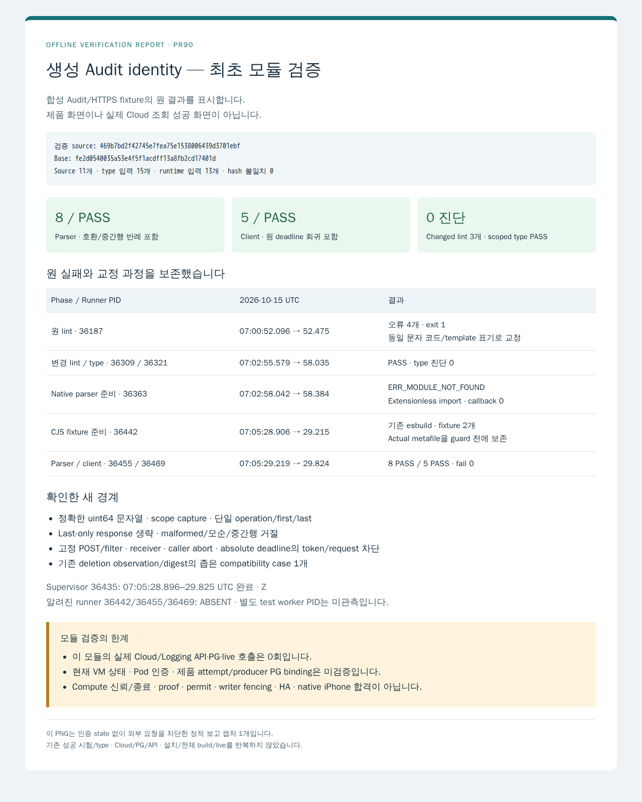

# 생성 Audit identity 모듈의 최초 검증

검증 source는 `469b7bd2f42745e7fea75e1538006439d3701ebf`이며 base는 `fe2d0540035a53e4f5f1acdff13a8fb2cd17401d`입니다. 최초 `bfadfa521411071d9a0cb1c522a560349e43f596` 뒤 Root가 채택한 absolute deadline·last-only response 교정을 `63c0d55373226402f79c36c30b602c8873d9d3e6`에 반영했고, lint 의미불변 교정 뒤 현재 source를 검증했습니다. 공개 head는 이 제품/fixture 11개에 보고 문서만 추가합니다. [Root 첫 결과 수락](https://github.com/hongseok-lee/orca-1012-runtime/pull/90#issuecomment-6186766457)은 원 자료 44개 대조의 일치를 기록합니다.

[정제 결과](verification.json)와 [source 11개·type 15개·runtime 13개·설정 hash](input-manifest.json)를 제공합니다. 원 parser/client TAP는 [parser.tap](parser.tap)·[client.tap](client.tap)에 byte 그대로 보존했습니다. 두 callback 묶음은 각각 8개·5개 PASS이며, 실제 Cloud 조회가 아닌 합성 모듈 fixture입니다.

| 단계 | 원 결과 |
|---|---|
| 첫 lint | PID 36187, 오류 4개, exit 1. 원 로그 hash를 보존했습니다. |
| 변경 lint와 scoped type | PID 36309/36321, PASS/진단 0. 정규식과 문자열 표기만 의미불변 교정했습니다. |
| Native 준비 | PID 36363, extensionless import의 `ERR_MODULE_NOT_FOUND`, callback 0. 원 TAP를 보존했습니다. |
| 좁은 CJS 준비 | PID 36442, 기존 esbuild API로 fixture 2개 준비. Actual metafile/입력을 guard 전에 저장했고 mismatch 0입니다. |
| Parser/client | PID 36455/36469, 07:05:29.219–29.824 UTC, 8 PASS/5 PASS, exit 0입니다. |

알려진 최종 supervisor 36435는 Z, runner 36442/36455/36469는 ABSENT였습니다. 별도 test worker PID는 독립 관측하지 않았습니다. 성공한 lint/type은 CJS 준비 뒤 반복하지 않았습니다. 보고 납품에서도 시험/type/Cloud/PG/API/install/whole build/live를 반복하지 않습니다.

아래 PNG는 [정적 HTML 보고서](report.html)를 기존 Browser 도구로 렌더한 **오프라인 결과 보고서**입니다. 제품 화면이나 실제 Cloud 성공 화면이 아닙니다. 인증 state 없이 요청을 차단하며 PNG 1개만 생성합니다. [캡처 provenance](report-provenance.json)에 실제 PID·UTC·HTML/PNG hash·크기·종료를 기록합니다.

Root가 별도로 수락한 G03 원 생성 Audit 관측과 이 합성 parser/client 검증은 다릅니다. 이 결과는 현재 VM 생존/종료·Pod 인증·제품 PG attempt/producer binding·Compute 신뢰 identity·VerifiedWorkloadIdentity·ComputeStoppedProof·permit·writer fencing·HA·native iPhone 합격이 아닙니다. 새 proof나 권한을 발급하지 않습니다. 원 실패는 새 성공으로 덮어쓰지 않으며, 최종 수락·Draft 해제·merge는 Root가 맡습니다.
