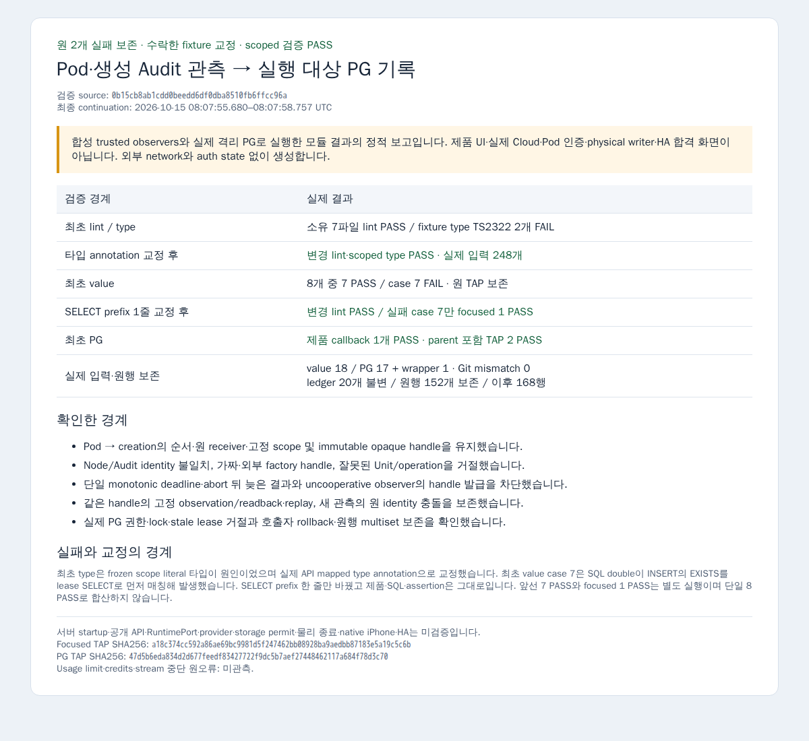

# 실행 대상 관측 composition — 모듈 납품

Pod authenticator의 관측과 Compute creation Audit identity를 순서대로 확인한 뒤, factory별 opaque handle로 기존 PG 실행 대상 기록에 연결합니다. 외부 관측은 transaction 밖에서 끝내며 `record`는 외부 I/O 없이 기존 권한·잠금·immutable record 경계를 사용합니다. 서버 startup·공개 HTTP·RuntimePort에는 배선하지 않습니다.

검증 pin은 `0b15cb8ab1cdd0beedd6df0dba8510fb6ffcc96a`이며 지정 main `2efede71206417f2d77f608025e0758a56a41108`에 1회 정렬한 source는 `9ba7bdba48e307604dfadf820555b390c1ef69e7`입니다. 소유 7파일의 blob·mode와 전이 source 38개의 내용은 대조됐습니다. Type 통과 pin은 `fac1538ff427bfda92b37f793c5fefce8bfcb2bf`이며, 이후 SQL double의 SELECT prefix 1줄은 변경 lint 및 focused case 7로 확인했습니다. 성공 시험·type·PG·schema를 정렬 때문에 반복하지 않았습니다.

| 단계 | 실제 결과 |
|---|---|
| 최초 lint | 소유 7파일 PASS |
| 최초 type | fixture literal 타입 TS2322 2개 FAIL; 제품·외부 진단 0 |
| 타입 annotation 교정 후 | 변경 helper lint 및 scoped type PASS; 실제 입력 248개 = source 38 + external 210 |
| 최초 value | 8개 중 7 PASS / case 7 FAIL; 원 TypeError·TAP 보존 |
| SELECT prefix 1줄 교정 후 | 변경 helper lint PASS; case 7만 focused 1 PASS |
| 최초 PG | 제품 callback 1개 PASS; wrapper parent 포함 TAP tests/pass 2 |
| 격리 DB 보존 | ledger 20개 불변; 원행 152개 모두 보존; 이후 총 168행 |

서로 다른 실행의 value 7 PASS와 focused 1 PASS를 단일 실행 8 PASS로 합치지 않습니다. PG의 합성 trusted observer를 실제 Cloud/Pod 인증으로 표시하지 않습니다. `TRANSACTION_LOCAL` 결과는 호출자의 COMMIT 성공을 대신하지 않습니다.

최초 type 실패는 configuration의 literal 타입 추론 때문이며 mapped type annotation만 바꿨습니다. 최초 value case 7은 synthetic SQL double이 원 INSERT의 EXISTS를 lease SELECT로 오인해 발생했습니다. 제품 SQL·assertions·기대값은 바꾸지 않고 SELECT prefix 한 줄만 교정했습니다. 별도의 최초 type input recorder 준비 오류도 원본에 보존했습니다. 원 TAP·전체 type 로그·metafile·wrapper·identity·ledger·원행 hash는 비공개 원자료에 보존했고 공개 TAP은 private stage 경로만 일반화했습니다. [검증 기록](verification.json)의 원 SHA256과 공개 파일 hash를 구분합니다.

[위임 명세 전문](contract.md), [P1-09](../../plans/orca-1012-specs/P1-09.md), [COMMON](../../plans/orca-1012-specs/COMMON.md)을 적용합니다. [실제 입력](inputs.json), [최초 value 실패 TAP](value-first-failure.tap), [focused PASS TAP](value-focused-pass.tap), [최초 PG PASS TAP](pg-first-pass.tap), [타입 교정](fixture-configuration-type.diff), [SELECT 교정](fixture-lease-select.diff)을 함께 제공합니다.

이 PNG는 실제 검증 결과를 정리한 최초 1회 offline 보고 화면입니다. 제품 UI·실제 Cloud·Pod 인증·physical writer·HA 성공 화면이 아닙니다. 외부 요청과 auth state 없이 기존 원격 Playwright 도구로 생성했으며 [provenance](composition-result-report-provenance.json)에 시각·hash·cleanup을 기록합니다.

실제 서버 조립·공개 API·provider·producer 인증·storage permit·물리 종료·native iPhone·HA 통합은 미검증입니다. 이 모듈을 P1-09 전체 완료로 표시하지 않습니다. Root 리뷰 전 Draft를 유지합니다.
