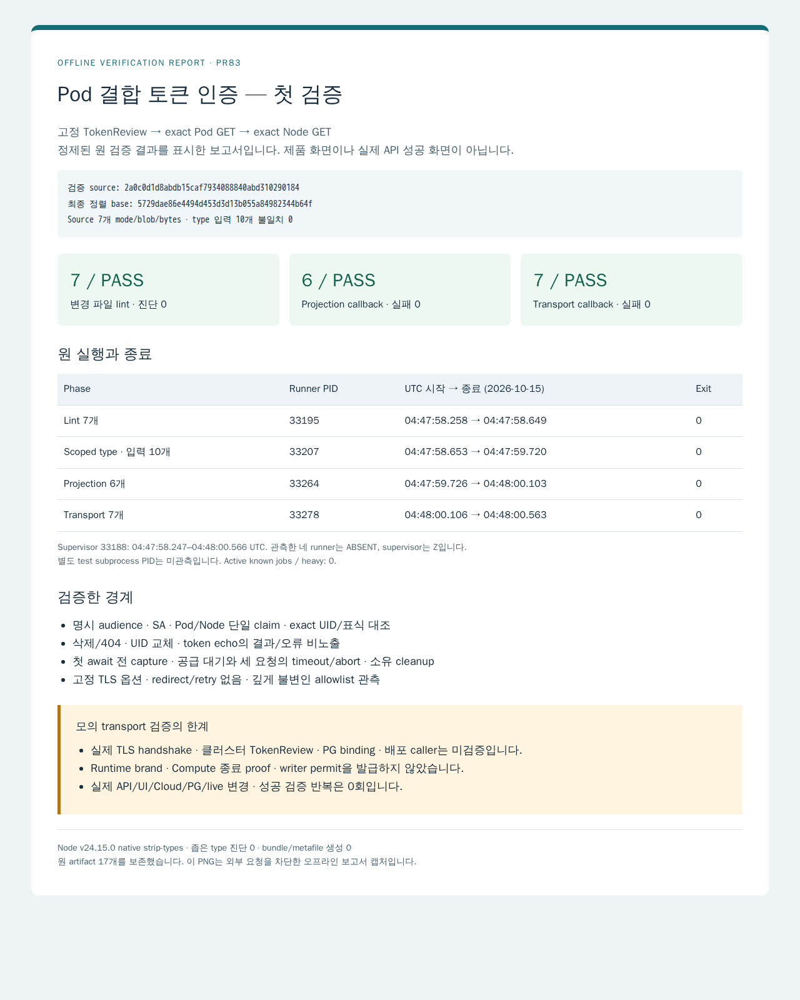

# Pod 결합 토큰 인증 모듈의 첫 검증

검증 source는 `2a0c0d1d8abdb15caf7934088840abd310290184`입니다. Root가 source와 첫 검증을 수락한 뒤 base를 `5729dae86e4494d453d3d13b055a84982344b64f`로 한 번 정렬했습니다. Source 7개의 mode/blob/bytes와 type 입력 10개의 hash는 그대로이며 성공 검증을 반복하지 않았습니다.

[정제 기록](verification.json)은 최초 lint 7개·좁은 type 진단 0·projection callback 6개·transport callback 7개의 통과와 종료를 담습니다. Runner PID 33264/33278과 관측하지 못한 별도 test subprocess PID를 구분합니다. Node native strip-types 경로라 bundle/metafile을 만들지 않았습니다. 원 artifact 17개는 비공개로 보존하며 전체 로그나 credential을 게시하지 않습니다.

아래 PNG는 [정적 HTML 보고서](report.html)를 기존 browser cache로 렌더한 **오프라인 결과 보고서**입니다. 실제 제품 UI·TLS handshake·클러스터 인증 화면이 아닙니다. [출처 기록](report-provenance.json)에 입력과 출력 hash·환경·시각·차단 범위를 기록합니다.

실제 Kubernetes TokenReview/Pod/Node API·credential 발급·RBAC/Pod 변경·Cloud·PG·live·설치/전체 build는 수행하지 않았습니다. 기대 identity의 PG 출처·attempt/incarnation/producer binding·Compute identity/종료·mount pin·실제 배포 caller는 별도 통합 범위입니다. 결과는 현재 Kubernetes 인증 관측이며 RuntimePort identity brand·ComputeStoppedProof·ProviderEffectPermit이나 계속 유효한 실행 권한을 발급하지 않습니다. Draft 해제와 merge는 Root가 담당합니다.
