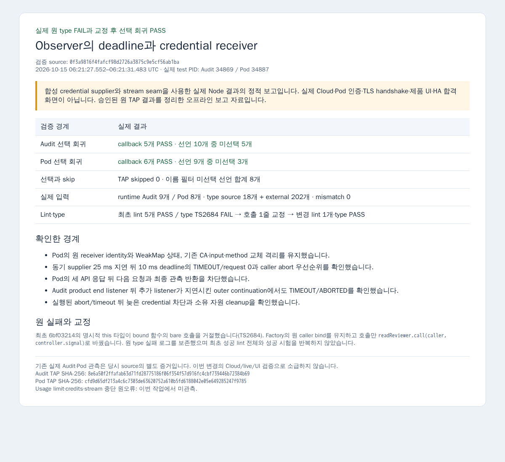

# Observer deadline 및 reviewer receiver 교정

Credential supplier가 동기 작업으로 deadline을 넘겨도 timer 실행 전이면 요청을 시작하던 경계를 교정했습니다. Pod reviewer는 원 caller에 factory 시점에 bind하며, endpoint·CA·scope·timeout snapshot과 caller abort 우선순위를 유지합니다. Audit는 transport뿐 아니라 outer observe의 await 이후와 evaluate/freeze 이후 반환 직전에도 monotonic deadline을 확인합니다.

실제 검증 source는 `0f3a9816f4fafcf98d2726a3875c9e5cf56ab1ba`이며 base는 `c6cb0b9d88389e3325f5a459bdf5eb75f85f0ffd`입니다. 제품 3개와 transport test 2개만 변경했습니다. 공개 RPC·schema·parser/projection·startup·PR87 새 모듈은 변경하지 않았습니다.

첫 source `6bf03214b788d760ca48d4a8bd92baeb9b5313a0`에서 lint 5개는 통과했으나 Pod 호출의 명시적인 `this` 타입 때문에 TS2684가 발생했습니다. 이때 bundle과 test에는 진입하지 않았습니다. 원 caller bind를 유지한 채 호출 한 줄을 `readReviewer.call(caller, controller.signal)`로 바꿨습니다. 변경 파일 lint 1개와 실패한 scoped type만 다시 확인했고, 미진입 선택 case를 최초 실행했습니다.

| 실제 범위 | 결과 |
|---|---|
| Audit transport 선택 callback | 5 PASS / 선언 10개 중 5개 미선택 |
| Pod transport 선택 callback | 6 PASS / 선언 9개 중 3개 미선택 |
| TAP skipped | 두 파일 모두 0; 이름 필터 미선택 선언 8개와 구분 |
| Scoped type | source 18개 + external 202개 = 220개, mismatch 0 |
| Runtime 입력 | Audit 9개 / Pod 8개, mismatch 0 |
| 실행 시각 | 2026-10-15 06:21:27.552–06:21:31.483 UTC |
| 실제 test PID | Audit 34869 / Pod 34887 |

기존 capture의 CA·input·method 교체 격리 assertion을 유지했습니다. 잘못된 frozen-copy receiver 기대만 원 receiver identity와 WeakMap 상태 검증으로 바꿨습니다. 새 regression은 동기 supplier의 25 ms 지연과 10 ms deadline, caller abort 우선순위, Pod의 세 API 응답 이후 다음 요청·최종 관측 차단, Audit product end listener 뒤 outer continuation 지연을 확인합니다. 동기 코드를 선점할 수 있다는 주장은 하지 않습니다.

[verification.json](verification.json)에 원 실패·교정 결과·선택 이름·TAP hash를, [inputs.json](inputs.json)에 정제한 실제 source/type/runtime 입력을 기록했습니다. [report.html](report.html)은 오프라인 결과 보고용 정적 HTML입니다. [원 PNG](observer-result-report.png)와 [원 provenance](observer-result-report-provenance.json)를 그대로 게시하며, [provenance.json](provenance.json)에 촬영·종료 상태를 기록했습니다.

보고 PNG는 2026-10-15 06:34:16.557–06:34:19.106 UTC에 1회 촬영했습니다. Offline context의 요청은 0이고 소유 Node 6511·Chrome 6528은 종료됐습니다. Root가 지정한 최종 base는 `c9bbc5f9f56cfd44f9a92280f93b4b1edec3e2e5`입니다. 실제 credential·TLS handshake·Cloud API·Pod 생성/인증·live source·PG·제품 UI·HA 검증은 이번 범위에서 수행하지 않았습니다. 기존 실제 Audit·Pod 관측은 당시 source의 별도 증거이며 이번 수정의 live 합격으로 소급하지 않습니다. Root가 리뷰·수락·merge를 담당합니다.

