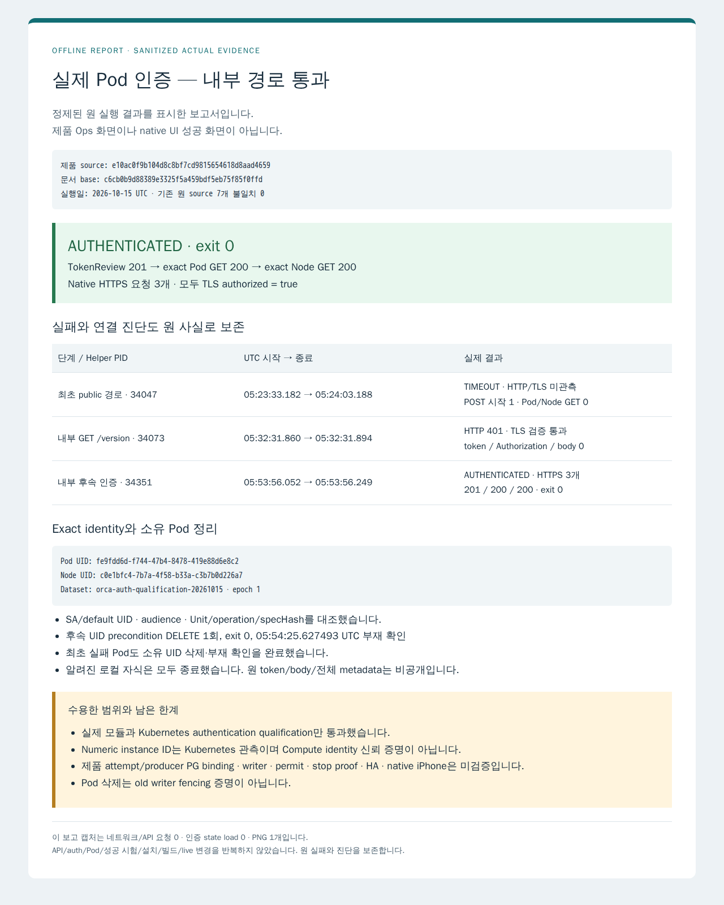

# 실제 Pod 인증의 공개 결과 기록

고정 제품 source는 `e10ac0f9b104d8c8bf7cd9815654618d8aad4659`이고, 이 문서 PR의 base는 `c6cb0b9d88389e3325f5a459bdf5eb75f85f0ffd`입니다. Root가 기존 원 자료와 source 7개를 직접 대조해 수락했습니다. 이 PR은 결과 문서만 추가하며 제품 코드나 실행 환경을 바꾸지 않습니다.

[정제 결과](verification.json)는 다음 세 결과를 각각 보존합니다.

| 단계 | 실제 관측 | 판정 |
|---|---|---|
| 최초 public 경로 | 05:23:33.182–05:24:03.188 UTC, helper 34047의 TokenReview POST 시작 1회, HTTP/TLS 미관측 | TIMEOUT, 인증 성공이나 거절을 입증하지 않음 |
| 내부 연결 진단 | 05:32:31.860–31.894 UTC, helper 34073의 GET `/version` 1회, HTTP 401/TLS 검증 통과, token·Authorization·body 0 | 연결만 확인 |
| 내부 후속 인증 | 05:53:56.052–56.249 UTC, helper 34351의 TokenReview 201 → Pod GET 200 → Node GET 200, 모두 TLS 검증 통과 | `AUTHENTICATED`, exit 0 |

첫 Pod UID `cba426b6-4d19-495b-b0a4-4a130380a399`는 UID precondition DELETE 1회 뒤 05:24:32.290859 UTC까지 부재를 확인했습니다. 후속 qualification Pod UID `fe9fdd6d-f744-47b4-8478-419e88d6e8c2`도 UID precondition DELETE 1회 뒤 05:54:25.627493 UTC까지 부재를 확인했습니다. 두 cleanup은 qualification 정리이며 old writer 차단 증명이 아닙니다.

후속 인증은 exact Pod/Node UID와 SA/default UID, qualification dataset·Unit/operation/epoch/specHash를 대조했습니다. Node UID는 `c0e1bfc4-7b7a-4f58-b33a-c3b7b0d226a7`입니다. Numeric instance ID `5673551603752096986`는 Kubernetes Node annotation의 관측이며 Compute API로 신뢰 identity를 확인한 결과가 아닙니다. 실제 API의 원 body·token·operator 사용자·전체 metadata·controller/helper·승인 파일·kubeconfig는 공개하지 않습니다. [원 자료 연결과 hash](evidence-provenance.json), [공개 일반화한 Root 계약 전문](contracts.public.md)을 제공합니다.

아래 이미지는 정제된 실제 결과를 [정적 HTML](report.html)에 표시한 **오프라인 보고 PNG 1개**입니다. 제품 Ops 화면·native UI 화면이 아닙니다. 캡처는 인증 state 없이 네트워크/API 요청을 차단하며, 실제 API/auth/Pod/성공 시험·설치·빌드·live 변경을 반복하지 않습니다. [캡처 provenance](report-provenance.json)에 실제 PID·UTC·HTML/PNG hash·크기·종료를 기록합니다.

이번 결과는 실제 모듈과 Kubernetes authentication qualification의 통과입니다. 제품 attempt/producer PG binding·배포 caller 통합·Compute identity 신뢰/종료·VerifiedWorkloadIdentity·ComputeStoppedProof·permit·writer fencing·HA·native iPhone은 미검증입니다. 원 public TIMEOUT과 내부 401은 후속 성공으로 덮어쓰지 않습니다. 최종 정렬·Draft 해제·merge는 Root가 담당합니다.
