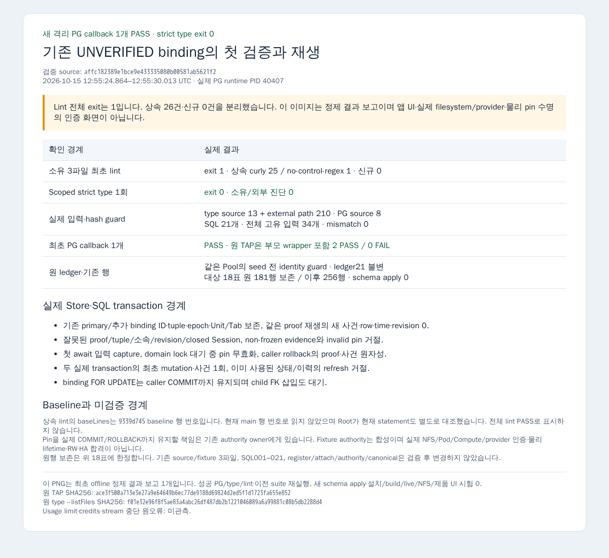

# 기존 UNVERIFIED binding의 최초 검증 — 최초 격리 검증 결과

기존 binding ID·canonical tuple·primary와 공개 객체 연속성을 유지하면서 준비된 directory evidence의 최초 결합과 동일 요청 재생을 처리하는 internal 경로를 작성했습니다. 물리 authority 발급이나 refresh API가 아닙니다.

Base는 `c0ccca1735dfd652765e36cb8cd0171bde10d00b`, 제품 조기 pin은 `25e86fcffe776998469374e78d2569f8e11ceb0d`, 제품·fixture source pin은 `a30d2601587d31f0c35bb761ac2d4ae4394d93d2`입니다. Source diff SHA256은 `78eb250c9297f6bb3a0c91b23c309750d9458181e593559f705bab7c64767a90`이며 [정확한 파일/hash](source-provenance.json), [Root 계약 전문](contract.md), [전체 diff](source.diff)를 제공합니다.

`StorageStore.verifyBinding`의 작은 forwarding 연결과 새 `binding-verification.ts`를 추가했습니다. 기존 event·prepared pin validator를 사용하고 첫 await 전에 DTO의 primitive 값과 query/authority receiver를 capture합니다. Session→Unit→domain lock 뒤 binding을 FOR UPDATE로 재조회하고 별도 statement에서 grant/mount 이력 부재를 확인합니다. Row lock은 caller의 실제 COMMIT/ROLLBACK까지 유지해 child FK 삽입과도 직렬화합니다.

최초 적용은 UNVERIFIED·proof/time NULL·epoch0·writer/seal NULL·grant/mount 이력0·expected revision 일치일 때만 기존 row의 proof/time/state/revision을 CAS합니다. 동일 proof/tuple의 VERIFIED 재생은 현재 revision 또는 현재-1과 같은 미사용 조건을 요구하며 새 사건·row·time·revision을 만들지 않도록 작성했습니다. 신규 성공에만 기존 journal/audit/outbox 경로를 호출합니다. Pin을 실제 transaction 종료까지 유지할 책임은 기존 authority owner에게 있으며 local 검사로 물리 lifetime을 보장하지 않습니다.

기존 register/attach·활성화/fencing·authority 계약·canonical parser·SQL001–021·Catalog/RPC는 변경하지 않았습니다. 기존 Store import의 줄바꿈만 합쳐 forwarding 2행 추가로 원 파일 제한을 늘리지 않았고 suppression은 추가하지 않았습니다.

## 최초 격리 검증 결과

검증 pin은 `affc182389e1bce9e433335080b00581ab5621f2`이며 제품 3파일은 Root가 수락한 `a30d2601`과 같습니다. Base `c0ccca1735dfd652765e36cb8cd0171bde10d00b`를 유지하고 선제 rebase는 하지 않았습니다.

| 항목 | 실제 결과 |
|---|---|
| 소유 3파일 최초 lint | exit 1 · 상속 26건 · 신규 0건 |
| 좁은 strict type 1회 | exit 0 · 소유/외부 진단 0 · source 13개 + external 경로 210개 |
| 새 PG callback 1개 | PASS · 부모 wrapper 포함 원 TAP 2 PASS / 0 FAIL |
| 실제 입력 guard | PG source 8개·SQL 21개 · type/PG/SQL 고유 34개 · mismatch 0 |
| DB 보존 | 같은 Pool seed 전 identity guard 통과 · ledger21 불변 · schema apply 0 |
| 기존 행 보존 | 비교 대상 18표의 기존 181행 보존 / 이후 256행 |
| 최초 정제 결과 보고 PNG | 1개 · offline/network request 0 · 제품 UI 아님 |
| 추가 PG/type/lint·이전 suite·install/build/live/NFS | 0 |
| Heavy 최종 점유 | 0 |

[원 lint](lint.log)와 [진단 분류](lint-classification.json)의 상속 진단은 전체 lint PASS가 아닙니다. `baseLines`는 [9339d745 baseline](lint-baseline-provenance.json)의 행 번호입니다. Root가 현재 main의 같은 statement와 현재 행도 별도로 대조해 초기 감사의 baseline 해석 불일치를 해소했습니다. 원 진단·원자료는 변경하지 않았습니다.

실제 Store·PG로 원 ID/tuple/epoch/primary·Unit/Tab 보존, 같은 proof 재생의 새 사건·row·time·revision 0, 잘못된 proof/tuple/소속/revision/closed Session·prepared shape/pin 거절, 첫 await DTO capture, domain lock 대기 중 pin 무효화, caller rollback, 두 transaction의 최초 mutation/사건 1회, 과거 사용 상태/이력의 refresh 거절과 caller COMMIT까지 child FK 대기를 확인했습니다. 새 schema나 기존 row를 reset/delete하지 않았습니다. 원행 보존은 위 18표에 한정합니다.

[검증 요약](verification.json) · [실제 입력·wrapper provenance](actual-inputs.json) · [공개 정제 TAP](pg.sanitized.tap) · [strict 설정 공개본](scoped-type.public.json) · [PNG provenance](existing-binding-verification-result-report-provenance.json)

Pin을 caller의 실제 COMMIT/ROLLBACK까지 유지할 책임은 기존 authority owner에게 있습니다. 이 fixture의 prepared evidence는 합성이며 실제 filesystem/provider/물리 lifetime·RW·HA 합격이 아닙니다. Live migration/source sync·NFS/provider 시험은 0입니다. Root가 원 검증을 수락했으며 최종 PR 리뷰·수락·merge는 Root가 담당합니다. 이번 turn의 usage limit·credits·stream 중단 원오류는 미관측입니다.
