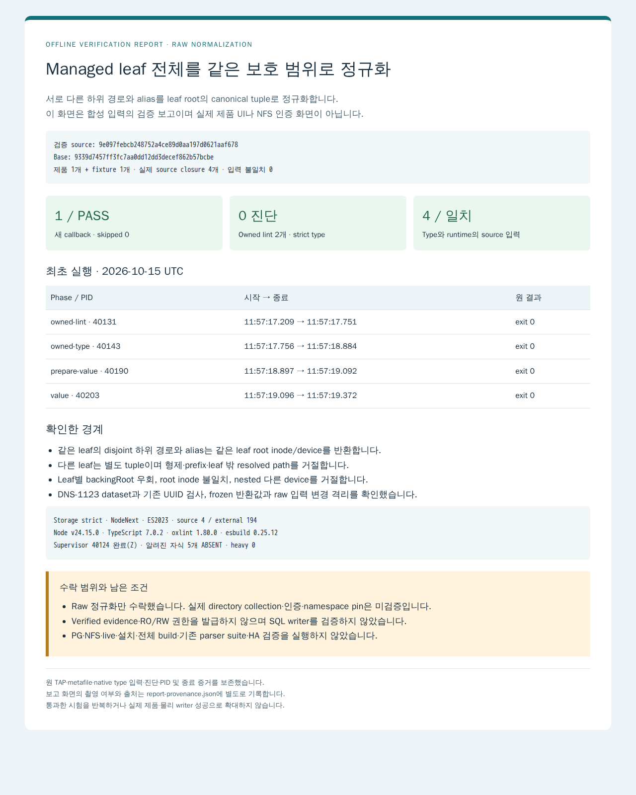

# Managed leaf canonical 검증 결과

새 `canonicalizeManagedLeaf`는 기존 parser의 두 candidate를 검사하고 leaf root의 immutable candidate를 반환합니다. 기존 canonical/Store/evidence/DB bytes는 변경하지 않았습니다.

- 검증 source: `9e097febcb248752a4ce89d0aa197d0621aaf678`.
- Base: `9339d7457ff3fc7aa0dd12dd3decef862b57bcbe`.
- 최초 owned lint 2개는 진단 0, strict type는 진단 0이며 native compiler 입력은 source 4개와 external 194개입니다.
- 새 value callback 1개가 PASS이며 skipped 0입니다. 증분 fixture 변환의 실제 source 입력 4개는 Git pin/hash와 일치합니다. 원 fixture 본문은 변경하지 않았습니다.
- Supervisor 40124는 2026-10-15 11:57:17.192–11:57:19.372 UTC에 exit 0으로 끝났습니다. 11:57:55.979 UTC에 supervisor Z와 알려진 자식 5개 ABSENT를 확인했습니다. Heavy는 0입니다.
- Root는 원 TAP·helper·입력·strict 설정·종료 상태를 audit 30건, 불일치 0으로 대조해 최초 검증을 수락했습니다.

실제 directory 수집·인증·namespace pin·Verified evidence·RO/RW 권한·SQL writer·HA는 미검증입니다. PG/NFS/live/기존 parser suite/설치/전체 build/UI는 실행하지 않았습니다. 최초 보고 PNG 1개를 12:12:09.479 UTC에 촬영했습니다. 외부 요청 0, 인증 state 0이며 context와 browser를 닫았습니다. Supervisor 9125는 Z, helper 9132는 ABSENT이고 heavy 0입니다.

`verification.json`은 정제된 원 결과, `input-manifest.json`은 정확한 source closure와 설정, `value.tap`과 `value.metafile.json`은 원 산출물과 byte-identical입니다. `report.html`은 위 결과만 표시하는 정적 보고 입력이며 `report-provenance.json`에 실제 촬영·hash·PID·종료 상태를 기록했습니다. `verification.json`의 미실행 목록은 11:57의 source 최초 검증 단계 기준이며, 12:12에 오프라인 보고 촬영만 추가했습니다. Private cache/원자료 경로는 공개하지 않고 원 전체 로그와 helper는 비공개 운영 증거에 보존합니다.

아래 실행 계약은 비공개 리뷰 링크 1개만 설명 문구로 일반화했습니다. 승인 public COMMON은 전문 그대로 포함하며 private 정본은 수정하지 않았습니다.

## 실제 오프라인 보고 PNG

PNG SHA-256: `ef062ed37f4224e872f30d609df4edb38634a4b7b1d0f114214c00ba32923e1e`, 214798 B입니다. 실제 앱 UI·NFS 인증·물리 proof 화면이 아닙니다.

## Root 실행 계약 전문

# P1-10 — managed leaf 전체의 canonical write domain

Root 지정 source 계약, 2026-10-15. 기존 Backend Sol6.1/high를 재사용한다. Storage 리뷰 판정 (비공개 운영 기록)의 D1/Claude1을 하나의 변경으로 구체화한다. 계획·수용 결정은 Root가 맡으며 worker는 아래 source/fixture만 작성한다.

## 문제와 고정 결과

현재 canonicalizer는 실제 관측 디렉터리의 상대 경로를 반환한다. 새 managed leaf 안의 서로 다른 두 하위 디렉터리를 각각 binding으로 등록하면 기존 SQL 문자열 중첩 규칙은 별도 RW 영역으로 본다. Managed storage에서는 내용 전체가 하나의 보호 범위이므로 leaf root의 tuple·서버 inode를 반환해야 한다. 기존 일반 canonicalizer와 기존 binding을 바꾸거나 전체 export를 하나의 writer로 합치지 않는다.

새 `storage/managed-leaf-canonical.ts`에 순수 함수 `canonicalizeManagedLeaf(observation, leafObservation, authority, managed)`를 추가한다. 앞의 두 인자는 기존 `DirectoryObservation`, authority는 기존 `DomainAuthority`, managed는 readonly `{dataset: string, leafId: string}`다. 반환은 기존 `CanonicalCandidate`이며 Verified evidence나 pin/권한을 발급하지 않는다. 두 관측은 같은 인증 전 raw server namespace 입력으로 취급하고 실제 collection/authentication/namespace 불변성은 별도 경계임을 명시한다.

1. Dataset은 기존 배포 이름과 같은 canonical DNS-1123 label(1–63자), leafId는 기존 logicalId의 canonical UUID 검사를 사용한다. 관리 root 아래 leaf 주소는 `/<dataset>/<leafId>`로 고정한다. 새 서버 namespace의 physical root는 `/runtime-domains`에 대응할 예정이며 실제 서버 mountpoint `/exports`와 혼동하지 않는다. 이 모듈은 실제경로를생성하지않는다.
2. 기존 canonicalizeObservation을 requested observation과 leafObservation 각각에 적용한다. 같은 authority의 전체 managed export root를 사용한다. leaf candidate의 canonicalDirectory는 위 기대주소와 정확히 같아야 한다. authority.backingRoot를 leaf마다 바꿔 모든 leaf를 `/`로 만드는 입력은 거절한다. 기존 parser/alias/관측일관성 검사를 복제하거나 약화하지 않는다.
3. Requested candidate가 선택된 leaf와 같거나 그 하위여야 한다. 기존 containsPath로 경계를 비교하고 형제 leaf·문자열 prefix만 같은 주소·leaf 밖으로 resolve된 symlink를 거절한다. 같은 서버 Pod/generation/domain/PV 및 device여야 하며 nested 다른 device는 거절한다. 요청이 leaf root 자체라면 inode도 leafObservation과 같아야 한다. 하위 inode가 leaf inode와 다른 것은 정상이다.
4. 반환은 leaf root candidate의 immutable 복사/기존 freeze 결과이며 leaf canonicalDirectory와 실제 root inode/device를 보존한다. 요청 하위 경로/inode를 섞어 새 candidate를 만들지 않는다. 같은 leaf의 두 disjoint 하위 경로는 같은 tuple/sameDirectory이고 다른 leaf는 다른 tuple이다. Raw 입력의 변경으로 반환된 값이 바뀌지 않아야 한다.
5. 잘못된 managed descriptor/leaf mismatch/outside leaf/device mismatch는 기존 StorageError의 안정적 code로 거절한다. 에러에 원경로/본문을 복사하지 않는다. 새 SQL/Store mutation·공개 RPC·physical proof factory·새 브랜드 cast는0이다.

## 소유·검증 경계

Base는 main9339d7457ff3fc7aa0dd12dd3decef862b57bcbe다. 새 source1과 `storage/managed-leaf-canonical.test.mts`만 소유한다. canonical.ts/evidence.ts/store.ts/migration/DB PR98 파일은 변경0이다. 필요하면 source 기준으로 관련 함수의 위치를 읽되 전면 재설계하거나 새 구현목록을 만들지 않는다.

Fixture는 실제 parser를 통과하는 합성 server mountinfo/stat를 사용한다. 한 callback 안에서 (a) leaf A의 disjoint 하위/alias가 같은 leaf root identity, (b) leaf B는 별도 tuple, (c) 다른 leaf·경계 비슷한 형제·leaf 밖 resolved path 거절, (d) leaf별 backingRoot로 `/` 우회·root inode 불일치·다른device 거절, (e) 반환값 불변과 잘못된 descriptor 거절을 확인한다. 기존 canonical parser 전체 suite를 복제하지 않는다. 실제 NFS·authenticated proof·SQL writer 합격으로 표시하지 않는다.

지금은 source/fixture 조기pin/exactdiff와 DraftPR만·heavy0이다. 실행/lint/type/test/PG/원격/NFS/새PNG/build/install0이며 Root source 검토 뒤 기존 remote cache에서 owned lint/type와 새 callback1의 최초 검증만 배분한다. PR은 명세 전문·변경·미실행과 승인 public COMMON을 담고 private 운영주소/세션/원자료를 통째 게시하지 않는다. 최종 실제 결과/스크린샷·merge는 후속 Root 판정이다. 새 usage 원오류만 보고하고 동결template/backup/TTL·옛queue를 건드리지 않는다.

## 조기 source 수락·최초 좁은 검증 — 2026-10-15 11:54 UTC

Root가 PR99 head9e097febcb248752a4ce89d0aa197d0621aaf678의2파일137줄 전체diff252a70af를 읽었다. 함수43줄은기존정규화와containsPath를재사용하며descriptor전체일치·기대leaf·device·rootinode검사후immutable leaf candidate를반환한다. fixture94줄의callback1은위지정경계를검사하며합성raw입력/인증미구현을유지한다.

Backend에 heavy1을 배분한다. 기존 remote Node/oxlint/TS/esbuild cache에서 새2파일 lint1, 기존storage/tsconfig의 strict/NodeNext/ES2023/types=node 옵션을유지하되새2파일만entry인좁은type1, 새fixturecallback1을처음실행한다. 실제 sourceclosure는new2+canonical.ts+shared identity.ts이며그입력의pin/hash/metafile을보존한다. 전체4724파일guard/기존parser suite/PG/네트워크/NFS/설치/build/UI/PNG를추가하지않는다. 필요한증분fixture변환만허용한다. 원진단/실제PID/끝/cleanup을먼저보고하고성공단계를반복하지않는다. 기존DB검증과heavy최대2이며Infra는공개증거준비만한다.

## 최초 검증 수락·공개 준비 — 2026-10-15 12:02 UTC

Root가원valueTAPe20e8f2d·변환helper·source4/metafile/hash·strict NodeNext/ES2023 설정·원진단/cleanup을대조했다. Rootaudit30모두일치1c4425a5다. Control40124는11:57:17.192–19.372 exit0,lint40131/type40143 진단0·type입력source4+external194,value실제40209 callback1 PASS/skip0다. 실제knownchildren5 ABSENT/supervisorZ·heavy0이며원fixture본문은변경하지않았다. Raw 합성정규화만수락하고physical인증/namespace pin/SQLwriter/HA로확대하지않는다.

Backend는동일source2 bytes로정제결과/TAP/provenance 및본문을준비한다. 기존명세전문과후속검증/수락절을유지하고최종필수CI를확인한다. 현재Infra와DB의보고capture가배분돼있어Backend의최초필수보고PNG1은free슬롯Root배분전까지0이다. 새제품실행/시험/PG/NFS/설치/build0·heavy0이다. 현재base9339는독립PR97/98의변경과같은검증입력에겹침이없으면재정렬하지않고Root가finaldiff/merge가능성을확인한다.

## 최초 보고 PNG 배분 — 2026-10-15 12:10 UTC

Infra와 DB의 보고 capture가 끝나 heavy0임을 확인했다. Backend에 기존 원격 Playwright/browser cache를 이용한 현재 정제 HTML의 실제 보고 PNG 1회만 heavy1로 배분한다. 앱 UI·물리 NFS·인증 proof 사진으로 표현하지 않는다. 제품 source2 bytes와 통과한 원 lint/type/value 결과를 유지하며 재시험·PG·NFS·live 변경·설치·build는0이다. 사진 원본/hash/실제 PID·cleanup을 기록하고 공개 사본·provenance·본문·최종 head 및 필수 CI를 제출한다. 마지막 source와 다른 독립 main 변경을 이유로 불필요한 정렬·검증을 반복하지 않는다. 최종 source/본문/PNG/CI 확인과 merge는 Root가 수행한다.

## P1-10 명세 전문

# P1-10 — Storage Binding·RO 다수/RW 하나·실제 fencing

상태: 구현·통합 진행 중 · 단계: Phase 1 / 착수 묶음 2. 최신 모듈·PR·검증·남은 완료 조건은 [실행 현황](../orca-1012-execution-status.md)을 따른다. Canonical/store 모듈과 개별 관측 결과를 실제 writer fencing 전체 합격으로 표시하지 않는다.
선행: [P1-02](P1-02.md)·[P1-09](P1-09.md). 활성화/완료 gate: [G-04](G-04.md).
근거: [1012 정본](../../reference/haagent-20261012/plans/orca-durable-session-snapshot-rpc-spec-20261010.md) §3·§11. [공통 계약](COMMON.md)을 적용한다.

## 목적과 수정 경계

논리 경로나 Agent 이름이 달라도 같은 실제 디렉터리에는 한 writer만 허용한다. 수정 경계는 canonical storage domain 판정, binding/mount registry, grant 전이, 실제 mount/fence 연계다.

## 구현 계약

1. backend·export·canonical directory를 기준으로 보호 범위를 계산한다. alias/symlink와 상하위 디렉터리 중첩을 별개의 안전한 writer라고 취급하지 않는다.
2. 같은 범위의 RO는 여러 개, RW는 최대 하나다. RO 표기뿐 아니라 실제 read-only mount로 쓰기를 막는다.
3. RESERVED→REVOKING→실제 차단 증거→ACTIVE의 소유권 이전을 구현하고 attempt/Pod UID/storage epoch와 증거를 연결한다.
4. Phase 1에서는 이전 Compute 실제 종료 증거 뒤에만 새 RW를 허용한다. DB lease·Pod object 삭제·HTTP fence만으로 완료 처리하지 않는다.
5. 실패/불명은 REVOKING/BLOCKED와 원인으로 보존한다. 새 cold attempt도 같은 차단 조건을 통과해야 한다.
6. storage grant와 logical Session/input lease를 구분한다. 여러 앱의 조회·입력 접수를 writer 수로 제한하지 않는다.

## 완료·검증 기준

- V1-09/G-04: 이전 실행 단절·복귀, alias·상하위 중첩, grant 경합에서 동시 RW가 0이다.
- 여러 RO mount가 공존하며 실제 쓰기를 거절한다.
- stale attempt/epoch의 revoke/종료 결과가 새로운 writer를 잘못 허용하거나 차단하지 않는다.
- 차단 불명/실패 상황에서 새 writer가 열리지 않고 BLOCKED 원인과 재시도 상태가 남는다.

## 산출물·연계

binding/mount 모델과 실제 write/fence 증거를 제출한다. Phase 2의 storage seal·mutation 검사는 P2-02에서 추가한다. 이 작업에서 NFS 메타데이터만으로 프로세스 차단을 추정하지 않는다.

## 병렬 납품 경계

P1-09의 Port/fence 계약 확정 후 storage 파일을 별도 worker에 배분할 수 있다. 공통 gateway/타입은 P1-09 소유자와 순서대로 반영한다. 작성 병렬화와 실제 mount/RW 허용은 구분하며, 어떤 개발 시험에서도 새 writer 허용 전 G-04의 실제 차단 증거가 필요하다.

## 승인 public COMMON 전문

> root 지정 문서의 공개 일반화 사본이다. 요구사항·작업 ID·수용기준은 보존하며 private 원본은 byte-identical로 보존됨과 구분한다. 원본 SHA-256: `9aa08c26af6d7411b818eb9f649f8215b00840f19188e4be61784c8834ce4623`.

# 1012 개별 작업 명세의 공통 계약

작성·계획 책임: root 오케스트레이션 · 2026-10-12. 이 문서는 각 작업 명세에 공통으로 적용한다. 명세 작성 완료와 제품 구현 완료를 구분한다.

## 기준과 적용 순서

- [1012 개정 정본](../../reference/haagent-20261012/plans/orca-durable-session-snapshot-rpc-spec-20261010.md)을 구현 기준으로 삼는다. 파일명의 20261010이 아니라 본문의 2026-10-12 개정이 기준이다. 보존 SHA-256은 `76b52dc79f4ac5fd1274131564aba3cc1d53e1a88b0810fa031ae27ec0dfc200`이다.
- [구현 작업목록](../orca-1012-implementation-worklist.md)의 작업 ID·Phase·의존성을 유지한다. 개별 명세는 작업목록의 완료 기준을 구체화하며 정본을 변경하지 않는다. 불일치를 발견하면 worker는 근거를 보고하고 root가 판정한다.
- 리뷰 판정 (비공개 운영 기록)과 미반영 의견 재검증 (비공개 운영 기록)의 후속 보완을 적용했다. 과거 리뷰의 P1/P2 심각도와 구현 Phase 1/2는 별개다.
- 1011 NFS 공용 인계 문서는 참고 자료다. 옛 작업보드의 완료나 합성 실험 성공을 이 명세의 구현·실기기 합격으로 재사용하지 않는다.

## 현재 문서·저장소 접근 경로

**기존 GKE 클러스터는 삭제됐고 기존 NFS 공유 mount는 현재 없다.** 현재 문서는 이 저장소의 `docs/reference/haagent-20261012/` 로컬 보존본과 이 명세 디렉터리에서 읽는다. 위 정본 링크는 로컬 파일이다.

`<historical-nfs-source>`·`<historical-nfs-source>` 등 보존 원문에 남은 주소는 과거 출처다. 현재 접근할 경로로 사용하지 않는다. private 원본 정본/manifest는 byte-identical로 보존됨을 유지하기 위해 출처 문자열을 덮어쓰지 않는다. 이 public 사본은 운영 정보를 일반화하고 별도 hash로 구분한다. 로컬에 없는 자료가 필요하면 `<protected-operator-backup>`의 보호된 백업에서 필요한 자료의 별도 열람 경로를 마련한다.

아래 구현 계약의 Agent NFS·seal·writer·NFS 장애 시험은 **P1-01의 새 환경 구축 후 수행할 요구**다. 옛 NFS endpoint/export/mount나 옛 테스트 Pod가 현재 살아 있다는 뜻이 아니다. 새 실제 경로는 환경을 구축·확인한 뒤 기록한다.

## 역할과 위임

- 계획 해석·작업 분해·우선순위·파일 소유권·수용기준·최종 완료 판정은 root가 맡는다. 실행 worker는 구체적으로 위임된 코드 작성·실행·검증·증거 기록을 맡는다.
- 모든 실행 worker는 `gpt-6.1-sol` / reasoning `high`다. [운영 규칙](../../../AGENTS.md)과 [템플릿 기록](../../../AGENTS.md)을 따른다.
- 동결 orphan `<frozen-template-id>`, 완료 cutoff `<frozen-template-cutoff>`는 fork source로만 사용한다. 원본의 resume·turn/start·후속 지시·설정/이력 변경은 금지한다. 관련 worker의 재사용만 root가 결정한다.
- 명세에 적은 수정 경계는 논리 모듈이다. 현재 소스별 실제 파일·HEAD는 [G-01](G-01.md)에서 확인하고, root가 위임 전에 수정 가능 파일과 공통 schema/Port의 단일 변경 소유자를 지정한다. 과거 소스 경로를 현재 파일이라고 만들어 쓰지 않는다.
- 선행 ID는 통합 완료에 필요한 조건이다. 공통 계약 확정 뒤 독립 코드는 병렬 작성할 수 있다. G-02~05 등 실제 증거는 해당 기능 활성화 전 조건이며 모든 core 코드 작성을 막는 전역 순환 의존성이 아니다.
- 구체적인 배분은 [병렬 실행 흐름](../orca-1012-parallel-execution-flow.md)을 따른다. 계약 확정·모듈 검증 통과·전체 통합 합격을 구분하고 기존 ID의 최종 수용기준은 유지한다. 중간 산출물을 쓰는 위임에는 해당 revision과 남은 합류 조건을 명시한다. 공용 파일 변경과 동일 원격 환경의 장애 시험은 각각 소유자를 정한다.
- 전체 한도는 root 포함 11개다. bridge가 없으면 실행 worker 최대 10개, bridge가 활성인 경우 최대 9개이며 모든 하위 실행을 합산한다. 각 위임에 작성 착수 계약, 조기 산출물, 최종 통합 선행, 변경 파일 소유자, 시험 환경 점유 범위를 적는다.
- [PR·개발환경 운영 규칙](../orca-1012-pr-development-workflow.md)에 따라 실행 worker는 branch/worktree와 PR로 변경을 제출하고 root가 리뷰 댓글·수정 지시·머지를 맡는다. 작업 명세 전문, 실제 변경, 스크린샷과 검증 결과를 PR 본문에 기록한다. 기반 준비 후 사용자 최종 시작 명령 전에는 P1/P2 기능 구현을 시작하지 않는다.

## 항상 지킬 제품 계약

1. 기존 iPhone/Mac 공개 RPC·strict schema·ID·인증 의미를 유지한다. 미검증 capability를 광고하거나 가짜 provider ID를 만들지 않는다. 새 Dashboard HTTP API와 앱 RPC를 구분한다.
2. PostgreSQL이 논리 객체·입력·receipt·operation·사건의 정본이다. durable commit 전에 성공 ACK를 보내지 않는다. PGDATA/WAL은 Agent NFS와 분리하며 단일 PG의 가용성·영구 손실 한계를 명시한다.
3. 원 Input Component·본문·첨부·receipt를 보존한다. 자체 합산 byte/token/개수 quota, 자동 분할·요약·삭제를 추가하지 않는다. 실제 wire/provider/저장소 오류는 기존 계약으로 정직하게 처리한다.
4. 입력 접수, provider 수락, 완료, 외부 효과 확인은 서로 다르다. PTY write는 provider 수락 증거가 아니다. 외부 효과가 불명확하면 UNKNOWN을 보존하며 임의 재실행·정확히 한 번 실행 보장으로 대체하지 않는다.
5. 취소 의도와 실행 결과를 분리한다. 취소된 UNKNOWN의 과거 미완료 자동 계속을 금지하고 새 독립 입력을 허용한다. 취소/UNKNOWN/실패 이력만으로 wake하지 않는다.
6. `session_fence`, `execution_epoch`, `controller_term`, `storage_epoch`를 분리한다. 옛 실행 차단은 실제 명령 경계와 Compute/스토리지 증거로 확인한다. DB lease나 Pod object 부재만으로 차단 완료를 선언하지 않는다.
7. 같은 실제 디렉터리 범위의 RW는 하나, RO는 여러 개다. 여러 클라이언트의 조회·Chat 접수와 raw Terminal input lease를 혼동하지 않는다.
8. Agent는 1 Runtime Unit/Node, memory limit 필드 생략, CPU limit 미설정 원칙을 유지한다. 실제 admission·배치·예산으로 검증하고 별도 Orca node-headroom gate를 추가하지 않는다.
9. Phase 1은 cold native resume·reactive OOM 증설·안전한 자동 축소를 포함한다. Snapshot과 live 선제 증량은 Phase 2다. 추가 자동 계속 정책 [U-01](U-01.md)과 과거 DB 복원 자동화 [C-01](C-01.md)를 Phase 1의 새 필수 gate로 만들지 않는다.
10. 새 dataset epoch로 시작하며 기존 개발 데이터 이관기는 만들지 않는다. 계정 자격·공유 인프라·관리 VM/백업·동결 템플릿을 보존한다. 대체 경로가 검증된 뒤 해당 구경로를 제거한다.

## 자원 정책의 초기 기본값

아래는 versioned policy의 초기값이다. 새 환경의 실제 적용값이나 조정 불가능한 상수라는 뜻이 아니다. 정책 변경은 revision과 실제 admission/workload 증거로 추적한다.

| 항목 | 계약 |
|---|---|
| R·P·B | R은 대상 container의 실제 admitted memory request, P는 해당 container에 귀속된 유효 관측 peak, B는 검증된 최소/시작 필요량. Pod 총량을 container peak로 혼동하지 않는다. Phase 2에는 B에 실제 복원 필요량도 반영한다. |
| 증설 | `round_up_profile_step(max(2×R, 1.25×P))`, P가 없으면 2×R. effective cap 내 target>R일 때만 적용한다. |
| cap·예산 | 기본 cap 16Gi, 더 낮은 실제 정책/예산 우선. growth budget은 `ceil(log2(effective_cap/minimum_request))`; episode와 Runtime Unit rolling 24h 예산을 함께 지킨다. replacement budget은 growth budget+3. |
| 안정화 | 영향 작업 완료/명시 해결과 실제 활동 30분 OOM 없음으로 episode를 안정화한다. Ready/idle만으로 초기화하지 않는다. OOM 후 learned floor 24h 보호. |
| 저사용 | 같은 workload profile에서 최근 24h 안 실제 활동 60분, peak≤0.5×R. 초기 표본 간격 15초, coverage≥95%, 공백>60초인 창 제외. 한 창은 한 번만 사용한다. |
| 축소 | `round_up_profile_step(max(0.75×R, 1.30×P, B))`, minimum≤target<R. 한 번 최대 25% 감소. 256Mi 이상 64Mi 단위, 미만 1Mi 단위이며 검증된 minimum을 정확한 끝점으로 포함한다. |
| 보호·rollback | 축소 간 60분+새 관측 창, OOM 후 24h 보호. 영향 작업 완료와 실제 활동 60분 안정화 전 축소 실패에는 직전 정상 크기로 별도 1회 rollback. 실패한 workload profile의 추가 축소를 24h 금지한다. |

## 검증과 완료 증거

제품 빌드·런타임·provider 시험은 Sol worker가 원격 테스트 Pod/빌드 환경에서 수행한다. 오케스트레이션 호스트에서 제품 빌드/런타임 시험을 하지 않는다. Claude/Codex의 사용자 지정 최대 허용·permission-skip 설정은 시작·복구 모두 유지한다.

일상 검증은 원격 backend 개발 서버의 source 갱신·watch/reload와 Expo 개발환경에서 수행한다. 수정마다 이미지/릴리스/desktop 패키지를 다시 빌드하지 않는다. 개발 도구의 필요한 증분 변환은 허용하며, 의존성·native 모듈·배포 경계 변경 등 전체 빌드가 필요한 경우 대상과 이유를 PR에 기록한다. 실제 Expo iPhone 화면을 클릭해 얻은 스크린샷과 backend 응답을 함께 남기고, Expo Web·실제 설치 앱·합성 시험의 증거를 구분한다.

각 작업은 다음을 제출한다. 완료 증거의 실제 경로는 위임 시 지정하고 결과에 기록한다.

- 변경 소스 revision, 기존 patch와 작업 patch의 구분, 실제 수정 파일, build/image digest, schema/policy/config revision.
- 환경·시각·대상 identity·전제 조건, 재현 절차와 기대/실제 결과. 합성 시험과 실제 앱/provider 시험을 분리한다.
- 관련 Session/Message/operation/attempt/Pod UID/epoch/term의 연계, DB commit·receipt·provider/fencing/admission 증거. 본문·장기 인증키를 일반 인프라 로그에 복사하지 않는다.
- 성공뿐 아니라 명세에 지정된 경합·실패·응답 유실·재시작 경계의 결과. 미측정과 미지원, 조건부 제외를 명시한다.
- 실패한 gate, 남은 제한, 통과한 범위와 root의 완료 판정. 코드 작성 완료·원격 검증 통과·배포 완료를 하나의 상태로 합치지 않는다.

필수 invariant는 `accepted-without-row=0`, `duplicate active writer=0`, `stale grant accepted=0`, `closed Tab resurrected=0`이다. 관련 작업은 UNKNOWN 수/최장 나이, queue age/gap, reconcile overdue, replay gap, 자원 desired/admitted/실사용·예산·실패를 기록한다. 이미 통과한 시험은 코드·환경 변경이나 새 실패/미해결 우려가 있을 때만 반복한다.

## 명세 상태 관리

P1/P2 작업의 현재 구현 상태는 모두 미착수, G 작업의 실제 증거는 미확보다. O 작업만 기존 완료 증거가 있다. U-01은 사용자 결정 대기, C-01은 조건부 비활성, P2-10은 선택 기능이다. 각 파일의 계약은 앞으로 충족할 조건이며 성공 결과가 아니다. 완료 판정 시 해당 명세·작업목록에 revision·증거·제한을 함께 기록한다.
