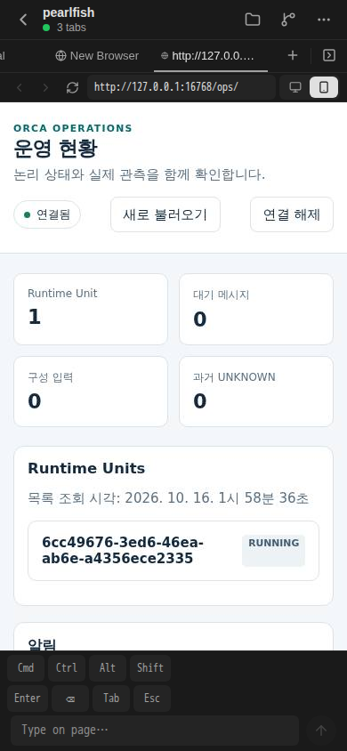

# P1-10 — namespace profile의 논리 domain 최초 등록

새 backend/export로 최초 namespace profile을 등록하면 기존 `registerNamespaceProfile`은 domain 잠금 전에 대상 row가 없어 `LOCK_TARGET_MISSING`으로 실패한다. 같은 기존 transaction에서 정확 backend/export의 domain을 `INSERT ... ON CONFLICT DO NOTHING`으로 먼저 확보한 뒤 원 domain lock·profile/version/audit/outbox 처리를 수행하도록 2줄만 추가했다. 이 domain은 논리 잠금 키이며 물리 directory 자격·VERIFIED binding·writer 권한이 아니다.

고정 기준은 `e036bee08083750345796596d1e330280cd86c3c`다. 제품은 `d3fbc48238d8378b8d6196258e5c9a1c8fa6730b`, fixture 포함 source는 `10aa727fd67c847dfda3b003b778ba4edd10658b`다. 제품 diff는 register 함수의 2줄 추가뿐이며 다른 함수·전역 lock·schema·proof는 변경하지 않았다. 파일 hash와 source 입력은 [source-status.json](source-status.json)에 기록했다.

## 현재 검증 상태와 준비 범위

새 PG callback source 1개, 125줄을 준비했다. 새 domain/profile의 실제 확정 등록, 동일 입력 ALREADY_REGISTERED에서 revision/version/audit/outbox 불변, 같은 profile에 다른 domain을 제시한 scope 충돌에서 전체 rollback과 새 domain 부재를 확인하도록 작성했다. Fixture가 domain을 별도 INSERT하지 않고 제품 함수만 호출한다. 기존 affected 5표의 원행과 ledger23 보존을 확인한다.

지금 lint/type/PG/remote/DDL/collector/설치/build 실행은 모두 0이다. 새 성공 TAP나 actual type/metafile는 아직 없다. 기존 namespace/owner/collector suite와 완료된 PR138 검증은 반복하지 않는다. Backend의 같은 전용 DB 사용 종료 뒤 Root가 최초 집중 검증을 직렬 배분한다.

Fixture 입력은 `ORCA_NAMESPACE_BOOTSTRAP_APPROVED=root-first-verification`, `ORCA_NAMESPACE_BOOTSTRAP_DATABASE`, `ORCA_NAMESPACE_BOOTSTRAP_DATABASE_OID`, 같은 `PGDATABASE`다. 기존 격리 ledger23 DB를 사용하며 실제 DB/system/dataset/OID/backend PID를 같은 Pool에서 등록 전에 확인한다. Live DB나 새 DB/DDL/reset은 허용하지 않는다. 실제 secret 인증 입력은 기존 private 실행 환경에 남긴다.

## 기존 화면의 실제 출처와 한계

기존 Root 수락 PNG는 2026-10-16 01:58:40.109 UTC, Expo Web 390×844이며 SHA256은 `b29541710eabcb20a17eed244cdfce476cc8469353ca8c252a85486746ae0893`이다. Connected·한국어 Ops·닫힌 Unit 카드까지만 확인했다. 이번 최초 domain 등록이나 실제 managed binding·홈 mount·물리 pin·writer fencing·native·HA를 검증한 화면은 아니다. 새 UI 변경이나 재촬영은 없다.

[Root 계약 전문](contract.md)과 P1-10·승인 COMMON을 PR 본문에 담는다. 실제 qualification 판정·검증 배분·수락/merge는 Root가 담당한다. 이번 turn에서 새 usage limit/workspace credits/stream 오류는 미관측이며 소유 원격 job/heavy는 0이다.
