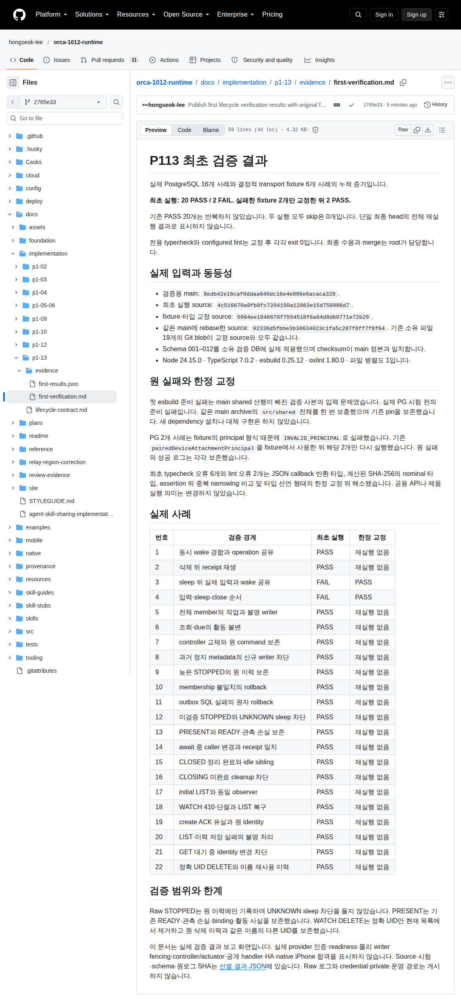

# P113 최초 검증 결과

실제 PostgreSQL 16개 사례와 결정적 transport fixture 6개 사례의 누적 증거입니다.

**최초 실행: 20 PASS / 2 FAIL. 실패한 fixture 2개만 교정한 뒤 2 PASS.**

기존 PASS 20개는 반복하지 않았습니다. 두 실행 모두 skip은 0개입니다. 단일 최종 head의 전체 재실행 결과로 표시하지 않습니다.

전용 typecheck와 configured lint는 교정 후 각각 exit 0입니다. 최종 수용과 merge는 root가 담당합니다.

## 실제 입력과 동등성

- 검증용 main: `8edb42e16caf0ddaa840dc16e4e886e6acaca328`.
- 최초 실행 source: `4c516670a0fb8fc7204150a12863e15d758886d7`.
- fixture·타입 교정 source: `5964ee1846670f7554518f6a64d8db9771e72b29`.
- 같은 main에 rebase한 source: `92336d5fbbe3b30634023c1fa5c287f6ff7f8f64`. 기존 소유 파일 19개의 Git blob이 교정 source와 모두 같습니다.
- Schema 001–012를 소유 검증 DB에 실제 적용했으며 checksum이 main 정본과 일치합니다.
- Node 24.15.0 · TypeScript 7.0.2 · esbuild 0.25.12 · oxlint 1.80.0 · 파일 병렬도 1입니다.

## 원 실패와 한정 교정

첫 esbuild 준비 실패는 main shared 선행이 빠진 검증 사본의 입력 문제였습니다. 실제 PG 시험 전의 준비 실패입니다. 같은 main archive의 `src/shared` 전체를 한 번 보충했으며 기존 pin을 보존했습니다. 새 dependency 설치나 대체 구현은 하지 않았습니다.

PG 2개 사례는 fixture의 principal 형식 때문에 `INVALID_PRINCIPAL`로 실패했습니다. 기존 `pairedDeviceAttachmentPrincipal`을 fixture에서 사용한 뒤 해당 2개만 다시 실행했습니다. 원 실패와 성공 로그는 각각 보존했습니다.

최초 typecheck 오류 6개와 lint 오류 2개는 JSON callback 반환 타입, 계산된 SHA-256의 nominal 타입, assertion 뒤 중복 narrowing 비교 및 타입 선언 형태의 한정 교정 뒤 해소됐습니다. 공용 API나 제품 실행 의미는 변경하지 않았습니다.

## 실제 사례

| 번호 | 검증 경계 | 최초 실행 | 한정 교정 |
| --- | --- | --- | --- |
| 1 | 동시 wake 경합과 operation 공유 | PASS | 재실행 없음 |
| 2 | 삭제 뒤 receipt 재생 | PASS | 재실행 없음 |
| 3 | sleep 뒤 실제 입력과 wake 공유 | FAIL | PASS |
| 4 | 입력·sleep·close 순서 | FAIL | PASS |
| 5 | 전체 member의 작업과 불명 writer | PASS | 재실행 없음 |
| 6 | 조회·due의 활동 불변 | PASS | 재실행 없음 |
| 7 | controller 교체와 원 command 보존 | PASS | 재실행 없음 |
| 8 | 과거 정지 metadata의 신규 writer 차단 | PASS | 재실행 없음 |
| 9 | 늦은 STOPPED의 원 이력 보존 | PASS | 재실행 없음 |
| 10 | membership 불일치의 rollback | PASS | 재실행 없음 |
| 11 | outbox SQL 실패의 원자 rollback | PASS | 재실행 없음 |
| 12 | 미검증 STOPPED와 UNKNOWN sleep 차단 | PASS | 재실행 없음 |
| 13 | PRESENT와 READY·관측 손실 보존 | PASS | 재실행 없음 |
| 14 | await 중 caller 변경과 receipt 일치 | PASS | 재실행 없음 |
| 15 | CLOSED 정리 완료와 idle sibling | PASS | 재실행 없음 |
| 16 | CLOSING 미완료 cleanup 차단 | PASS | 재실행 없음 |
| 17 | initial LIST와 동일 observer | PASS | 재실행 없음 |
| 18 | WATCH 410·단절과 LIST 복구 | PASS | 재실행 없음 |
| 19 | create ACK 유실과 원 identity | PASS | 재실행 없음 |
| 20 | LIST·이력 저장 실패의 불명 처리 | PASS | 재실행 없음 |
| 21 | GET 대기 중 identity 변경 차단 | PASS | 재실행 없음 |
| 22 | 정확 UID DELETE와 이름 재사용 이력 | PASS | 재실행 없음 |

## 검증 범위와 한계

Raw STOPPED는 원 이력에만 기록하며 UNKNOWN sleep 차단을 풀지 않았습니다. PRESENT는 기존 READY·관측 손실·binding·활동 사실을 보존했습니다. WATCH DELETE는 정확 UID만 현재 목록에서 제거하고 원 삭제 이력과 같은 이름의 다른 UID를 보존했습니다.

이 문서는 실제 검증 결과 보고 화면입니다. 실제 provider 인증·readiness·물리 writer fencing·controller/actuator·공개 handler·HA·native iPhone 합격을 표시하지 않습니다. Source·시험·schema·원로그 SHA는 [선별 결과 JSON](first-results.json)에 있습니다. Raw 로그와 credential·private 운영 경로는 게시하지 않습니다.

## 최초 실제 결과 문서 캡처

고정 공개 commit `2765e33083e58e6fe34ea40e4e62b0752c325050`의 이 문서를 새 독립 browser Context에서 2026-10-13 11:30:29.186 UTC에 한 번 캡처했습니다. Viewport는 1140 × 1500, full-page PNG는 1140 × 2469입니다. 촬영을 위해 시험을 다시 실행하지 않았습니다. [실제 provenance](capture-provenance.json)에 URL·source 관계·browser image·PNG SHA를 기록했습니다.
