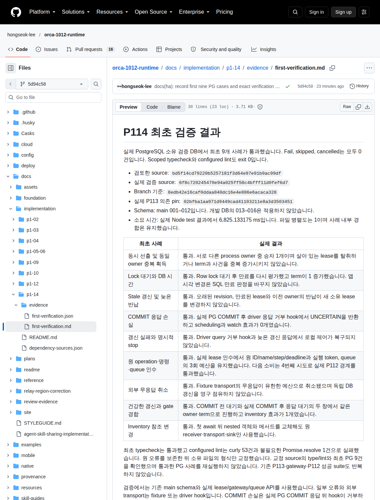

# P114 최초 결과 보고 화면

Root가 검토하고 수용한 최초 PG 9개 결과 보고 화면입니다. 지정된 client owner가 2026-10-13 13:04:39.750 UTC에 1회 촬영했으며 화면 크기는 1140 × 1500입니다. 이 게시 작업에서는 source 변경, 재시험, 재촬영 또는 rebase를 하지 않았습니다.

촬영 대상 문서 revision은 `5d94c58b7faa70645be3bf3c53562202bf19a671`이고 실제 검증 source는 `6f8c720245470e94a025ff58c4bfff11d0fef6d7`입니다. PNG SHA-256은 `d11c37d0f487bc269ac8efb520a4d7cce6beec1d0946de68d7107a507bd2c50d`입니다. [원 출처 기록](p114-first-report-provenance.json)의 문서와 결과 JSON hash를 원 bytes와 대조했습니다.

[최초 검증 문서](first-verification.md), [안전한 원 결과와 source graph·schema hash](first-verification.json), [P113 의존 source hash](../dependency-sources.json)를 연결합니다. 최초 실패와 성공의 원 로그는 private 지속 증거 `/home/orca/.local/state/orca-1012-implementation/p1-14-ha-first-verification/`에 보존되어 있으며 해당 `SHA256SUMS`의 SHA-256은 `b37b03d64a5ad745b73f854213daa17819b7b139ec08a5d9e4ac4fe12cef2437`입니다. 비밀이 포함될 수 있는 원 로그를 공개하지 않습니다.

이 PNG는 검증 결과 문서의 화면이며 실제 HA, provider 실행, 물리 fence 또는 제품 UI의 성공 화면이 아닙니다. PG 9개 사례와 scoped type/lint의 정확한 범위 및 driver hook의 한계는 원 검증 문서에 유지합니다.
