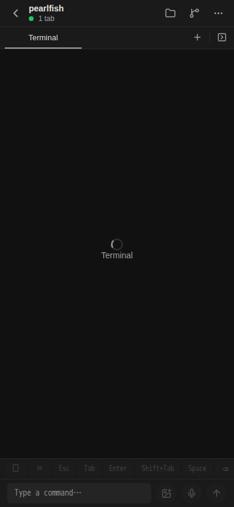
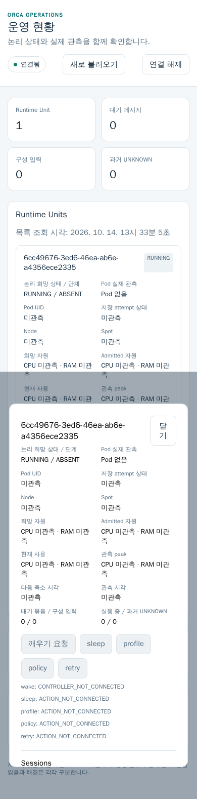

# P1-16 / P1-26 / P1-27 — C3 최초 생성 UI 증거

기존 정상 paired Expo Web UI에서 Create를 최초 1회 클릭해 자동 생성 이름 `pearlfish`의 Workspace 창을 열고 원 목록에 표시되는 것을 관측했습니다. 같은 정상 인증의 Ops runtime-units API는 HTTP 200을 반환했고 Unit 상세 화면을 관측했습니다. Root가 원 결과와 PNG 2장을 직접 읽고 수락했습니다. 이 PR은 문서와 기존 PNG만 추가합니다.

## 실제 실행과 source

- UI job은 2026-10-14 13:32:56.788 UTC에 시작해 13:33:05.944 UTC에 exit 0으로 종료했습니다. Create 제출은 13:33:03.923 UTC에 1회였으며 helper 재제출은 0회입니다.
- 기존 installed Client source 참조는 `8edb42e16caf0ddaa840dc16e4e886e6acaca328`입니다. Runtime source 참조는 `e8ef0f7664bc8a5828b0c771b4b0bd247083a2ab`이며 Root가 승인한 delta 입력의 참조입니다. Checkout 전체 Git SHA는 증명하지 않았습니다.
- 실제 `/ops/app.js` 응답은 HTTP 200이고 SHA256은 `6fcdaf20c50f786d8d3b16c72b1a1c29256f2ca6ff498e41eeb73f2ccfad1a8f`입니다. HTML/CSS도 HTTP 200입니다. 이 자산은 기존 C3 runtime의 `minify:true` / `target:node18` 변환 결과를 소비합니다. 이번 문서 단계에서 build를 반복하지 않았습니다.
- Viewport는 390 × 844, DPR 1이며 mobile/touch 옵션을 사용한 Expo Web입니다. 실제 native iPhone 증거는 아닙니다.
- 최종 실행의 renderer error는 0건입니다. WS 송신/수신 frame 수는 각각 3/4, 0/0, 53/56입니다. Frame 수로 암호화 요청 identity나 mutation receipt를 확정하지 않습니다.
- 기본 Blank Terminal을 유지했고 Agent 선택 sheet를 열지 않았습니다. Setup control은 표시되지 않았습니다. 기존 source가 setupCommand 부재에 `inherit`를 보내므로 명시적 `skip` 성공이나 hooks 응답 성공으로 확대하지 않습니다.

## 최초 PNG와 provenance

아래 두 PNG는 Root가 공개를 승인한 원 bytes이며 재촬영·수정하지 않았습니다. 각각의 원 촬영 시각, source 참조, 실제 자산 hash와 viewport는 provenance에 구분해 기록했습니다. Raw URL/query 값·paired host 식별자·credential은 JSON에 포함하지 않습니다.

Workspace 창을 2026-10-14 13:33:04.734 UTC에 촬영했습니다. 이름과 Terminal label은 관측됐으나 pending 문구는 확인되지 않았으며 Terminal 실행·출력 성공을 판정하지 않습니다.

Ops 화면은 2026-10-14 13:33:05.709 UTC에 촬영했습니다. Unit 조회·상세 표시의 실제 관측이며 provider 실행 성공이나 Pod 생성 증거가 아닙니다. Root의 현재 수락 범위는 Terminal 실행 0 / Pod 없음입니다.

| 원 PNG | SHA256 |
|---|---|
| `workspace-created-first.png` | `53990a5ab41bfafed707ee5a02b7fbdd67fe1a977d994cbce63a07f58f8cf00a` |
| `ops-created-unit-first.png` | `3b1e66cb087f28eca7cedd8152a6ece331812c895b8eff6ad1ba1c6514cec6a1` |

[Workspace provenance](workspace-created-first-provenance.json)와 [Ops provenance](ops-created-unit-first-provenance.json)는 공개용 metadata 사본입니다. 원 결과·private 상관 입력과 인증 자료는 비공개 운영 증거에 그대로 보존합니다.

## 원 실패와 범위 조정

최초 fixed-name helper는 제출 전에 TimeoutError로 종료됐으며 정확한 selector 원문을 저장하지 못했습니다. 원 실패를 이번 성공으로 덮어쓰지 않았습니다. 다음 읽기 전용 진단에서는 실제 label `Workspace name [Optional]`과 exact `Workspace name` selector의 불일치를 확인했습니다. Label을 교정한 run도 이름 채우기 전에 실패했고 renderer TypeError를 관측했습니다. 이후 focus 진단의 프로젝트 label duplicate 오류는 focus 0회로 별도 보존했습니다.

Dialog로 한정한 focus 진단은 focus 1회 뒤 `Keyboard.default.metrics is not a function`을 원 message/stack으로 보존했습니다. Root가 고정 Client source의 `mobile/src/components/mounted-bottom-drawer.tsx:162` 및 fillAvailable sheet와 대조해 웹 제약으로 확인했습니다. 앱 수정이나 polyfill 없이 Root가 OPTIONAL name/source를 비우고 기본 Blank Terminal을 유지하는 자동 이름 경로를 배분했습니다. 최종 실제 이름은 `pearlfish`이며 처음 계획한 fixed name을 사용한 성공이 아닙니다. 위 진단은 모두 Create 0회이며 최종 UI 제출만 1회입니다.

## 남은 판정

공개 Worktree ID와 Ops 내부 Workspace UUID/Unit의 상관은 `correlationPending=true` / `sameUnitQualified=false`입니다. 이 PR 시점에 DB 상관 확인은 0회이며, 단일 Unit 조회나 ID 문자열 일부가 같다는 이유로 동일 Unit을 확정하지 않습니다. Root가 원 receipt와 PG metadata를 별도로 읽고 판정합니다.

현재 `controllerConnected=false`이며 Terminal 실행/출력, provider/attempt/RW 연결, native 기기, 자동 인증 전달, 중앙 Browser, Active/Standby 전체 HA의 성공을 주장하지 않습니다. 기존 paired state와 개발 서버를 유지했으며 추가 pairing·Metro/서버 재시작·설치·source sync·재촬영은 없습니다. 기존 비밀 없는 화면 2장의 공개 승인과 제품 기능 전체의 완료 판정은 별개입니다.

## 계약과 문서 단계 확인

[Root 작업 계약 전문](root-dispatch-public.md)을 공개 일반화 규칙으로 보존했습니다. [승인 public COMMON](../../plans/orca-1012-specs/COMMON.md) 전문은 PR 본문에 원문 그대로 포함합니다. 해당 정본과 다른 역할의 파일은 수정하지 않았습니다.

문서 단계의 확인은 지정 base 위의 소유 파일 diff, PNG 원 bytes/hash 및 공개용 metadata 검토뿐입니다. 제품 시험·PG 조회·브라우저 실행·설치·build를 새로 수행하지 않았습니다.
