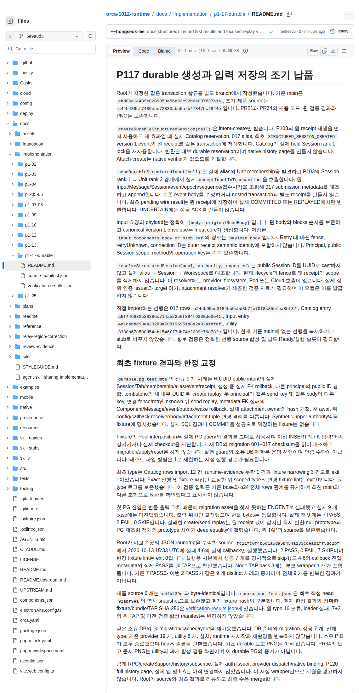

# PR42의 최초 실제 보고 문서 PNG

Root가 수락한 원 PNG와 공개용 provenance를 byte-identical로 게시합니다. 이 화면은 2026-10-13 16:05:08.145 UTC에 보고 문서 target `5e9e8d54b0cddec641794c4e2cd3bfb4907aea40`에서 촬영했습니다. Fixture source는 `fc21fc0f4b5d1a5da5b454a133cdead1ff5dc2bf`, 원제품 source는 `c44b439cf7489eee72833abb5afb47847bcf844e`입니다. 이번 asset 게시 head와 캡처 target을 구분합니다.

실제 heading은 “최초 fixture 결과와 한정 교정”이며 viewport는 1140 × 2200, DPR은 1입니다. 원 첫 PG의 7 PASS·2 FAIL과 실패 callback 2 개의 focused 2 PASS·7 SKIP, distinct 9 개의 과거 검증 결과를 설명하는 문단이 보입니다. Node TAP pass 3에는 부모 wrapper 1 개가 포함됩니다. 캡처는 시험을 새로 실행한 화면이 아니라 당시 결과 보고 문서를 표시한 실제 browser 화면입니다.

PNG SHA-256은 `a23982830b1f99ce4fd84d0da022dce6e8ca20c8ae479cdab002d8b13daa5d83`이며 크기는 710,514 bytes입니다. 원 공개용 provenance SHA-256은 `bd00125514d8e826a137017631aa22ae5c6635fcb50af06ea0edb4b0242548f7`입니다. [원 provenance](pr42-first-report-provenance.json)에 target/source, 시각, 실제 문단 위치와 최초 촬영 1 회가 기록돼 있습니다. 사적인 owner 인계 파일은 게시하지 않았습니다.

화면 문서의 “최초 durable 보고 PNG는 아직 없음”은 촬영 직전 문서 상태를 뜻합니다. 현재 asset 게시 상태와 구분하며 원 문서와 provenance는 수정하지 않았습니다. 이번 게시에서 재촬영, PG/fixture/type/lint, 빌드, 설치와 runtime 실행은 모두 0 회입니다.

제품 앱, native iPhone, 공개 RPC, 실제 인증 issuer, provider inference 또는 HA 합격 화면이 아닙니다. 실제 연결과 최종 수용·merge는 Root의 후속 gate입니다.
