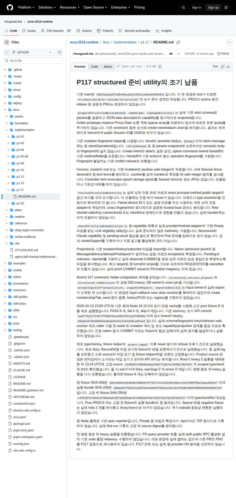

# P117 utility의 최초 보고 문서 캡처

2026-10-13 13:38:35.941 UTC에 원격 browser의 별도 Context에서 보고 문서를 표시하고 PNG 1 회를 촬영했습니다. Root가 수락한 원 PNG와 provenance를 byte-identical로 게시합니다. 이번 게시의 재촬영은 0 회이며 pure fixture 8 개를 다시 실행하지 않았습니다.

캡처 대상은 문서 revision `2d74199bb87d46893cb471351edf3ed85864fc1e`입니다. 최초 pure source는 `1a4f791d772387ff586f0e2a05070f2a22f8088a`이며 type/lint 교정 source는 `3338b67c580d54ab1546ff7db74c2089e76d78fc`입니다. PNG 안의 “실제 캡처는 없음”이라는 문장은 촬영 직전 문서 상태를 기록한 것입니다. 지금의 asset 게시 상태와 구분합니다.

PNG SHA-256은 `2f62a0eba73d9c885cf35673dba2713a38e0c89f69f6a11c882432930b3e195a`, 크기는 689,517 bytes입니다. 원 provenance SHA-256은 `db347d6a80cbeb7f859a8a037c1d9ec88f2849a84c458ce476aa13a2995488e4`입니다. [원 provenance](p117-utility-first-report-provenance.json)에 실제 heading과 결과 문단의 위치, viewport 및 최초 촬영 횟수가 있습니다.

이 PNG는 구현 설명과 utility의 과거 합성 검증 결과를 보여 주는 보고 문서입니다. 제품 앱, 실제 인증, provider, native iPhone 또는 HA 합격 증거가 아니며 후속 durable create/send PG 결과도 담지 않습니다. 기존 PR21 PNG를 재사용하지 않았습니다.
