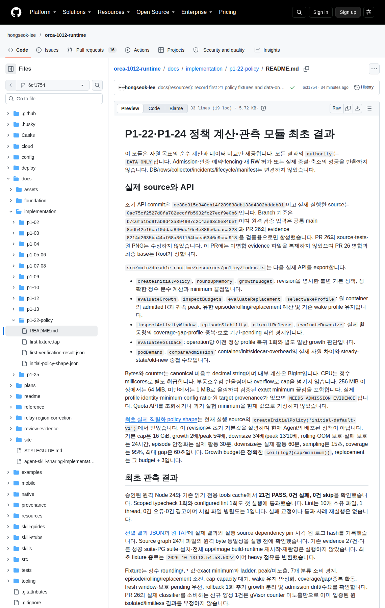

# P1-22·P1-24 정책 계산·관측 모듈 최초 결과

이 모듈은 자원 목표의 순수 계산과 데이터 비교만 제공합니다. 모든 결과의 `authority`는 `DATA_ONLY`입니다. Admission·인증·예약·fencing·새 RW 허가 또는 실제 증설·축소의 성공을 반환하지 않습니다. DB/rows/collector/incidents/lifecycle/manifest는 변경하지 않았습니다.

## 실제 source와 API

조기 API commit은 `ee38c315c340cb14f289838db133d4302bddcb81`이고 실제 실행한 source는 `0ac75cf2527d8fa782eccffb5932fc27ecf9e0b6`입니다. Branch 기준은 `b7c6fa1bd9fab9d43a394907c2c4ae63c0e84bef`이며 원격 검증 입력은 공통 main `8edb42e16caf0ddaa840dc16e4e886e6acaca328`과 PR 26의 evidence `8214d2635ba44af68a361154baea6346e9cca918`을 검증용으로만 합성했습니다. PR 26의 source·tests·원 PNG는 수정하지 않았습니다. 이 PR에는 미병합 evidence 파일을 복제하지 않았으며 PR 26 병합과 최종 base는 Root가 정합니다.

`src/main/durable-runtime/resources/policy/index.ts`는 다음 실제 API를 export합니다.

- `createInitialPolicy`, `roundUpMemory`, `growthBudget`: revision을 명시한 불변 기본 정책, 정확한 정수 분수 계산과 minimum 끝점입니다.
- `evaluateGrowth`, `inspectBudgets`, `evaluateReplacement`, `selectWakeProfile`: 원 container의 admitted R과 귀속 peak, 유한 episode/rolling/replacement 예산 및 기존 wake profile 유지입니다.
- `inspectActivityWindow`, `episodeStability`, `circuitRelease`, `evaluateDownsize`: 실제 활동창의 coverage·gap·profile·중복·보호 기간·pending 작업 경계입니다.
- `evaluateRollback`: operation당 이전 정상 profile 복귀 1회와 별도 일반 growth 판단입니다.
- `podDemand`, `compareAdmission`: container/init/sidecar·overhead의 실제 자원 차이와 steady-state/old-new 중첩 수요입니다.

Bytes와 counter는 canonical 비음수 decimal string이며 내부 계산은 BigInt입니다. CPU는 정수 millicores로 별도 취급합니다. 부동소수점 반올림이나 overflow로 cap을 넘기지 않습니다. 256 MiB 이상에서는 64 MiB, 미만에서는 1 MiB로 올림하며 검증된 exact minimum 끝점을 포함합니다. 실제 profile identity·minimum·config·ratio·원 target provenance가 없으면 `NEEDS_ADMISSION_EVIDENCE`입니다. Quota API를 조회하거나 과거 실험 minimum을 현재 값으로 가정하지 않았습니다.

[최초 실제 직렬화 policy shape](initial-policy-shape.json)는 현재 실행 source의 `createInitialPolicy('initial-default-v1')`에서 얻었습니다. 이 revision은 초기 기본값을 설명하며 현재 Agent의 배포된 정책이 아닙니다. 기본 cap은 16 GiB, growth 2배/peak 5⁄4배, downsize 3⁄4배/peak 13⁄10배, rolling·OOM 보호·실패 보호는 24시간, episode 안정화는 실제 활동 30분, downsize는 실제 활동 60분, sampling은 15초, coverage는 95%, 최대 gap은 60초입니다. Growth budget은 정확한 `ceil(log2(cap/minimum))`, replacement는 그 budget + 3입니다.

## 최초 관측 결과

승인된 원격 Node 24와 기존 읽기 전용 tools cache에서 **21건 PASS, 0건 실패, 0건 skip**을 확인했습니다. Scoped typecheck 1회와 configured lint 1회도 첫 실행에 통과했습니다. Lint는 10개 소유 파일, 1 thread, 0건 오류·0건 경고이며 시험 파일 병렬도는 1입니다. 실패 교정이나 통과 사례 재실행은 없습니다.

[선별 결과 JSON](first-verification-result.json)과 [원 TAP](first-fixture.tap)에 실제 결과와 실행 source·dependency pin·시각·원 로그 hash를 기록했습니다. Source graph 24개 파일의 원격 byte 동일성을 실행 전에 확인했습니다. 기존 evidence 27건·다른 성공 suite·PG suite·설치·전체 app/image build·runtime 재시작·재촬영은 실행하지 않았습니다. 최초 fixture 종료는 `2026-10-13T13:54:58.502Z`이며 heavy 점유를 반환했습니다.

Fixture는 정수 rounding/큰 값·exact minimum과 ladder, peak/미노출, 7개 분류 소비 경계, episode/rolling/replacement 소진, cap·capacity 대기, wake 유지·안정화, coverage/gap/중복 활동, fresh window·보호·pending 우선, rollback 1회·추가 growth 분리 및 admission drift/수요를 확인합니다. PR 26의 실제 classifier를 소비하는 신규 양성 1건은 gVisor counter 미노출만으로 이미 입증된 원 isolated/limitless 결과를 부정하지 않습니다.

## 실행 경로와 미연결 범위

소유 원격 source는 `/home/orca-dev/implementation/p1-22-policy/source`, 실행 mirror는 `/tmp/orca-p122-policy-execution`입니다. 기존 `/workspace/backend/p1-02-db/tools`만 읽기 재사용했습니다. 기존 cache·package·lock·node_modules를 수정하거나 설치하지 않았습니다. 시험 전에 manifest의 각 파일 SHA를 대조한 뒤 원격 tools의 TypeScript와 configured oxlint를 scoped 경로에 적용하고, 기존 esbuild로 test entry 1개를 Node 24용으로 변환하여 `node --test --test-concurrency=1 --test-reporter=tap verification/policy.test.mjs`를 최초 실행했습니다.

최초 실제 보고 PNG는 기존 client 단일 owner가 1회 촬영했고 Root가 원 화면을 수용했습니다. 이 worker의 촬영은 0건이며 원 이미지를 수정하지 않았습니다. 아래 화면은 교정 전 6cf target·원 21건이고, 후속 8857 focused 실행의 화면이 아닙니다. 계산 fixture를 실제 OOM·G-03 admission·PG 동시 예약·P1-23 cold 복구·P1-24 실제 자동 축소 합격으로 표시하지 않습니다. 신뢰 ingress의 원 minimum/config/metrics/budget 공급과 DB/controller 연결은 후속 소유 범위입니다. 이 모듈은 caller의 관측 provenance를 검사하지만 자기 선언 입력을 인증하는 factory를 제공하지 않습니다. Pod Ready·idle·시간 경과로 counter나 BLOCKED를 초기화하지 않습니다.

## 최초 실제 보고 화면

P1-22·P1-24 최초 순수 fixture 21건의 실제 browser 보고 화면입니다. Captured target은 `6cf175499b5ce2fd0349ab0e3f8f679db3a2e1e6`, 원 실행 source는 `0ac75cf2527d8fa782eccffb5932fc27ecf9e0b6`, 촬영 시각은 `2026-10-13T14:32:35.327Z`입니다. Viewport는 1140 × 1800이며 최초 관측 결과 heading과 21건 PASS·0건 실패·0건 skip을 보여 줍니다. 원 PNG SHA-256은 `f6699742c4a71b5e069731d663540bf98002d6476099d32cfbb4febcf2784ada`입니다.

[최소 공개 provenance](evidence/pr41-first-report-provenance.json)와 [별도 Root 수용 기록](evidence/pr41-first-report-root-acceptance.json)에 원 source·target·문서 hash·시각·원 artifact 관계를 보존했습니다. 원 PNG/provenance는 수정하지 않았습니다.

## 좁은 capacity 합류의 최초 focused 결과

교정 source `8857ea44614867f6c2410dad6bf8b79e65585ac9`에서 새 focused **1건 PASS, 0건 실패, 0건 skip**과 변경 typecheck·두 파일 lint가 첫 실행에 통과했습니다. 종료 시각은 `2026-10-13T14:44:00.738Z`이며 오류 교정이나 사례 반복은 없습니다. [별도 focused 결과 JSON](growth-capacity-focused-result.json)과 [원 focused TAP](growth-capacity-first.tap)에 source·실제 개수·로그 hash를 기록했습니다. 원 21건은 재실행하지 않았습니다.

`evaluateGrowth`는 수치·cap·endpoint를 확인한 뒤 capacity를 판단합니다. 첫 capacity 부족의 RESOURCE_WAIT는 검증된 targetMemoryBytes와 원 sourceRefs·windowId를 보존하고, admission 미확인·cap 실패는 그대로 반환합니다. priorResourceWait는 새 계산 없이 NO_NEW_MEMORY_CAUSE를 반환합니다. Signature/export는 동일하며 영속 owner는 같은 API를 소비하고 원 WAIT 계획을 읽습니다. 이 focused 결과도 DATA_ONLY이며 실제 admission·예약·growth를 증명하지 않습니다. 위 PNG는 이 focused 결과의 화면이 아닙니다.
