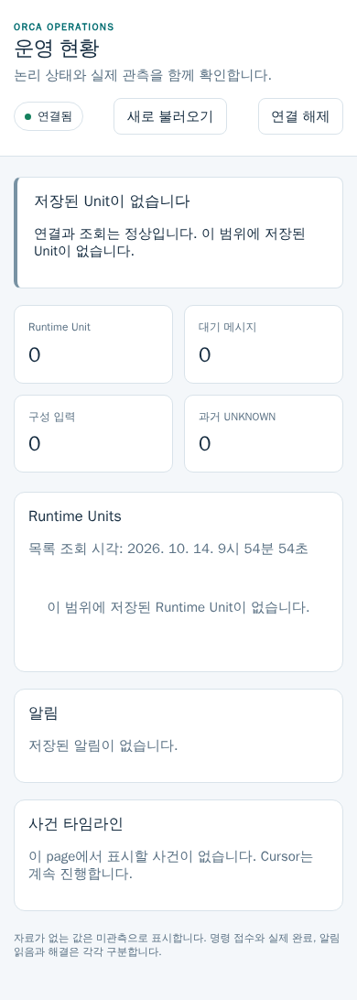
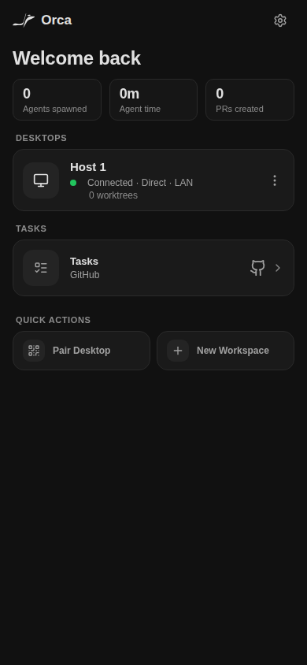

# P1-16 / P1-26 / P1-27 실제 개발환경 최초 연결 결과

Backend의 최초 C2 반영 뒤 원 paired state와 정상 token으로 실제 Expo Web 및 Ops 화면을 확인했습니다. 기존 합성 화면과 별도의 실제 개발환경 증거입니다. 이 PR은 수락된 결과의 문서·이미지 게시만 수행합니다.

Backend 기준 main은 `7bcd7c899aa13c0a62dbfe737c20c40c71307eaa`이며 승인된 214개 input 범위의 동등성을 owner가 확인했습니다. 전체 runtime/client checkout의 Git SHA는 미확정입니다. Backend owner의 기존 최초 minify:true / target:node18 build 1회를 소비했고, client source와 Metro는 변경하지 않았습니다.

## 실제 관측

- 기존 paired state의 host 1개와 nonempty token entry 1개를 재사용했습니다. 재pairing이나 인증 우회는 없습니다. WebCrypto secure context·random·subtle digest를 확인했습니다.
- 실제 정상 Bearer 인증으로 Unit·notifications·events·stream API가 모두 HTTP 200을 반환했습니다. Unit 0개, notification 0개, event PAGE 0개이며 Ops는 실제 빈 scope 화면입니다. 정상 인증값은 화면 캡처 전에 입력창에서 비웠습니다.
- 실제 Ops `app.js` SHA-256은 `c19dedc83745ef897c88c4c4bf4e57cec1abb1fcf74ad58f0a628c631f6804bd`이며 HTML/CSS/app.js 응답은 모두 200입니다. 두 페이지 runtime 오류는 0개입니다. Console은 Expo info 1개·warning 5개·log 7개였으며 원문은 공개하지 않습니다.
- Expo 원 화면의 Connected · Direct · LAN과 0 worktrees를 확인했습니다. 프로젝트 drawer를 연 뒤 `Orca 1012 Dev` label visible을 관측했으나 해당 세 번째 화면의 PNG는 만들지 않았습니다. 생성 동작을 실행하지 않았습니다.

## 원 실패와 남은 경계

원 job은 2026-10-14 09:54:45.919 UTC에 시작해 09:54:55.677 UTC에 exit 1로 종료됐습니다. 성공 화면 2개를 촬영한 뒤 세 번째 프로젝트 화면에서 `CAPTURE_URL_NOT_SAFE`를 반환했습니다. Helper는 credentials·query·fragment가 있는 URL을 촬영 전에 거절합니다. 실패 당시 실제 URL은 저장되지 않아 어느 조건이었는지와 민감 여부는 미확정입니다. 제품 route source의 정상 action query 형태와 실패 당시 실측을 혼동하지 않습니다.

원 실패·exit 1과 private provenance를 보존했으며 이번 게시에서 helper 교정, 세 번째 capture 재시도, 추가 browser/API/시험/설치/build/runtime 변경은 모두 0회입니다. Guard의 정상 action query 처리는 다음 실제 UI 경계가 필요할 때 Root가 별도로 지정합니다. Browser/context는 닫혔고 활성 소유 job PID는 0개이며 heavy는 반환됐습니다. 원 auth state도 유지했습니다.

## 최초 원 PNG와 provenance

두 PNG는 수락된 원 bytes 그대로입니다. Viewport는 모두 390 × 844, DPR 1, isMobile/hasTouch true입니다. 원 screenshot은 fullPage 옵션을 사용했으며 실제 이미지 pixels는 provenance에 기록했습니다. 이 옵션을 full-page 기능 전체 합격으로 해석하지 않습니다. Expo 설명용 원 heading annotation과 실제 이미지 제목 Welcome back도 provenance에서 구분했습니다. 원 timestamp/source 및 원 provenance hash를 유지하고 공개 사본에서는 실제 origin만 일반화했습니다.

### Ops 실제 빈 scope

[원 시각·hash·viewport·경계](ops-empty-scope-first-provenance.json)

### Expo Web 실제 재연결과 빈 workspace

[원 시각·hash·viewport·경계](expo-workspace-first-provenance.json)

[실제 응답·원 실패·종료 결과](first-connection-result.json), [Root 계약 전문 공개 사본](root-dispatch-public.md), [승인된 COMMON](../../plans/orca-1012-specs/COMMON.md)을 함께 읽습니다. Native iPhone/Mac, 자동 인증 전달, 중앙 Browser/screencast, controller 및 전체 HA 완료는 이 결과로 선언하지 않습니다.
