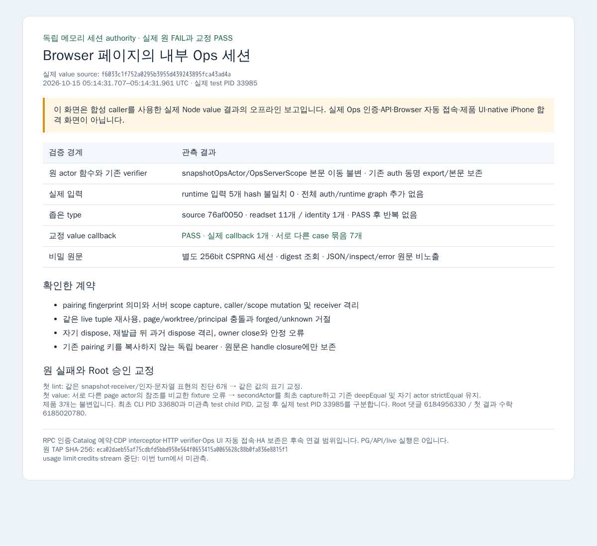

# Browser 페이지의 내부 Ops 세션 authority

원 계약 base는 `5729dae86e4494d453d3d13b055a84982344b64f`이며 실제 교정 value 검증 source는 `f6033c1f752a0295b3955d439243895fca43ad4a`입니다. 이 독립 모듈은 trusted RPC 경계의 인증·범위 검사 및 Catalog Browser 예약 이후 서버 composition에서 사용해야 합니다. 현재 그 caller와 CDP/HTTP/UI 연결은 구현하지 않았습니다.

`createOpsBrowserSessionAuthority(scope)`는 서버가 고른 dataset/namespace/workspaceIds를 복사합니다. 모든 메서드는 동기이며 receiver에 의존하지 않습니다. 입력 page/worktree/fingerprint를 그 call에서 복사하고 원 문자열을 변경하거나 alias를 해석하지 않습니다.

- `issuePageSession(input)`은 기존 pairing 키를 받지 않고 `randomBytes(32)`의 별도 256bit bearer를 발급합니다. 같은 live page/worktree/fingerprint는 같은 handle과 token을 재사용합니다. 같은 live page를 다른 worktree/principal로 바꾸면 stable conflict입니다.
- `findPageSession(key)`는 page와 worktree가 모두 exact일 때만 handle을 반환합니다. `authenticateBearer(token)`은 live issued token의 SHA256 digest에 해당하는 immutable actor만 반환하고, unknown/forged/폐기된 값에는 null입니다.
- Handle은 비밀이 아닌 readonly page/worktree/fingerprint와 `readBearer()`/`dispose()`만 가집니다. 원 bearer는 closure에만 있으며 JSON/inspect/error에 담지 않습니다. `readBearer()`는 trusted CDP request hook 전용이고 dispose/owner close 뒤에는 sanitized stable 오류입니다.
- Actor는 기존 `pairing-sha256:` principal과 `ops-pairing-sha256:` authorizationRef 의미 및 capture한 서버 scope를 사용합니다. Actor와 workspace array는 동결합니다. HTTP 요청자가 actor/scope를 지정하지 않습니다.
- Dispose는 자기 record만 제거합니다. 과거 handle의 늦은 dispose가 재발급 handle을 제거하지 않으며 owner close는 자기 메모리 세션을 정리하고 추가 issue를 막습니다. cookie/URL/HTML/JS/DOM/storage 전달, SSE 강제 종료, 기기별 회수, 주기 재인가, TTL 및 PG 인증 테이블은 추가하지 않았습니다.

Root의 05:04 의존성 조정에 따라 기존 `snapshotOpsActor`와 `OpsServerScope`를 같은 본문으로 순수 `actor.ts`에 이동했습니다. 기존 `auth.ts`는 동명 import/re-export를 보존하고 `createDeviceRegistryOpsVerifier`의 원 주석/본문은 불변입니다. 전체 runtime 의존을 stage/설치하거나 stub/손작성 alias를 만들지 않았습니다. 새 모듈은 actor.ts에서 직접 import하며 기존 verifier의 대응은 source로 대조했습니다. 기존 handler/UI/schema/Catalog/provider/startup/package/lockfile은 변경하지 않았습니다.

## 실제 검증과 원 실패

최초 lint 4개는 표현 관련 진단 6개로 실패했습니다. 동일 Map snapshot 식을 별도 const로 먼저 평가하고 fixture의 동일 receiver/args와 문자열을 같은 값의 표현으로 교정했습니다. 변경 2개 lint는 통과했고 suppression·조건·assertion·actor/verifier 본문은 바꾸지 않았습니다.

`76af0050259a1bdb10b9cd4b216d3ab17e34347e`에서 소유 actor/session/fixture 3개의 좁은 type가 exit 0입니다. 실제 제품 source readset은 11개이고 identity 모듈은 1개입니다. 전체 auth verifier/runtime graph를 추가하지 않았습니다. 그 뒤 Root가 승인한 fixture의 secondActor capture와 자기 actor strict 비교만 변경했으며 성공 type는 반복하지 않았습니다. 제품 3개 bytes는 불변입니다.

첫 value callback은 두 번째 page actor를 첫 page의 별도 actor 객체와 strict reference 비교해 실패했습니다. 계약은 page별 immutable actor와 같은 pairing/scope 의미를 요구하며 page 간 동일 object identity를 요구하지 않습니다. Root가 원 TAP·제품·fixture를 읽고 [판정 댓글](https://github.com/hongseok-lee/orca-1012-runtime/pull/85#issuecomment-6184956330)로 두 번째 최초 actor capture와 기존 deepEqual 유지, dispose 뒤 그 같은 actor strictEqual을 수락했습니다. 원 오류는 보존했고 assertion을 deepEqual로 완화하지 않았습니다. 최초 CLI PID 33680과 미관측인 종료 test child PID를 구분합니다.

수락된 fixture만 교정한 뒤 변경 fixture lint 1개와 실패 value callback 1개가 통과했습니다. 실제 test PID는 33985, runner는 33979이며 2026-10-15 05:14:31.707–05:14:31.961 UTC, exit 0입니다. TAP parent+child 합계 2개는 제품 callback 1개이고 서로 다른 case 묶음은 7개입니다. 실제 value 입력 5개는 fixed Git hash와 일치하며 원 callback body와 생성 wrapper hash를 따로 보존했습니다.

확인한 범위는 독립 256bit opaque 세션, pairing fingerprint 및 서버 scope, caller/scope mutation과 receiver 격리, 중복 재사용과 page/worktree/principal 충돌, forged/unknown/invalid 거절, 자기 dispose와 재발급 뒤 stale dispose/owner close, JSON/inspect/error 비밀 비노출입니다. 실제 bearer namespace 원문은 원 TAP에서 0건입니다. 원 실패/교정 PASS·source/input/metafile/wrapper/log/PID/UTC/exit는 비공개 원자료에 보존하며 공개 [verification.json](verification.json)과 [inputs.json](inputs.json)에 정제된 결과·hash만 기록합니다.

## 미연결 경계와 화면

실제 RPC 인증, Catalog PG 예약, CDP interceptor, HTTP verifier, Ops UI 자동 접속 및 HA 보존은 미구현·미검증입니다. 이 모듈의 value 통과는 그 연결이나 제품/native UI 합격이 아닙니다. PG/live/API/실제 Browser 접속 실행은 0이며 기존 전체 auth/HTTP suite도 반복하지 않았습니다.

Root의 별도 browser 슬롯 배분 뒤 원격 Playwright의 새 offline context에서 value 결과 보고 PNG를 한 번 캡처했습니다. 보고 프로세스 PID는 6112이며 2026-10-15 05:20:00.534–05:20:02.781 UTC, exit 0입니다. 이 PNG는 원 Node TAP을 요약한 오프라인 보고이고 실제 Ops 인증/API·제품 UI·native iPhone 캡처가 아닙니다. 실제 앱이나 auth state를 열지 않았고 원 bearer·credential·운영 경로를 넣지 않았습니다.

[캡처 provenance](value-result-report-provenance.json)에 원 TAP/검증 source/HTML/PNG hash를 연결했습니다. 기존 실제 화면을 이 기능의 성공 화면으로 표시하거나 반복 촬영하지 않았습니다. 이번 turn에서 usage limit·credits·stream 중단은 미관측이며 소유 child 종료와 heavy 반환을 기록했습니다. 최종 범위·수락·merge는 Root가 담당합니다.
