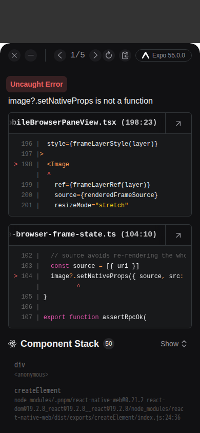

# Browser screencast capability 연결 검증

제품 pin은 `cdb84393b3469141fc2f86cf62465e109f7faf46`이며 base는 `ab9b369d5318b01cd862e5abc78307a06e983685`입니다. 명시 `screencast:true`와 기존 정상 health predicate를 함께 요구하고, Orcad는 실제 resolved Chromium provider에만 flag를 전달합니다. Certificate 지원은 기존 renderer/offscreen 조건을 유지합니다. 최종 기록에서 제품 3개와 fixture 1개의 bytes/mode는 그대로입니다.

[정제 검증 기록](verification.json)은 원 Vitest JSON의 새 callback 1개와 총계를 보존합니다. Passed 1 / failed 0 / pending 1,268이며 원 JSON 372,141 bytes의 SHA-256은 `e0e5c69ab90bb0eebf261bf75fb4844bbfc01f5f42ea769710d1dbd043a5cf99`입니다. 전체 JSON은 게시하지 않았습니다. Runner PID 31461은 2026-10-15 03:01:42.355–03:02:40.215 UTC에 exit 0으로 완료됐습니다. Callback 자체 보고 시간은 약 26.901 ms이며 별도 worker PID는 미관측입니다.

최초 lint의 301줄 제한 실패를 보존했습니다. 두 options 속성을 같은 줄에 놓는 공백 배치만 교정한 뒤 변경 파일 1개의 lint만 확인했습니다. 원 표현식·규칙·기존 callback은 바꾸거나 반복 실행하지 않았습니다. 전체 checkout Git SHA는 증명하지 않았습니다.

별도 Client의 실제 C4 최초 UI 1회는 2026-10-15 03:25:48.372–03:26:14.117 UTC, runner PID 5199, exit 1입니다. 서버 composite `0919809827747ffec106fdfef0c751e43538bdbb`와 Expo client `8edb42e16caf0ddaa840dc16e4e886e6acaca328`에서 Browser 메뉴 → New Browser modal → `about:blank` Open 1회 → loaded data image를 관측한 뒤 `image?.setNativeProps is not a function` 앱 오류가 나타났습니다. Helper는 `new-browser-label`의 `PHASE_DEADLINE_EXCEEDED`로 종료됐습니다. Codex·Send·Tab 왕복은 모두 0회입니다.

아래 PNG는 390 × 844 Expo Web의 실제 실패 화면입니다. SHA-256은 `fcb6ace7428b97415a5fdb85ddbc2ac341c0d40a94b9204bac763f54cc3e7499`, 크기는 63,044 bytes입니다. [출처 기록](c4-first-ui-failure-provenance.json)은 raw URL이나 인증값을 포함하지 않습니다.

이 화면과 loaded data image 관측은 정상 stream·페이지 사용·Chat·인증·provider·HA·native 기기 합격이 아닙니다. Web 수정은 별도 Client PR 소유입니다. 이번 최종 납품에서는 성공한 시험·설치·build·UI를 재실행하지 않았으며 Draft 해제와 merge는 Root가 결정합니다.
