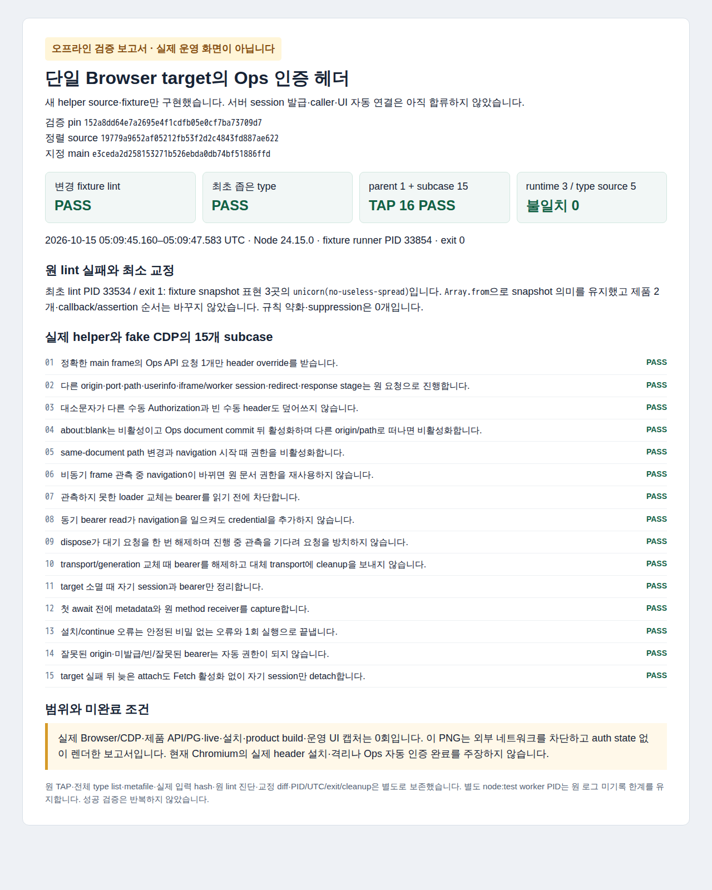

# 단일 Browser target의 Ops 인증 helper 검증

새 `external-chromium-ops-auth` prefix의 제품 2개와 fixture 1개만 구현했습니다. Trusted composition에서 canonical Ops origin·정확한 page/target/generation/transport와 기존 CDP connection, closure의 `readBearer()`/`disposeBearer()`를 받습니다. 반환은 동결된 `snapshot()`/idempotent `dispose()` handle입니다. `readBearer()`는 동기 `string | null`이며 실제 server session 모듈과 아직 연결하지 않았습니다.

소유 CDP session의 Request stage Fetch/XHR 중, 현재 committed main document가 정확한 Ops origin의 `/ops` 또는 `/ops/`이고 요청이 같은 origin의 `/ops/v1/`인 경우에만 개별 header override를 사용합니다. 수동 Authorization·redirect·타 origin/port/path·다른 frame/session에는 credential을 추가하지 않습니다. Navigation/loader/transport/generation 관측이 바뀌면 원 권한을 재사용하지 않으며 자기 listener/session/bearer만 정리합니다. Cookie·전역 header·JS/DOM/storage 주입은 없습니다.

최초 검증 pin은 `152a8dd64e7a2695e4f1cdfb05e0cf7ba73709d7`이고 지정 main `e3ceda2d258153271b526ebda0db74bf51886ffd`에 한 번 정렬한 source는 `19779a9652af05212fb53f2d2c4843fd887ae622`입니다. 소유 source 3개와 실제 runtime/type source 5개의 mode/blob 불일치는 0개입니다. 정렬 뒤 성공 검증을 반복하지 않았습니다.

## 원 실패와 최초 결과

최초 lint PID 33534는 2026-10-15 05:08:33.081–05:08:33.430 UTC, exit 1이었습니다. Fixture의 Set snapshot 표현 3곳에 `unicorn(no-useless-spread)` 진단이 있었습니다. 원 진단과 exact diff를 보존하고 snapshot을 유지하는 `Array.from(...)` 표현으로만 교정했습니다. 제품 2개·callback/assertion·SQL/auth 계약·lint 규칙은 바꾸지 않았습니다.

변경 fixture lint PID 33753은 exit 0입니다. 최초 좁은 type PID 33765, fixture bundle 준비 PID 33841, fixture runner PID 33854도 exit 0입니다. Parent callback 1개와 subcase 15개를 원 TAP에서는 tests 16개/pass 16개/fail 0개로 보고합니다. 전체 실행 시각은 05:09:45.160–05:09:47.583 UTC입니다. [정제 결과 JSON](first-verification.json)에 15개 subcase와 원 진단/hash를 기록했습니다.

Actual runtime 입력은 3개, type의 source 입력은 5개이며 고정 Git과의 hash 불일치는 0개입니다. Metafile을 guard 전에 보존했고 전체 `--listFiles` 로그와 원 TAP/runner/config/입력/exit도 비공개로 보존합니다. 05:10:26.201 UTC에 알려진 child는 모두 ABSENT, supervisor는 Z였습니다. 별도 node:test worker PID는 원 로그 미기록 한계를 유지하며 성공 시험을 반복하지 않았습니다.

## 정제 오프라인 PNG

이것은 실제 운영 UI 화면이 아닌, 외부 요청을 차단하고 auth state 없이 렌더한 보고서입니다. [Provenance](verification-report-provenance.json)의 PID는 6016, 캡처 시각은 2026-10-15 05:18:21.721 UTC, exit는 0입니다. 외부 요청은 0건이며 context/browser를 닫았습니다. PNG SHA-256은 `1f6d6b07b0e33c29c0f4bd9c2c92606987fb9f2621fa65a9c0b1cea75d74008d`입니다.

캡처 준비의 첫 OCI exec는 해당 컨테이너에 없는 Node 경로로 process 시작 전에 실패했습니다. 원 오류와 result/PNG 부재를 보존하고 실제 Node 경로만 확인해 미진입 캡처를 한 번 수행했습니다. 기존 오프라인 도구·동일 HTML 입력을 사용했고 제품/인증 설정은 바꾸지 않았습니다.

기존 caller/UI/CDP 공용 파일·서버 bearer session 모듈에는 변경이 없습니다. 실제 제품 Browser/CDP·HTTP/API/PG·live 반영·설치·product build·운영 화면 캡처는 0회입니다. 이 fake CDP 결과를 현재 Chromium의 실제 header 설치·worker/iframe 격리·Ops 자동 인증, 실제 iPhone/Mac·HA·전체 P1-27 합격으로 확대하지 않습니다. 실제 caller와 Ops UI 합류는 Root의 별도 배분 범위입니다.
