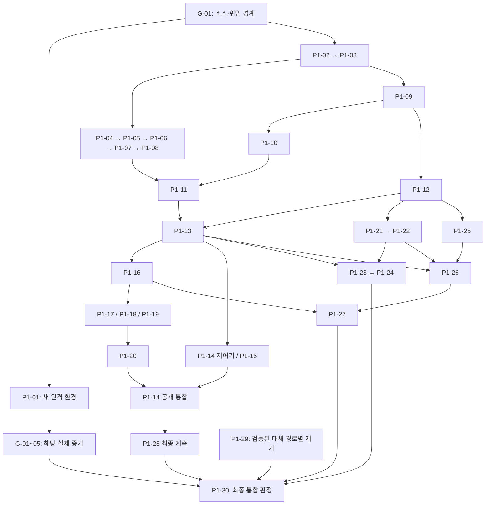
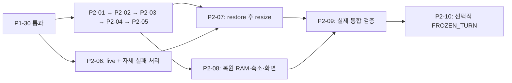

> root 지정 문서의 공개 일반화 사본이다. 요구사항·작업 ID·수용기준은 보존하며 private 원본은 byte-identical로 보존됨과 구분한다. 원본 SHA-256: `4eb5fadfcff710c1816dfebd432a5dec058c0bed7618920f7ee309100f2fde83`.

# Orca 1012 의존성 기반 병렬 실행 흐름

> 아래 최초 공개 사본 provenance는 유지하며, 이번 개정은 Root 공용 RW 계약 SHA256 `c8430943986c7bb53891c5d94fa368ce8670b153c66ee377b8746ab9ad89d10b`에 따른 범위 문단 추가다. 최신 private 실행 현황 전문을 복사한 것이 아니다.

**2026-10-15 범위 교정:** 아래 단일 RW·G-04 조건은 Agent 홈/provider 상태/보호된 checkout의 writer 교체에 적용한다. [별도 공용 협업 공간](orca-1012-shared-rw-scope.md)의 서로 다른 Agent RW는 병렬 허용하며, 공용→보호 범위 우회는 거절한다. 공용 공간을 이유로 같은 Agent의 이전/새 실행 중복을 허용하지 않는다. 기존 작업 ID/파일 소유권·공유 환경 점유 규칙은 유지한다.

작성·판단: root 오케스트레이션 · 2026-10-12 · 상태: **실행 흐름 설계, 제품 구현 미착수**.

기준은 [현재 작업목록](orca-1012-implementation-worklist.md), [50개 ID별 명세](orca-1012-specs/README.md), [공통 계약](orca-1012-specs/COMMON.md)이다. **기존 작업 번호와 최종 수용기준을 유지한다.** 아래 내부 산출물 구분은 새 작업 ID나 새로운 제품 기능을 추가하지 않는다. 작업 합병·새 번호 분할은 아직 수행하지 않았다.

현재 기존 클러스터/NFS와 옛 원격 테스트 Pod는 없다. 문서는 로컬 보존본을 읽고, 제품 실행 검증은 P1-01에서 마련한 새 원격 환경을 사용한다. 이 문서 작성으로 인프라 생성·worker 실행·제품 구현을 시작하지 않는다.

## 1. 번호 순서 대신 계약과 합류 조건으로 배분

작업목록의 선행 열은 통합 완료 조건을 포함한다. 이를 모두 “앞 작업 최종 완료 전에는 한 줄도 작성 불가”로 해석하면 불필요한 직렬화와 상호 대기가 생긴다. 각 ID 안에서 다음을 구분한다.

| 상태 | 뜻 | 다음 작업에 넘길 수 있는 것 |
|---|---|---|
| 계약 확정 | root가 실제 수정 파일·소유자, 입력/출력·ID·revision·오류/transaction 경계를 확정 | 그 계약에 의존하는 독립 코드 작성. 가짜 capability나 미검증 실행 권한을 열지 않음 |
| 모듈 검증 통과 | 해당 산출물의 실제 저장/경합/실패 처리를 적절한 원격 환경에서 검증 | 검증한 범위의 통합. 다른 provider/앱/장애 조합의 합격으로 확대하지 않음 |
| 통합 합격·작업 완료 | 개별 명세의 전체 조건과 관련 실제 gate가 충족되고 root가 증거를 검토 | 해당 ID를 최종 완료로 기록 |

가짜 구현이나 stub이 컴파일된 것을 모듈 검증 통과로 표시하지 않는다. 격리 fixture로 확인한 계약과 실제 앱/provider/스토리지 증거도 구분한다. 선행 작업의 일부 계약만 사용하는 경우, 위임서에 **어느 산출물/revision을 사용하는지와 아직 남은 최종 합류 조건**을 적는다.

## 2. 공통 계약을 먼저 고정할 범위

G-01에서 실제 소스를 확인한 뒤 root가 아래 계약과 파일 소유자를 정한다. 구현은 Sol 6.1/high가 맡는다.

| 기존 ID | 먼저 고정할 계약 | 동시에 막아서는 안 되는 후속 작업 |
|---|---|---|
| P1-02 | 객체/receipt/operation ID, 네 종류 fence/epoch/term, 공통 row revision·lock 순서, 각 도메인이 쓰는 schema | P1-03 및 해당 schema가 확정된 도메인 모듈 |
| P1-03 | transaction·journal/outbox·canonical event, atomic context/notification 기록 경계 | P1-04, P1-09, 이후 사건·자원·출력 모듈 |
| P1-09 | 명령 envelope·Port signature·receipt·조회/인수·STAGED/ADMITTED 구분 | P1-10/11/12, P1-13의 controller 작성 |
| P1-05~08 | intake/merge/seal, 취소 CAS, context revision·전달 증거의 내부 계약 | P1-11, P1-13, P1-17/18 |
| P1-13 | lifecycle intent/operation 입력, 상태 projection과 wake/sleep/close 경계 | P1-16의 Catalog 저장/조회, P1-14의 제어기, 자원 명령 연결 |

P1-02에서 Phase 2 기능까지 모두 구현해야 P1-03을 시작하는 식으로 확대하지 않는다. 필요한 schema 계약과 그 실제 제약을 먼저 넘기되 P1-02의 나머지 최종 요구는 계속 추적한다. 공용 schema/Port를 서로 다른 worker가 각자 다른 정의로 구현하지 않는다.

## 3. Phase 1의 모듈 합류 흐름

아래 그림은 공통 계약을 고정한 뒤의 주요 모듈 흐름이다. 전이적으로 충족되는 의존성과 모든 개별 시험은 생략했다. **최종 완료 DAG가 아니라 작성·모듈 통합 순서**이며, 실제 gate와 전체 완료 판정은 뒤 표를 적용한다. P1-01의 새 원격 환경은 모든 제품 실행 검증의 공통 기반이다.

P1-28의 계측 코드는 P1-03부터 함께 넣고 마지막에 분포를 통합한다. P1-29도 마지막에 한꺼번에 제거하지 않고 각 대체 경로의 증거가 확보될 때 수행한다. P1-30의 시험 준비와 개별 시험은 앞 단계와 함께 진행하며 최종 완료만 모든 조건 뒤에 둔다.

### 언제 어떤 작업을 동시에 열 수 있는가

같은 행은 같은 날이나 동시에 끝나는 배치가 아니다. 먼저 준비된 작업부터 빈 실행 슬롯에 배정한다. `→`는 행 안에서도 순서가 있다는 뜻이고, 쉼표로 구분한 가지는 파일/환경이 분리되면 병렬로 진행할 수 있다.

| 준비된 산출물 | 동시에 열리는 기존 작업 | 기다려야 하는 실제 합류 |
|---|---|---|
| G-01의 실제 소스·변경 경계 확인 | P1-01, P1-02, G-02의 실제 소스 호출 경로 조사 | P1-02의 원격 검증은 새 환경 필요. 앱 handshake/E2E는 서비스 준비 후 |
| P1-02의 필요한 schema와 P1-03 transaction 계약/모듈 | P1-04, P1-09 | 공용 DB/Port 변경 소유자는 하나 |
| P1-04의 첨부 계약, P1-09의 gateway 계약 | P1-05→06→07→08, P1-10, P1-12 | 실제 writer 허용은 해당 G-04 차단 증거 확보 후 |
| P1-12의 영속 enqueue/consumer 계약 | P1-21→P1-22, P1-25 | P1-22 실제 적용은 G-03 admission 증거 필요. P1-13 전체 완료를 기다릴 이유 없음 |
| P1-08의 context 계약 + P1-09/10 모듈 | P1-11 및 G-05의 provider 검증 | P1-07/08의 실제 interrupt/context 시험도 이 시점에 함께 합류 |
| P1-06~12의 필요한 모듈·실행 증거 | P1-13 통합 | 단순 상태 함수 합격을 실제 wake/sleep/fencing 합격으로 표시하지 않음 |
| P1-13 모듈 | P1-16, P1-14 제어기, P1-15 | P1-14 최종 완료는 P1-16~20 공개 경로 합류 후 |
| P1-11/13 + P1-21/22 | P1-23→P1-24 | 다른 종료와 OOM 구분, 실제 자원·writer·복구 증거 필요 |
| P1-13/22/25 | P1-26 | 실제 명령 결과는 해당 controller 경로와 연결해 검증 |
| P1-16 + 입력/provider/Terminal 공통 계약 | P1-17, P1-18, P1-19 | P1-18/19의 동일 terminal.send/input-floor 파일은 단일 소유자. 최종 앱 검증은 G-02 |
| P1-16/26 | P1-27 | 중앙 Browser·인증·실기기 검증. 자원 작업 미완료를 완료 표시하지 않음 |
| P1-16~19 + P1-11/03 | P1-20 최종 출력/공개 경로 통합 | journal/replay 기반 코드는 앞서 계약 확정 후 작성 가능 |
| P1-14 제어기 + P1-16~20 | P1-14 공개 HA 통합, 관련 G-02/04/05 잔여 조합 검증 | host·인증·receipt·replay 실제 연속성 확인 |
| P1-14 공개 통합 + P1-17~20 | P1-28 최종 측정 | hot/cold/reconnect/file-detection 실제 분포 |
| 각 대체 기능의 원격 합격 증거 | 해당 부분 P1-29 | 제거 뒤 영향 경계 재검증; 동일 환경 시험 중 무단 baseline 변경 금지 |
| P1-01~29 및 G-01~05 전체 증거 | P1-30 최종 판정 | Phase 1 시험만 적용. U-01·C-01·Phase 2를 추가 전역 gate로 만들지 않음 |

### 상호 대기를 막는 실제 gate 운영

| gate/작업 | 먼저 할 수 있는 것 | 최종 증거의 합류 지점 |
|---|---|---|
| G-01 ↔ P1-01 | G-01의 소스·HEAD·patch·구축 입력 확인 후 새 환경을 만든다 | 실제 원격 build/test 경로 확인은 P1-01에서 마련한 환경과 합류. 존재하지 않는 옛 Pod 경로로 G-01을 통과시키지 않음 |
| G-02 ↔ P1-17~20/27 | 현재 코드의 capability/Stop ID 경로 조사, 계약 기반 adapter 작성 | 실제 설치 앱의 handshake·Stop·Browser는 구현된 경로로 시험. 미검증 지원 광고 금지 |
| G-03 ↔ P1-22 | P1-01 환경에서 admission·배치 사실 조사, versioned 정책/예약 작성 | 실제 Agent·sidecar/initContainer·provider 시작·자원 적용 증거와 합류 |
| G-04 ↔ P1-10/13/14 | P1-09/10의 차단 메커니즘을 새 환경에서 검증 | lifecycle/HA 경합 조합은 해당 연결 후 추가 검증. 어떤 단계든 새 RW 전에 실제 차단 증거가 있어야 함 |
| G-05 ↔ P1-07/08/11 | provider adapter와 취소/context의 독립 모듈 작성 | 실제 receipt·interrupt·cold resume·context 전달을 함께 검증하고 각 관련 ID를 닫음 |
| P1-12 ↔ P1-08/25 | P1-12는 실패 시 context/notification row의 원자 저장을 공통 DB 계약으로 수행 | P1-08은 provider 전달, P1-25는 알림 projection/replay를 맡음. 그 전체 서비스 완료를 기다려 FAILED commit을 미구현으로 남기지 않음 |
| P1-29 ↔ P1-30 | 각 기능의 수용 시험 증거를 구현과 함께 확보하고 구경로 제거 | P1-30 최종 완료만 제거·영향 재검증 후. 모든 시험을 마지막까지 미루는 상호 대기 금지 |

gate마다 증거의 대상 revision·provider·경로·환경을 기록한다. 일부 조합 합격을 gate 전체 합격으로 올리지 않는다. 이 구분은 안전 조건을 완화하는 수단이 아니다.

## 4. Phase 2의 병렬 흐름

P1-30 통과 뒤 **Snapshot 경로 P2-01**과 **live resize P2-06**을 독립적으로 시작할 수 있다. P2-06은 Snapshot PoC 결과를 기다리지 않는다.

| 시점 | 병렬 작업 | 합류/실패 처리 |
|---|---|---|
| Phase 1 통과 | P2-01, P2-06 | live는 자체 실제 실패/timeout/cold 증거까지 확보 |
| P2-01의 gate 계약 확보 | P2-02, P2-03의 manifest/검사 코드 작성 | P2-03 최종 통합은 P2-02 실제 seal 증거 후. 그래프의 최종 선행은 유지 |
| P2-01~03 모듈 합류 | P2-04→P2-05 | READY와 stopped, CONSUMED와 첫 쓰기, 재시도/cold를 실제로 확인 |
| P2-05와 P2-06 통과 범위 확보 | P2-07, P2-08 | P2-07과 P2-08이 공통 resize/profile/gate 파일을 함께 수정하면 소유자를 정해 직렬 반영 |
| P2-01~08 증거 | P2-09 | live 실패와 restore 후 실패를 각각 판정. 같은 NFS/노드 장애 시험은 격리하거나 직렬화 |
| P2-09 이후 | 선택적 P2-10 | 별도 qualification. 다른 작업의 필수 선행으로 역연결하지 않음 |

P2-01이 실패하면 해당 memory restore 가지를 보류한다. P2-06의 독립 구현·실증은 계속할 수 있지만 이것만으로 P2-09 전체를 완료했다고 표시하지 않는다. 현재 명세의 P1-30 선행을 제거해 Phase 2 제품 PoC를 앞당기는 변경은 이 흐름에 포함하지 않았다.

## 5. 실제 동시 실행 수와 배분 방식

**사용자가 전체 한도를 11개로 변경했으며 현재 도구 지시에서도 확인했다.** root의 기획과 bridge의 제어 역할은 실행 worker와 구분하되 전체 슬롯에는 포함한다. 작업 ID와 최종 수용기준은 유지하고, 아래와 같이 위임 단위를 확장한다.

현재 이 대화에 제공된 도구의 실제 한도는 **root 포함 총 11개**다. 별도 bridge가 없으면 worker 최대 10개, bridge 1개가 활성인 경우 worker 최대 9개를 배분한다. 실제 실행 전 제공된 전체 한도를 다시 확인하고 모든 하위 에이전트를 합산한다. native 세션이 별도 목록에 보인다는 이유로 제한을 우회하지 않는다.

이번 변경은 현재 도구에 명시된 11개 슬롯에 맞춘 운영 문서 갱신이다. 로컬 설정 변경이나 설정 reload로 한도를 늘린 것은 아니다. 동결 template은 변경하지 않는다.

### 초반에는 계약을 확정하고, 준비된 작업부터 슬롯을 늘린다

G-01의 소스 대응표가 나온 뒤에는 P1-01 환경, P1-02→03 공통 영속 기반, G-02의 현재 앱 호출 경로 조사를 우선 독립 배분한다. 공통 schema·Port·취소/context·lifecycle intent 계약을 root가 확정하는 대로 후속 작업을 연다. 슬롯 10개가 있다는 이유로 아직 정의되지 않은 계약을 각 worker가 따로 만들어 구현하게 하지 않는다.

아래는 **각 행의 착수 조건이 충족됐을 때** 사용할 최대 10개 worker 배분 예다. 전부 첫날 동시에 착수한다는 뜻이 아니며, 고정 worker ID나 새 작업 번호도 아니다. G-01에서 실제 파일 분리가 확인되지 않으면 같은 소유자에게 묶거나 먼저 공통 변경을 반영한다.

| worker 자리 | 기존 ID와 맡길 산출물 | 작성 착수에 필요한 계약 | 통합·실증에서 남는 합류 |
|---|---|---|---|
| 1 | P1-04, 이후 P1-05~08 입력 core | P1-02/03, 첨부 수락 계약 | 실제 dispatch/interrupt/context는 P1-11·G-05와 합류 |
| 2 | P1-09 공통 Port/gateway, 이후 P1-13 상태/intent/reconcile | P1-02/03 및 해당 입력·사건 명령 계약 | lifecycle 전체는 P1-06~12 실제 모듈·증거와 합류 |
| 3 | P1-10 storage binding·실제 fencing, G-04 | P1-02, P1-09 Port/fence 계약 | 실제 시험은 P1-01 환경; 새 RW 전에 실제 old writer 차단 필수 |
| 4 | P1-11의 Claude adapter·증거, 공통 provider 계약의 반영 소유자 | P1-08 context, P1-09 Port, P1-10 writer 계약 | 실제 cold/receipt/interrupt/context 및 G-05의 Claude 행렬 |
| 5 | P1-11의 Codex adapter·증거 | worker 4와 같은 공통 계약, 분리된 provider 파일 | G-05의 Codex 행렬; P1-11 전체 완료에는 두 provider 모두 필요 |
| 6 | P1-12 사건 큐, 이후 P1-25 알림/replay | P1-02/03, P1-09 event/ACK 계약 | FAILED/context/notification 원자 저장과 실제 producer 연결 |
| 7 | P1-21 사건 증거, 이후 P1-22 정책/예약, G-03 | P1-03/09/12 계약과 해당 모듈 | 실제 admission/배치·자원 증거, 이후 P1-23/24의 실행 복구 |
| 8 | P1-16 Catalog·identity·조회와 intent 접수 | P1-02/03/05, P1-13의 확정 intent/projection 계약 | 실제 create/sleep/close 연결·경합 검증은 lifecycle과 합류 |
| 9 | P1-20 journal/replay/projection 기반 | P1-03 영속 journal, P1-11 event identity, P1-16 projection 계약 | native history·공개 adapter 최종 통합은 P1-11/16~19 이후 |
| 10 | P1-28 공통 계측/probe, P1-30의 확정 수용 조건별 시험 코드 | 공통 ID/trace와 root가 정한 기존 V1 시험 범위 | 제품 파일 hook은 해당 소유자가 반영; 실제 실행은 구현·원격 환경 준비 후 |

bridge가 활성이라 실행 worker가 최대 9개면 열 번째 후보를 대기열에 둔다. root는 병목과 실제 증거 필요도에 따라 위 행을 재배치한다. 계측 담당을 기다리느라 필수 hook이 누락되지 않도록 각 기능 소유자가 확정된 계측 계약을 구현에 포함한다. 완료된 worker의 관련 작업 재사용은 허용하되 신규 독립 worker는 항상 같은 동결 템플릿에서 시작한다.

### core 계약 이후의 재배분

| 준비된 산출물 | 동시에 배분할 수 있는 작업 | 반드시 남기는 합류 |
|---|---|---|
| P1-13 모듈, P1-16 Catalog 계약 및 필요한 입력/provider 모듈 | P1-14 제어기, P1-15, P1-17, P1-18/19, P1-20 기반/준비된 adapter 통합 | 공용 controller는 한 변경 소유자. P1-20 최종 완료는 P1-17~19 전체 합류 후 |
| P1-21/22와 P1-11/13 모듈 | P1-23→24 | resize/rollback은 같은 정책·operation 소유권을 사용 |
| P1-13/22/25 계약, P1-16의 Browser/identity 계약 | P1-26 API, P1-27 UI를 다른 worker에 병렬 배분 | API/UI 계약 fixture는 실제 명령 적용·설치 앱 합격이 아님. 실제 controller와 G-02에 합류 |
| 위 기능들이 구현되는 동안 | P1-28 probe, P1-30의 구현된 경계별 검증, 합격한 대상의 P1-29 | 제품 수정과 동일 파일 시험 코드를 별도 worker가 동시에 수정하지 않음. 제거 뒤 영향 경계 재검증 |
| P1-16~20 공개 경로 합류 | P1-14 공개 HA 통합, 남은 앱/provider/resource 검증 | 공용 장애 시험과 최종 성능 측정은 환경 점유를 분리 |
| 모든 Phase 1 증거 | P1-30 최종 판정 | P1-01~29와 G-01~05를 전부 충족해야 함 |
| P1-30 통과 | P2-01과 P2-06 | Phase 2 실제 PoC의 Phase 1 선행 유지 |
| P2-01 gate와 공통 계약 확정 | P2-02 storage seal, P2-03 manifest, P2-04/05의 확정 계약 부분, P2-06 live 검증 | P2-04/05 전체 통합은 P2-02/03 이후. 공통 gate/CONSUMED 파일은 한 소유자 |
| P2-05/06 합류 | P2-07, P2-08, P2-09의 준비된 실제 조합별 검증 | live 실패와 restore 후 실패를 각각 확인; 최종 P2-09는 P2-01~08 전체 합류 후 |

여러 행의 준비 작업이 동시에 존재하면 최대 9~10개 worker에 배분할 수 있다. 실제 소요시간·변경 파일·원격 환경의 수용량을 아직 측정하지 않았으므로 상시 10개 가동이나 10배 단축을 전제하지 않는다. 공용 장애 주입, migration, 동일 실기기 시험은 다음 절의 점유 규칙에 따라 직렬화한다.

## 6. 같은 파일과 같은 검증 환경은 별도로 소유자를 정한다

### 코드 변경 소유권

| 공유 경계 | 소유권 원칙 | 관련 작업 |
|---|---|---|
| migration·schema·공용 DB 타입 | 최초 P1-02 담당 소유자를 유지한다. 다른 worker는 필요한 계약 변경을 제출하고 같은 파일을 동시 수정하지 않는다 | P1-02/03 및 모든 DB 도메인 |
| receipt·Session lock·merge/seal·취소 CAS | 하나의 intake 변경 소유자가 경계 변경을 통합한다 | P1-05~08 |
| Runtime Port·command envelope·gateway fence | 하나의 Port 변경 소유자. 각 구현체가 다른 서명을 만들지 않는다 | P1-09/10/11/12, P2-01/04~07 |
| Claude/Codex 공통 binding·receipt·context 타입 | 공통 계약 반영 소유자는 하나, provider별 구현 파일과 시험 데이터는 분리. 한 provider 합격을 다른 provider 증거로 재사용하지 않음 | P1-11, G-05 |
| lifecycle/operation 공용 controller | P1-13의 공용 상태 전이는 한 소유자가 반영한다. HA·자원 worker는 분리된 모듈에서 작성 | P1-13~15/23/24/26 |
| terminal.send·input floor·binary/ACK 연결 | 실제 같은 파일이면 P1-18/19를 같은 worker에 연속 위임한다 | P1-18/19 |
| Catalog/journal/replay projection | P1-16/20의 공통 projection 변경 소유자를 정하고 adapter를 독립시킨다 | P1-16~20, P1-25~27 |
| Snapshot manifest/gate/consumption | 공통 상태와 첫 쓰기 경계를 한 소유자가 통합한다 | P2-01/03~05/07 |
| resource profile/resize/rollback | P1-22/24의 계약을 변경할 때 live·restore·Dashboard가 각자 분기하지 않는다 | P1-22~24, P2-06~08 |

실제 파일명이 겹치는지는 G-01 결과로 확정한다. 논리 모듈이 다르다는 이유만으로 같은 큰 controller 파일의 동시 수정을 허용하지 않는다. 필요하면 독립 worktree에서 작성하되 공통 파일 반영은 지정 소유자가 순서대로 수행한다. 독립 worktree는 의미 충돌을 자동 해결하지 않는다.

### 원격 실행·시험 점유

| 시험/변경 | 병렬 허용 조건 |
|---|---|
| DB 단위·입력 경합 시험 | 독립 DB/schema/테스트 데이터로 격리한 경우. 동일 schema migration 적용은 직렬화 |
| 서로 다른 Session/Runtime Unit 기능 시험 | 실제 storage write domain·operation·데이터가 분리돼 있고 공유 장애 주입이 없는 경우 |
| G-04·P1-14·P1-15의 fencing/HA/관측 장애 | 동일 controller/DB/대상 실행에 영향을 주면 하나의 시험만 수행 |
| OOM/압박·quota·admission 정책 변경 | 해당 환경의 다른 성능/기능 시험에 영향을 주면 직렬화하거나 검증된 독립 환경 사용 |
| iPhone/Mac 실제 UI/Stop/Browser | 같은 기기·연결·입력 lease는 단일 시험 소유자. 기기와 Session이 분리된 조합만 병렬 |
| Snapshot seal·writer·mtime/watch 시험 | 실제 canonical directory와 watch 범위가 분리된 경우. 동일 domain의 capture/변경/복원은 하나의 시나리오가 소유 |
| 배포·DB migration·공용 admission 변경 | 시험 baseline을 고정한 동안 임의 변경 금지. 적용 후 영향 시험만 새 revision으로 재검증 |

검증용 대상 격리는 제품에 새 node-headroom gate나 새 전역 제어기를 추가한다는 뜻이 아니다. 공용 환경을 예약하는 것은 오케스트레이터의 시험 배분 규칙이다. 원격 환경·artifact/image digest·증거 경로를 각 위임에 고정한다.

## 7. 합치기·쪼개기·변경 권고

**작업 번호를 합치거나 40개 구현 명세를 새 번호로 나누는 것은 지금 필요하지 않다.** 우선 다음과 같이 위임 단위와 중간 산출물을 정리한다. 실제 파일 경계가 확인되기 전 새 작업 수를 늘리지 않는다.

| 현재 ID | 권고 | 이유와 유지할 완료 경계 |
|---|---|---|
| P1-02/03 | 같은 worker에 연속 위임. P1-02는 공통 ID/transaction에 필요한 schema부터 순차 제공 | migration·lock·transaction 계약 충돌을 줄임. 나머지 §5 schema 요구는 P1-02에서 계속 추적 |
| P1-05/06, P1-07/08 | 같은 intake worker가 연속 수행하는 두 묶음으로 운영 | receipt/append/claim/취소 transaction 경계가 강하게 결합. 각 ID별 검증·상태는 유지 |
| P1-09/10 | 11개 슬롯에서는 Port/fence 계약을 먼저 넘긴 뒤 gateway와 storage binding을 별도 worker에 병렬 배분. 실제 파일이 겹칠 때만 공통 변경을 직렬화 | 슬롯이 적을 때의 연속 위임을 기본값으로 두지 않음. 새 RW의 G-04 실제 차단 조건은 유지 |
| P1-11 | 같은 ID 안에서 공통 provider 계약, Claude adapter, Codex adapter, 최종 증거 합류를 구분. provider별 두 worker 병렬 배분 | provider 차이를 공통 성공 상태로 덮지 않고 양쪽 실제 검증을 병렬화. 공통 타입은 한 반영 소유자, 전체 완료에는 양쪽 모두 필요 |
| P1-13 | 같은 ID 안에서 상태/intent/reconcile 모듈과 실제 runtime 통합을 나눠 납품 | 모든 provider E2E 종료까지 lifecycle 계약을 숨기면 P1-16·HA·자원이 모두 지연됨. 최종 합격은 P1-06~12 실제 합류 후 |
| P1-16 | Catalog/ID/조회·tombstone 저장과 실제 create/sleep/close 연결을 분리해 납품 | Pod 0 저장/조회 코드는 lifecycle의 전체 완료를 기다릴 필요가 없음. 작업 전체 완료에는 실제 lifecycle 계약 필요 |
| P1-20 | journal/replay/projection 기반과 P1-17~19의 최종 adapter 통합을 구분 | 출력 기반을 뒤늦게 만들며 모든 adapter를 재작업하는 위험 감소. 실제 provider/history 증거는 별도 확보 |
| P1-18/19 | 실제 terminal.send/floor 파일이 겹치면 같은 worker에 묶음 위임 | legacy 분류와 raw/binary/ACK 경계 충돌 감소. G-01에서 분리가 확인되면 독립 작성 가능 |
| P1-14 | 이미 보완한 제어기 단위/공개 RPC 통합의 두 완료 단계를 반드시 적용 | P1-16~20 전에는 최종 완료 금지. HA 코드 작성은 먼저 가능 |
| P1-26/27 | HTTP/auth/replay/command 상태 계약을 먼저 고정하고 API와 UI를 별도 worker에 배분. 실제 자원 명령은 P1-23/24 등 해당 controller 결과와 합류 | 202 접수나 버튼 표시를 증설/축소 실행 완료로 오인하지 않게 함. 모든 읽기 UI를 자원 최종 완료까지 막지는 않음 |
| P1-28/29/30 | 횡단 작업으로 계속 추적: 계측 삽입·대체 경로별 제거·구현과 동시 수용 시험, 마지막에 각 ID의 최종 증거 집계 | 마지막 단계의 대량 재작업과 검증/제거 상호 대기 감소 |
| P2-04/05 | capture/restore 상태·manifest 파일이 겹치면 동일 worker 연속 위임 | READY/stopped/CONSUMED/실패 fencing의 같은 해석 유지. 두 ID와 시험은 구분 |
| P2-06/07 | 합치지 않음. 공용 resize adapter만 한 소유자가 관리 | live는 Snapshot과 독립. 두 실패 경로를 각각 검증해야 함 |

이번 11개 슬롯 개정에서는 **P1-09/10 분리, P1-11 provider별 병렬 위임, P1-13/16/20 중간 납품, P1-26/27 계약 선행 병렬 작성, P1-28/30 조기 검증**을 해당 개별 명세에도 반영했다. 이는 기획상의 실행 단위 변경이며 구현 완료가 아니다. P1-26/27의 실제 명령 합류는 해당 controller별로 적용하고 모든 자원 기능을 새 전역 선행으로 삽입하지 않는다. 정본·최종 수용기준을 삭제하거나 U-01을 임의 결정하지 않는다.

## 8. root가 운영할 준비 작업 목록

root는 매 결과 수신 시 다음을 확인해 새 작업을 연다.

1. 필요한 계약/모듈/revision이 준비됐는가. 같은 ID의 어떤 중간 산출물인지 명시됐는가.
2. 실제 수정 파일 소유자와 공통 타입 변경 경로가 정해졌는가. 다른 활성 worker와 충돌하는가.
3. 원격 환경과 시험 대상이 준비돼 있는가. 구현 작성은 가능하지만 실행 시험은 아직 대기인지 구분했는가.
4. 해당 작업의 실제 gate와 마지막 합류 조건이 남아 있음을 worker에게 전달했는가.
5. 긴 후속 연결을 여는 작업 또는 조기에 실패를 알아야 할 gate를 먼저 배분했는가.

초기 우선 관리할 긴 연결은 `P1-02/03 → P1-04~08 → P1-11 → P1-13 → P1-16~20 → P1-14 공개 통합 → P1-28 → P1-30`이다. 여기에 `P1-09/10`과 `P1-12`가 합류한다. 이는 **소요시간이 측정되기 전 병목 후보**이며 수학적으로 산출한 임계 경로나 일정 약속이 아니다. P1-21/22/25를 먼저 진행해 P1-23/24와 Dashboard가 뒤늦게 새 병목이 되지 않도록 한다.

각 위임에는 기존 ID, 산출물 단계, 허용 파일, 선행 revision, API/schema/Port 계약, 원격 검증 범위와 증거 위치, 공유 환경 점유 조건, 최종 완료 전 남은 합류를 적는다. worker는 범위 밖 설계 선택이 필요하면 사실과 대안을 보고하고 root가 결정한다.

모든 신규 worker는 동일 동결 orphan/cutoff에서 시작하는 Sol 6.1/high다. 공통 suffix에 최신 로컬 문서 경로·기존 NFS 없음·역할 분리·동결 원본 금지를 동일하게 넣고 그 뒤에 작업별 지시를 붙인다. 다른 작업 worker를 새 템플릿으로 삼지 않는다. 원본 재개/수정·cache warming은 금지한다.

## 9. 전체 작업 범위 확인

| 범위 | 이 흐름에서의 처리 |
|---|---|
| O-01~03 | 기존 완료/보존 계약. 재실행하지 않고 현재 기반으로 사용 |
| G-01~05 | 소스 확인과 구현 병렬 실증. 기능/경로별 증거를 추적하고 전체 합격을 별도로 판정 |
| P1-01~30 | 위 모듈 흐름·합류 표·점진 검증/제거로 모두 추적 |
| P2-01~09 | Phase 1 뒤 Snapshot/live 독립 가지와 최종 통합 |
| P2-10 | 별도 선택 검증; 필수 가지에 역의존 없음 |
| U-01 | 추가 자동 계속 정책만 사용자 결정 대기. 확정된 core 작업 비차단 |
| C-01 | 과거 DB 복원 자동화 도입 시 조건부. 현재 필수 흐름 밖 |

이 문서는 기존 선행 조건을 직접 대조한 기획 검토다. 실제 소스별 DAG·변경 파일·작업 시간·원격 환경의 동시 수용량을 시험한 결과가 아니다. 그것들은 G-01/P1-01과 이후 실행 증거로 root가 구체화한다.
