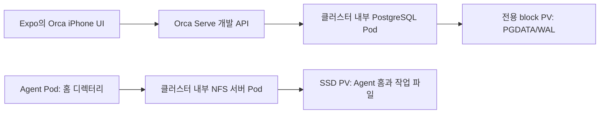

> root 지정 문서의 공개 일반화 사본이다. 요구사항·작업 ID·수용기준은 보존하며 private 원본은 byte-identical로 보존됨과 구분한다. 원본 SHA-256: `8aea8e56e7c1d14b458167c084a1c183570fb879e3b2858b8ddf229852808a7a`.

# Orca 1012 — public PR와 개발환경 운영

작성·판단: root 팀리드 · 2026-10-12. 사용자 후속 지시를 반영한 운영 기준이다. **현재는 기반 준비 중이며 P1/P2 기능 구현 시작 전**이다.

기존 [작업목록](orca-1012-implementation-worklist.md), [개별 명세](orca-1012-specs/README.md), [11개 슬롯 병렬 흐름](orca-1012-parallel-execution-flow.md)의 ID와 최종 수용기준을 유지한다. 기반 준비가 끝나면 root가 사용자에게 최종 시작 명령을 요청한다.

현재 준비하는 public 저장소·클러스터·backend 개발 runner·Expo 검증의 구체적인 납품 범위는 root가 작성한 [기반 준비 PR 명세](orca-1012-foundation-pr-specs.md)를 따른다.

## 역할과 시작 경계

| 담당 | 책임 |
|---|---|
| root 오케스트레이션 / 팀리드 | 계획·명세·의존성·수정 파일 배분, PR 리뷰 댓글, 실행 worker에 수정 지시, 증거 판정, 수락과 merge |
| Sol 6.1/high 실행 worker / 시니어 개발자 | 위임된 branch/worktree에서 코드·환경 변경, 필요한 검증·실제 화면 조작·스크린샷, PR 작성과 리뷰 수정 |
| bridge | 동결 템플릿에서 worker fork·진행 제어·결과 전달. 계획·최종 리뷰·merge 판단을 대신하지 않음 |

전체 동시 한도는 root 포함 11개다. 별도 bridge가 없으면 worker 최대 10개, 활성 bridge 1개가 있으면 worker 최대 9개다. native worker도 합산한다. 원본 orphan template/cutoff는 계속 동결하며 최신 운영 지시는 공통 worker suffix에만 넣는다.

지금 허용된 작업은 public 저장소·PR 체계, 공개할 소스 기준선, 원격 backend/Expo 개발환경, 시각검증·스크린샷 경로의 준비다. P1-01/G-01과 겹치는 기반 사실은 부분 증거로 기록한다. 이 준비만으로 P1-01 영속성/WAL 복구나 P1-14 HA 등 제품 기능을 완료하지 않는다. 사용자 최종 시작 명령 전에는 기능 작업 큐를 실행하지 않는다.

## 저장소와 공개 범위

새 public 저장소의 지정 경로는 `hongseok-lee/orca-1012-runtime`이다. 실제 생성·접근·visibility 결과는 별도 기반 준비 보고에 남긴다. 작업용 checkout은 기존 private 플랫폼 저장소와 분리한다.

**현재 개발 소스 결정:** 공개 upstream `stablyai/orca@776e424e76405a06851dd9ec9ff3b58ffbdb3eea`를 도입하고, Node-only 개발 source에는 기존 common 패치 `0001/0005/0006/0007`을 적용한다. 기존 source 준비 script의 orcad 선택과 같다. 1012 설계가 조사한 과거 `bddb2a82… + working tree` 전체와 동일하다는 뜻은 아니다. 읽기 전용으로 조사한 보존 cache는 `776e424e…`와 Electron 계열까지 포함한 패치 작업본이었고, 인계에 hash가 있는 핵심 16개 파일이 일치했다. 이는 해당 파일의 부분 대조 증거다. Electron 전용 30개 패치는 private 참조로 보존하고 Node 실행 그래프에는 일괄 도입하지 않는다. 설계의 요구사항은 그대로 유지하며 legacy cold/idle 경로와 새 source의 대응·교체 경계는 G-01/P1-29에서 명시한다. 이 선택이나 화면 부팅으로 그 기능을 이미 옮겼다고 판정하지 않는다.

- public Orca upstream의 확인된 source revision을 기준으로 하고 라이선스와 출처를 보존한다. 원격 개발 서버·Expo·PR의 revision 대응을 기록한다.
- 최초 main bootstrap 뒤 소스 도입·개발 도구·인프라·문서 변경은 PR로 제출한다. 기존 private 저장소의 전체 이력이나 디렉터리를 공개 저장소로 밀지 않는다.
- 제품 구현에 필요한 source·선별한 patch·작업 명세·운영 규칙·재현 자료만 명시한 파일 범위로 게시한다. 필요 시 private 정본과 구분된 public 문서 사본에서 운영 위치를 일반화하되 요구사항은 유지한다.
- 보호 백업, Codex 이력·template snapshot, credential·`.env`·실제 인증키, 사용자 대화/홈 데이터, 비공개 운영 자료는 게시 대상에 넣지 않는다. 스크린샷은 새 테스트 데이터로 촬영하고 인증키·pairing 값이 노출된 장면은 게시하지 않는다.
- upstream의 release/deploy automation을 그대로 활성화하지 않는다. 이번 개발 방식에 맞는 경량 검사와 명시적 배포 절차를 사용한다.

## PR 단위와 본문

원칙은 한 PR이 하나의 검토 가능한 변경을 설명하는 것이다. 같은 transaction/file owner가 필요한 P1-05~08 등은 묶을 수 있으나 각 ID별 충족 범위를 본문에 따로 표시한다. P1-11의 Claude/Codex처럼 한 ID를 여러 PR로 나눌 때에는 공통 계약과 선행 PR, 아직 남은 전체 완료 조건을 기록한다. task ID를 새로 만들거나 기존 최종 의존성을 지우지 않는다.

각 PR 본문은 다음 내용을 포함한다.

1. **문제와 변경 결과:** 어떤 사용자 동작/실패 조건에서 무엇이 바뀌었는지, 변경한 기존 ID와 범위.
2. **작업 명세 전문:** 해당 public 명세의 경로·revision과 본문. 여러 ID면 각각 포함하며 단순 링크만으로 대신하지 않는다. 원 명세 중 이번 PR이 충족하는 범위와 남는 범위를 명시한다.
3. **실제 변경:** 수정 경계, 사용하는 공통 계약/revision, 선행 PR, DB/API/state 변경과 필요한 적용 절차.
4. **시각검증:** 테스트 화면·조작 순서·기대/실제 결과, 변경 후 스크린샷과 비교가 필요한 경우 변경 전 스크린샷. 이미지 링크는 리뷰어가 접근 가능한 저장소 artifact/첨부를 사용한다.
5. **실행 증거:** source SHA, backend/Expo revision, 개발 URL의 비밀 없는 식별 정보, 실제 API 결과·관련 테스트, 기기/viewport/브라우저·시각, 미검증 범위.
6. **빌드·적용 범위:** dev reload/증분 변환 여부와 전체 빌드를 했다면 필요 이유. 영속 데이터나 실제 배포에 영향이 있으면 적용/복구 절차.

UI에 직접 드러나지 않는 backend 변경은 관련 실제 화면과 API/상태 증거를 함께 제시한다. 문서/개발기반 PR은 렌더링된 문서나 준비된 개발 화면의 실제 캡처로 결과를 보여주고 제품 기능 시험으로 표시하지 않는다. fixture·이미지 생성·정적 mockup을 실제 제품 스크린샷으로 제출하지 않는다.

스크린샷만으로 데이터 내구성·중복 방지·writer fencing·HA 합격을 판정하지 않는다. 해당 작업의 API/DB/실제 실행 증거도 연결한다. 스크린샷을 얻을 기능이 아직 없거나 실제 검증이 불가능하면 PR을 draft/미완료로 표시하고 원인을 기록한다.

## 리뷰와 merge

1. root가 ID·파일 소유자·작성 착수 계약·원격 검증 범위를 지정한다. worker는 별도 branch/worktree에서 작업한다.
2. worker가 PR을 열고 명세·변경·스크린샷·증거를 작성한다. root는 실제 diff, 최신 head SHA, 명세와 실행 결과를 대조한다.
3. root가 PR에 구체적인 리뷰 댓글을 남기고 worker에게 수정 범위와 이유를 전달한다. worker는 같은 PR에 수정과 후속 증거를 올린다.
4. root가 해결 여부와 영향 범위 검증을 확인한 뒤 최신 SHA를 대상으로 수락·merge한다. 리뷰 이후 변경된 head를 이전 승인만으로 merge하지 않는다.
5. merge 후 공유 개발환경을 해당 revision으로 갱신하고 필요한 smoke/영향 검증을 수행한다. branch 충돌 해소와 코드 변경은 실행 worker가 수행하고 root가 결과를 검토한다.

같은 GitHub 계정으로 만든 PR은 GitHub의 자기 PR approve 제한을 받을 수 있다. 실제 인증 구성을 확인한 뒤 사용할 보호 규칙을 설정하고, 지원되지 않는 독립 승인 강제를 설정했다고 주장하지 않는다. root의 리뷰 댓글·검토 SHA·수락 판단을 항상 남기며 worker에게 merge 권한 역할을 위임하지 않는다. 가능한 필수 검사·direct-push 제한을 적용하고 실제 적용 상태를 기록한다.

## 개발환경과 빌드 정책

일상 개발은 **원격 backend 개발 프로세스의 source 업데이트·watch/reload + Expo 개발 서버**를 사용한다. 코드 변경마다 컨테이너 이미지 게시·Pod 교체·desktop 패키징을 수행하는 방식은 기본 검증 경로로 사용하지 않는다.

- 개발 도구가 요구하는 초기 의존성 준비와 TypeScript/Metro의 증분 변환은 허용한다. 변경이 없는 의존성 설치나 전체 production build를 반복하지 않는다.
- 의존성/native 모듈/Electron runtime/실제 배포 artifact가 바뀌는 경우 해당 범위의 빌드 필요성을 판정한다. root가 이유와 범위를 확인하고 worker가 수행한다.
- 기존 main-only overlay 문서는 과거 배포 경로다. 이미지를 재게시하는 작업을 source hot reload라고 부르지 않는다. 새 dev 실행 명령·reload 방법은 실제 기동 검증 후 기록한다.
- 제품 build/runtime/provider 시험은 원격 환경에서 실행한다. 관리 VM과 보호 백업을 제품 런타임 시험 장소로 바꾸지 않는다.
- 공유 backend와 Expo는 배포 owner가 revision을 고정한다. 동시에 다른 PR로 교체하며 얻은 결과를 각 PR의 성공으로 남기지 않는다. 필요한 worker별 process/port/DB/Session 격리는 실제 자원 범위 안에서 마련한다.
- PR 필수 검사는 변경 범위 lint/type/계약 검증 등 필요한 경량 검사로 구성한다. 전체 image/desktop build를 모든 PR이나 수정 commit에 자동 실행하지 않는다.

## 비용과 클러스터 토폴로지

사용자 후속 조건에 따라 PostgreSQL과 NFS를 모두 클러스터 내부에 둔다.

목표 제품 배치는 Orca Serve의 Spot 1 Active + 1 Standby다. PG Compute·Agent Compute의 Spot 및 디스크 보존 조건도 정본을 따른다. PGDATA/WAL은 Agent NFS와 분리된 영속 block PV를 사용하며, NFS 서버는 SSD PV를 export한다. NFS를 사용하는 Agent Pod의 홈은 해당 NFS에 둔다. Cloud SQL·Filestore를 이번 기반의 전제로 추가하지 않는다.

새 클러스터의 실제 이름·region·storage class·용량·Spot/admission 값은 적용 결과로 남긴다. 기존 삭제된 클러스터/NFS 주소를 재사용 가능하다고 가정하지 않는다. 현재 관리 VM·백업과 남은 이전 디스크는 보호한다. 단일 PostgreSQL/NFS의 재기동·복구 범위와 Orca Serve의 Active/Standby를 구분하고 실제 인수/fencing 시험 전 HA 합격을 선언하지 않는다.

## Expo와 시각검증

실제 React Native Orca `mobile/` 소스의 Expo 환경을 backend에 연결해 사용한다. iPhone viewport의 실제 화면에서 클릭·입력·대기·결과 확인을 수행하고 스크린샷과 backend/API 증거를 같은 revision에 연결한다. 화면을 보기만 하거나 HTTP 200만 확인한 것을 기능 합격으로 기록하지 않는다.

Expo Web, native iPhone 설치 앱, Mac 설치 앱은 서로 다른 검증 대상으로 기록한다. Expo Web로 검증 가능한 흐름은 개발 중 빠르게 반복하고, native 전용 capability/Stop/Terminal/Browser 차이는 G-02와 관련 작업의 실제 앱 검증에 남긴다. 실제 연결된 기기나 자동화 경로가 없는 항목은 미확보로 표시한다.

기존 앱 동작을 확인하기 위한 개발 설정은 준비 범위에 포함한다. 새로운 앱 기능이나 공개 RPC 변경은 이번 기반 준비 범위에 넣지 않는다.

## 기반 준비 완료 판정

| 항목 | 최종 시작 요청 전에 확인할 결과 |
|---|---|
| public repo | 실제 URL·visibility·기준 source SHA·라이선스·선별 공개 범위 |
| PR 체계 | PR template·명세 본문·스크린샷 경로·경량 검사·실제 보호 설정, root가 리뷰한 기반 PR |
| backend 개발환경 | 원격 실행 위치·명령·인증/접근·health/API 연결, source 갱신 후 개발 프로세스 반영 방법 |
| cluster 저장소 | 내부 PG와 전용 block PV, 내부 NFS와 SSD PV, 새 개발용 홈/데이터 경로의 실제 상태 |
| Expo/시각검증 | 실제 client source·실행 URL·backend 연결·클릭 결과·스크린샷, Web/native 검증 경계 |
| worker 운영 | 같은 frozen prefix의 Sol6.1/high, branch/worktree·파일 소유권·슬롯·리뷰 수정 전달 경로 |
| 시작 대기 | 준비한 항목과 남는 기능 gate를 보고하고 사용자에게 최종 기능 작업 시작 명령 요청 |

실제 실행 결과는 별도 운영 보고와 PR에 연결한다. 이 운영 기준을 작성한 것만으로 기반 준비 완료를 선언하지 않는다.
