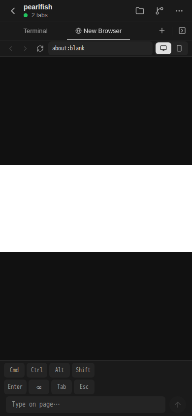
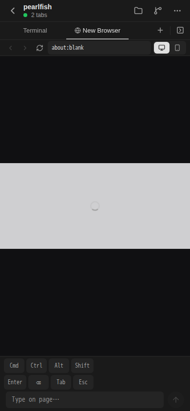

# C4 공개 API 개발 서버 반영과 실제 Expo 관측

이 문서는 Root가 검토한 실제 실행 결과만 기록한다. 문서 branch 기준은 `ba99c4619f9b71f25d2f383e3f56fe4c6e4aa7f7`다. 현재 서버 부분 반영의 source 출처는 로컬 합성 commit `0919809827747ffec106fdfef0c751e43538bdbb`, tree `9a72dcc04b9175002ed3ac1dfca9ce3a519d6157`이다. 새 기획이나 수용기준을 추가하지 않으며, 정제한 수치와 hash는 [result.json](result.json)에 있다.

Client에 지정한 이번 실제 반영 입력은 15개 파일, 105185 bytes이며 manifest SHA256은 `cb6c56b913d6475538f61f756555eeda983533d5df57674246de29960e86a316`이다. 기존 50개는 C4 기반 보존 기록으로 구분한다. 이번 15개와 기반 50개를 합친 최신 metadata는 겹친 3개에 이번 bytes를 적용한 62개 파일, 446866 bytes이며 SHA256은 `564212e6a43ac84904a2edc276c84446603d3e9c5e5f5e93f9812fc340092410`이다. 이 62개는 provenance 집계이며 별도 Client 실행 입력이나 전체 checkout/runtime closure 보증이 아니다.

첫 C4 반영 source는 `1c1dc82442e96fa6855752d393581eb8208d9d8f`였다. 원 runner `20837`과 runtime `20881`을 정상 종료한 뒤 49개 파일을 반영했으나 `orcad-controller.ts:103:17`에서 `../durable-runtime/ha/worker.ts`를 찾지 못해 build가 실패했다. 원 실패와 manifest를 보존했고, Root가 지정한 dependency 5개의 size/hash를 확인한 뒤 고정 source의 `worker.ts` 14352 bytes 한 파일만 보충했다. 같은 watch `30559`에서 runtime `30799`가 `2026-10-15 02:16:32.653 UTC`에 started, `02:16:45.017 UTC`에 READY가 되었다. 기반 50개 metadata의 SHA256은 `85282792297a31ca6b1d5f1314e3fd9c18c6820d79094f187d4697524fbd2a13`이며, 원 49개와 보충 1개의 provenance도 보존했다.

Browser capability와 structured hold 연결을 보완한 15개는 원 watch `30559`와 runtime `30799`의 정상 종료 뒤 일괄 반영했다. Runtime 종료 값은 code `0`, signal `null`이었고 두 lock 제거와 closed 이벤트를 확인했다. 새 watch `32040`을 한 번 기동하여 runtime `32095`, generation `1`의 started를 `03:21:50.556 UTC`, `orca_server_ready`를 `03:21:54.411 UTC`에 관측했다. Bundle SHA256은 `07858f120b5209f9e97b51cc82887624cc24fee34665c8907fc75e323e54ca2c`이다. 기존 config와 credential-free C4 profile은 유지했다. READY는 UI/API 성공 판정과 구분한다.

초기 Expo 시도는 HTTP `200` 뒤 `existing-workspace-list`에서 `PHASE_DEADLINE_EXCEEDED`로 실패했고 생성·Browser·Codex·Send·PNG는 모두 `0`이었다. 이 원 실패는 남겨 두었다. 연결 보완 뒤의 실제 UI 시도는 `03:25:48.372–03:26:14.117 UTC`에 실행되었고 Browser Open을 정확히 1회 눌렀다. About:blank 주소와 source 범위의 loaded data image를 관측한 뒤 실제 Expo Web 화면에서 `image?.setNativeProps is not a function` 오류가 나타났다. 원자료의 위치는 `MobileBrowserPaneView.tsx (198:23)`와 `mobile-browser-frame-state.ts (104:10)`이다. Helper는 별도로 `new-browser-label` 단계의 `PHASE_DEADLINE_EXCEEDED`로 exit `1`을 반환했다. 앱 오류와 helper 시간 초과를 같은 원인으로 단정하지 않는다.

이 시도의 Codex 선택과 Send는 모두 `0`이다. 실제 실패 PNG는 1개이며 SHA256은 `fcb6ace7428b97415a5fdb85ddbc2ac341c0d40a94b9204bac763f54cc3e7499`, 크기는 63044 bytes, viewport는 390 × 844다. Root가 원 PNG와 provenance를 검토했다. 이 원 실패 PNG의 본문은 추가하지 않았으며 이전 C3 사진을 C4 사진으로 재사용하지 않았다. Browser stream·페이지 사용·Chat 성공은 합격하지 않았다. 아래 후속 PG 관측은 response ID와 PG Tab의 상관만 확인하며 UI 요청 identity를 증명하지 않는다. Client의 Web 교정 후 제한된 관측은 아래 후속 기록에 별도로 합류했으며, 이 원 실패와 PNG metadata는 보존했다.

후속 한정 PG 관측은 `03:45:12.332–03:45:12.811 UTC`의 RR READ ONLY snapshot에서 기존 OPEN Browser 1개를 확인했다. Internal tab ID는 `2bc99253-b16a-4d3b-8084-d6de7b725b25`이고 public tab/page/workspace ID는 모두 `243bb196-87ec-401a-852d-60bd20ad2a2b`였다. Kind는 `browser`, lifecycle은 `OPEN`, revision은 `0`, UI 순서는 `1`이다. 해당 Workspace 범위에서 `browser.tabCreate` receipt 1개의 response ID가 이 PG Tab과 연결되었다. Receipt의 committed 시각은 `03:25:56.255 UTC`다. UI의 원 request key와 principal은 관측하지 못했으므로 UI 요청과 receipt의 identity 일치를 판정하지 않았다. 원 key·principal은 공개하지 않는다.

최초 `payload.url = 'about:blank'` 관측은 `false`였으며 그 원 결과를 그대로 보존했다. Root가 고정 source에서 확인한 `normalizeBrowserNavigationUrl`은 `about:blank`를 `ORCA_BROWSER_BLANK_URL` 상수 `data:text/html,`로 정규화한다. 이 소스 사실과 실제 DB 값은 별도로 검증했다. `03:52:54.891–03:52:55.342 UTC`의 추가 RR READ ONLY snapshot에서 이미 식별한 exact Browser row 1개만 읽었고, `payload.url = 'data:text/html,'`는 `true`, `payload.url = 'about:blank'`는 `false`, `launch_request.params.url = 'about:blank'`는 `true`였다. Params URL의 부재와 JSON null은 모두 `false`였다. 이 결과는 최초 false를 정정하거나 덮어쓰는 것이 아니라 source의 빈 페이지 정규화와 일치함을 확인한 후속 관측이다. Raw URL과 launch request 전체는 반환하지 않았고 receipt·전체 tabs를 다시 조회하지 않았다. 두 읽기 모두 READ ONLY `on`, baseline과 ledger 19개 일치, client/pool 종료를 확인했다. PG 쓰기·추가 Browser Open·자동 재시도는 `0`이다.

PR77/78이 main `e070…`에 합류한 사실과 현재 live source는 구분한다. 서버는 로컬 합성 source `0919809827747ffec106fdfef0c751e43538bdbb`의 부분 반영 62개 상태를 유지하며, merge를 이유로 추가 sync하지 않았다. Client의 Web 7개 파일 반영과 기존 Browser 재사용 helper는 별도 소유다. 이번 기록에는 아래에 전달된 실제 화면 관측만 합류했다.

후속 Client UI helper `5338`은 `04:20:21.537–04:20:35.674 UTC`에 기존 Browser → Terminal → 같은 Browser 선택을 각 1회 수행하고 exit `0`으로 종료했다. 새 Browser Open, Codex 선택, Send, helper 재제출과 직접 RPC 호출은 모두 `0`이다. 기존 탭 선택 자체는 기존 activation RPC를 발생시키므로 원 helper의 `readOnlyBrowserContinuation=true`를 전체 서버 READ ONLY로 해석하지 않는다. 이번 시도의 runtime error, alert와 uncaught overlay는 `0`이었다.

서버는 실제 15개 일괄 반영과 provenance 집계 62개인 `0919809827747ffec106fdfef0c751e43538bdbb` 상태다. Client는 설치 baseline `8edb42e16caf0ddaa840dc16e4e886e6acaca328` 위에 Web source `3817fb489ff9539aa1c0187170e842bed539c691`의 7개 파일만 부분 반영했다. Client manifest SHA256은 `3f48db1377ea638094ea453ddaf4d19f1dc4694c096f324e4b4c44de32bc8b2c`다. 서버 62개 metadata와 Client 7개를 합쳐 전체 checkout 또는 전체 runtime closure가 같다고 주장하지 않는다. UI 5338 원 관측 때에는 PR79 merge와 문서 branch 최종 정렬 전이었다. 현재 문서 branch는 PR79/80/81 합류 뒤 지정된 최종 main에 한 번 정렬했다.

첫 PNG에서는 `about:blank` 주소, 흰 blank frame, decoded image와 effective opacity `1`을 확인했다. Terminal을 선택한 뒤 같은 Browser로 돌아왔을 때에도 기존 decoded image와 opacity `1`을 관측했다. 두 시점의 frame URI hash가 같다는 사실은 blank 정지 화면 또는 cache 재사용일 수 있어 새 frame 도착을 증명하지 않는다. 복귀 탭 선택 약 138 ms 뒤 촬영한 PNG에는 loading overlay가 남아 있었다. 수락 범위는 첫 decoded frame과 같은 Browser의 cached return이며 fresh stream 재개·안정 재연결은 미증명이다. 추가 캡처나 재시도는 하지 않았다. UI에서 관측한 suffix를 앞선 PG full ID 또는 request identity의 추가 증명으로 사용하지 않았다.

첫 화면의 실제 PNG SHA256은 `d88d58698cc2e14eb6827f1b30bac74fd5c7e8e5c643d55369fa06baabb191f7`이다.

복귀 화면의 실제 PNG SHA256은 `662aa5cb69bf95fcb10bd7c6f8d3ac974880ba6aecc22ca40eee7157f121004a`다. 두 이미지 모두 실제 Expo Web 390 × 844 viewport의 원 bytes다. Native iPhone 또는 일반 Browser 기능의 전체 합격을 뜻하지 않는다.

결과 JSON의 `expoFirstAttempt.selectionUiCorrectionStatus`, `expoAfterConnectionsAttempt.actualAppFailure.webFixStatus`, `expoAfterConnectionsAttempt.pgCorrelationPending`는 각각 원 실패 시도의 종료 시점을 명시한 역사 상태다. 원 값은 `valueAtOriginalRecord` 또는 `valueAtOriginalAttemptEnd`로 보존했다. 후속 Web/UI 관측은 `clientPartialSource`와 `existingBrowserFrameAttempt`, 후속 PG 관측은 `existingBrowserPgReadback`와 `browserBlankNormalizationReadback`를 참조한다. 당시의 “교정 중” 또는 “PG 상관 대기”를 현재 문서 전체의 상태로 해석하지 않는다. 후속 PG 관측도 UI request key/principal identity 증명을 추가하지는 않는다.

PR79는 Root가 통지한 `96859aec…`에서 merge됐으며 PR80/81까지 합류한 최종 main은 `ba99c4619f9b71f25d2f383e3f56fe4c6e4aa7f7`다. 이 사실만으로 기존 서버 또는 Client 부분 source를 다시 반영하지 않았다. 문서 branch의 최종 정렬·게시와 실제 실행 source는 구분한다.

`controllerConnected=false`를 유지한다. 실제 provider 실행, physical executor, HA, native iPhone, Browser 생성 UI, Chat Send 및 history/subscribe 왕복은 이 기록에서 합격하지 않았다. Metafile은 원 watch의 graph 검사에 쓰이지만 파일로 저장되지 않아 전체 runtime closure는 미증명이다. 원 helper, manifest, 진단, 실패와 교정 자료의 경로·hash는 별도 비공개 운영 인덱스에 보존한다. Credential, config, 환경 값, 원 principal, 전체 로그와 개인 작업 경로는 공개 기록에 포함하지 않는다.
