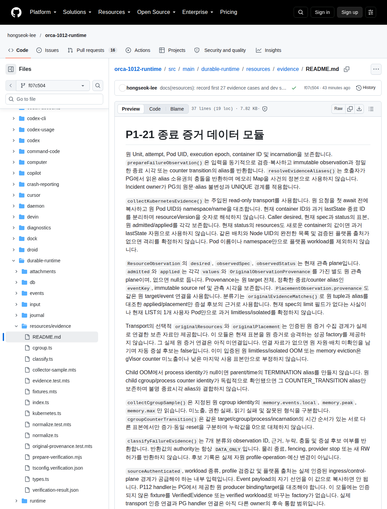

# P1-21 종료 증거 데이터 모듈

원 Unit, attempt, Pod UID, execution epoch, container ID 및 incarnation을 보존합니다. `prepareFailureObservation()`은 입력을 동기적으로 검증·복사하고 immutable observation과 정밀한 종료 시각 또는 counter transition의 alias를 반환합니다. `resolveEvidenceAliases()`는 호출자가 PG에서 읽은 alias 소유권의 충돌을 반환하며 메모리 Map을 사건의 정본으로 사용하지 않습니다. Incident owner가 PG의 원문·alias 불변성과 UNIQUE 경계를 적용합니다.

`collectKubernetesEvidence()`는 주입된 read-only transport를 사용합니다. 원 요청을 첫 await 전에 복사하고 원 Pod UID와 namespace/name을 대조합니다. 현재 container ID와 과거 lastState 종료 ID를 분리하며 resourceVersion을 숫자로 해석하지 않습니다. Caller desired, 현재 spec과 status의 표본, 원 admitted/applied를 각각 보존합니다. 현재 status의 resources도 새로운 container의 값이면 과거 lastState 자원으로 사용하지 않습니다. 같은 배치와 Node UID의 완전한 목록 및 검증된 플랫폼 출처가 없으면 격리를 확정하지 않습니다. Pod 이름이나 namespace만으로 플랫폼 workload를 제외하지 않습니다.

`ResourceObservation`의 `desired`, `observedSpec`, `observedStatus`는 현재 관측 plane입니다. `admitted`와 `applied`는 각각 `values`와 `OriginalObservationProvenance`를 가진 별도 원 관측 plane이며, 없으면 null로 둡니다. Provenance는 원 target 전체, 정확한 종료/counter alias인 `eventKey`, immutable source ref 및 관측 시각을 보존합니다. `PlacementObservation.provenance`도 같은 원 target/event 연결을 사용합니다. 분류기는 `originalEvidenceMatches()`로 원 tuple과 alias를 대조한 applied/placement만 증설 후보의 근거로 사용합니다. 현재 spec의 limit 필드가 없다는 사실이나 현재 LIST의 1개 사용자 Pod만으로 과거 limitless/isolated를 확정하지 않습니다.

Transport의 선택적 `originalResources`와 `originalPlacement`는 인증된 원 증거 수집 경계가 실제로 연결한 보존 자료만 제공합니다. 이 모듈은 현재 표본을 원 증거로 승격하는 성공 factory를 제공하지 않습니다. 그 실제 원 증거 연결은 아직 미연결입니다. 연결 자료가 없으면 원 자원·배치 미확인을 남기며 자동 증설 후보는 false입니다. 이미 입증된 원 limitless/isolated OOM 또는 memory eviction은 gVisor counter 미노출이나 낮은 마지막 사용 표본만으로 부정하지 않습니다.

Child OOM에서 process identity가 null이면 parent/time의 TERMINATION alias를 만들지 않습니다. 원 child cgroup/process counter identity가 독립적으로 확인됐으면 그 COUNTER_TRANSITION alias만 보존하며 불명 종료시각 alias와 결합하지 않습니다.

`collectCgroupSample()`은 지정된 원 cgroup identity의 `memory.events.local`, `memory.peak`, `memory.max`만 읽습니다. 미노출, 권한 실패, 읽기 실패 및 잘못된 형식을 구분합니다. `cgroupCounterTransition()`은 같은 target/cgroup/process/incarnation의 시간 순서가 있는 서로 다른 표본에서만 증가·동일·reset을 구분하며 누락값을 0으로 대체하지 않습니다.

`classifyFailureEvidence()`는 7개 분류와 observation ID, 근거, 누락, 충돌 및 증설 후보 여부를 반환합니다. 반환값의 authority는 항상 `DATA_ONLY`입니다. 물리 종료, fencing, provider stop 또는 새 RW 허가를 반환하지 않습니다. 후보 기록은 실제 자원 profile·operation·예산 변경이 아닙니다.

`sourceAuthenticated`, workload 종류, profile 검증값 및 플랫폼 출처는 실제 인증된 ingress/control-plane 경계가 공급해야 하는 내부 입력입니다. Event payload의 자기 선언을 이 값으로 복사하면 안 됩니다. P112 handler는 PG에서 제공한 원 producer binding/target을 대조해야 합니다. 이 모듈에는 인증되지 않은 fixture를 VerifiedEvidence 또는 verified workload로 바꾸는 factory가 없습니다. 실제 transport 인증 연결과 PG handler 연결은 아직 다른 owner의 후속 통합 범위입니다.

dev Pod에는 제품 Unit/attempt binding이 없으므로 `collectUnboundPodSample()`을 사용합니다. 실제 Pod UID와 container 표본만 보존하며 가짜 Unit·attempt·epoch를 넣지 않습니다. 결과는 `TARGET_UNRESOLVED`이고 자동 증설 후보가 아닙니다. 실제 backend 1개 표본은 Agent OOM 또는 제품 정책 합격을 뜻하지 않습니다.

## 소유 검증 경로

Root/bridge의 heavy 실행 자리 인계 뒤 승인된 backend에서만 최초 fixture를 실행합니다. 공유 cache는 DB owner가 준비한 읽기 전용 cache를 재사용하며 이 모듈은 설치를 수행하지 않습니다. 소유 NFS source의 승인 포인터를 execution mirror `/tmp/orca-p121-evidence-execution`에 합성하고 main 파일과 소유 변경 digest를 기록합니다. live source나 runtime을 자동 sync/restart하지 않습니다.

전용 TypeScript 입력은 `tsconfig.verification.json`입니다. 실행할 때 DB tools cache의 `@types/node` 경로를 `--typeRoots`로 지정합니다. `prepare-verification.mjs`는 기존 tools cache의 esbuild를 사용해 세 test entry만 Node 24용 `.mjs`로 변환합니다. 이후 `node --test --test-concurrency=1 verification/*.test.mjs`를 실행합니다. 최초 미실행 묶음에 spec/status 불일치, old lastState와 새 container 자원 혼합, 원 종료 배치 미확인 및 child process 누락의 신규 4경계를 포함했습니다. scoped lint도 같은 소유 디렉터리만 확인합니다. 이미 통과한 다른 모듈 suite는 반복하지 않습니다.

## 실제 관측 결과

검증 code revision은 `e1b578313e8ef3ed23141128c2ae8543fbfdf201`이고 공통 source는 `8edb42e16caf0ddaa840dc16e4e886e6acaca328`입니다. 승인된 원격 Node 24 환경에서 최초 fixture 묶음 **27건 PASS, 0건 실패, 0건 skip**을 확인했습니다. 7개 분류, 기존 음성 경계 15건, snapshot→digest 1건 및 원 종료 provenance 교정 4건입니다. 시험 파일 병렬도는 1이고 runtime fixture 실행은 한 번입니다.

최초 typecheck는 fixture의 readonly JSON narrowing 1건에서 실패했고 해당 표현을 교정한 뒤 scoped typecheck가 통과했습니다. 최초 configured lint의 102건은 interface/type, 중괄호, template 및 indexed-object 표기 규칙이었습니다. 소유 파일에 한정해 기계적 교정한 뒤 남은 sample helper 1건만 focused lint로 확인했습니다. 최종 적용된 scoped lint 범위는 모두 0건 오류·0건 경고입니다. 시험 조건이나 자원 분류 계약을 바꾸지 않았고 이미 통과한 fixture를 재실행하지 않았습니다.

실제 dev Backend Pod **1개**의 allowlist projection을 collector가 처리하여 `OBSERVED`, 논리 binding `null`, 자동 증설 후보 `false`를 확인했습니다. dev role은 Agent 자원 정책 대상이 아닙니다. Unit/attempt를 가짜로 채우지 않았고 production incident를 저장하지 않았습니다. 실제 Backend cgroup 파일은 조회하지 않았습니다. Cgroup 미노출·권한 실패·reset 및 원 incarnation delta 경계는 합성 fixture 결과입니다.

[선별 결과 JSON](verification-result.json)에 실제 개수와 실패→focused 교정 관계를 보존했습니다. 최초 실제 browser 화면은 모듈 구현 설명을 보여 주며, 실제 관측 결과 heading과 27건 결과 표는 viewport 밖에 있습니다. Root는 원 PNG를 직접 열고 구현 설명 화면으로 수용했습니다. 원 qualification의 결과 화면 수용 0건과 실패 원문은 보존했으며 재촬영하지 않았습니다. 제품 UI 또는 실제 OOM 화면이 아닙니다.

evidence 모듈 구현 설명의 최초 실제 browser 화면; 결과 표는 viewport 밖

[최소 공개 provenance](docs/evidence/p121-first-report-provenance.json)와 [별도 Root 수용 기록](docs/evidence/p121-first-report-root-acceptance.json)에 실행 source `e1b578313e8ef3ed23141128c2ae8543fbfdf201`, 촬영 target `f07c504260cf3bd91071c8409b8c3b00c1ee990b`, 촬영 시각 `2026-10-13T13:04:36.444Z`, viewport 1140 × 1500 및 원 PNG SHA-256을 기록했습니다. 위 27건 결과는 원 검증 결과이며 화면의 표 가시성을 주장하지 않습니다.

실제 Agent OOM·격리·물리 fencing·새 RW 허가·자원 정책 활성화는 검증하지 않았습니다. 신뢰 transport 인증 및 원 종료 자원·배치 보존 연결과 incident PG/P112 합류도 미연결입니다.
